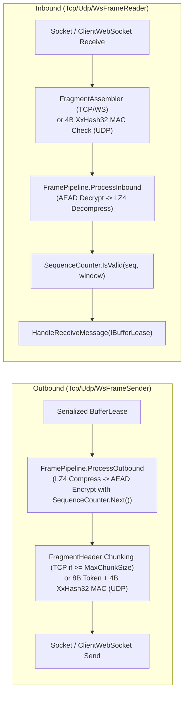

**Namespaces:** `Nalix.SDK.Transport.Internal`, `Nalix.Environment.Sequencing`  
**Assembly:** `Nalix.SDK`

Mỗi phiên cụ thể trong `Nalix.SDK` ủy thác I/O truyền tải mức thấp, phân mảnh, các biến đổi `FramePipeline` (nén LZ4 và mã hóa AEAD), và kiểm tra cửa sổ replay cho một cặp reader/sender nội bộ cùng một `SequenceCounter` không khóa.

:::warning[Cơ chế truyền tải nội bộ]
`TcpFrameReader`, `TcpFrameSender`, `UdpFrameReader`, `UdpFrameSender`, `WsFrameReader` và `WsFrameSender` là các kiểu `internal sealed`. Mã ứng dụng tương tác với chúng thông qua [TcpSession](./tcp-session.md), [UdpSession](./udp-session.md) và [WebSocketSession](./websocket-session.md).
:::

## Ánh xạ mã nguồn

- `src/Nalix.SDK/Transport/Internal/Tcp/TcpFrameReader.cs`
- `src/Nalix.SDK/Transport/Internal/Tcp/TcpFrameSender.cs`
- `src/Nalix.SDK/Transport/Internal/Udp/UdpFrameReader.cs`
- `src/Nalix.SDK/Transport/Internal/Udp/UdpFrameSender.cs`
- `src/Nalix.SDK/Transport/Internal/Ws/WsFrameReader.cs`
- `src/Nalix.SDK/Transport/Internal/Ws/WsFrameSender.cs`
- `src/Nalix.Environment/Sequencing/SequenceCounter.cs`

## So sánh khung truyền tải

| Transport | Reader / Sender | Khung trên dây | Phân mảnh | Bảo vệ replay / sequence |
| :--- | :--- | :--- | :--- | :--- |
| **TCP** (`TcpSession`) | `TcpFrameReader` / `TcpFrameSender` | Tiền tố độ dài khung tổng `ushort` 2 byte little-endian (`HeaderSize = 2`) | Chia nhỏ `FragmentHeader` khi gửi (`>= MaxChunkSize`) / `FragmentAssembler` khi nhận | `SequenceCounter.IsValid(seq, TcpWindow)` (cửa sổ trượt `1024` bit) |
| **UDP** (`UdpSession`) | `UdpFrameReader` / `UdpFrameSender` | `[8B SessionToken (outbound)][Payload][4B XxHash32 MAC]` (`<= MaxUdpDatagramSize`) | Không có (chỉ kiểm tra MTU của một datagram) | `SequenceCounter.IsValid(seq, UdpWindow)` (cửa sổ trượt `512` bit) |
| **WebSocket** (`WebSocketSession`) | `WsFrameReader` / `WsFrameSender` | `WebSocketMessageType.Binary` (khung `EndOfMessage`) | `FragmentAssembler` khi nhận (khi gửi, thông điệp binary WebSocket hoàn chỉnh được gửi trực tiếp) | `SequenceCounter.IsValid(seq, TcpWindow)` (cửa sổ trượt `1024` bit) |

## Pipeline biến đổi gửi & nhận

### Các bất biến nội bộ quan trọng

1. **Gửi đi được tuần tự hóa**: `TcpFrameSender` và `WsFrameSender` bảo vệ việc ghi socket bằng `SemaphoreSlim(1, 1)` (`_sendLock`), nên các lời gọi `SendAsync` đồng thời không bao giờ xen kẽ khung hoặc phần chia nhỏ trên stream.
2. **Nén rồi mới mã hóa (đối xứng)**: Khung gửi đi chạy `FramePipeline.ProcessOutbound` (nén payload có kích thước $\ge$ `CompressionOptions.MinSizeToCompress` trước khi mã hóa AEAD khi `encrypt == true`), còn khung nhận đi chạy `FramePipeline.ProcessInbound` (giải mã `PacketFlags.ENCRYPTED` trước khi giải nén `PacketFlags.COMPRESSED`).
3. **Cửa sổ replay của `SequenceCounter`**: Theo dõi số sequence truyền tải 32-bit nhúng trong các khung đã mã hóa và loại bỏ các gói trùng lặp hoặc nằm ngoài cửa sổ trước khi chúng tới `OnMessageReceived`.

## API liên quan

- [TCP Session](./tcp-session.md)
- [UDP Session](./udp-session.md)
- [WebSocket Session](./websocket-session.md)
- [Nén gói tin](../codec/frame-pipeline.md)
- [AEAD Ciphers](../security/aead-and-envelope.md)
