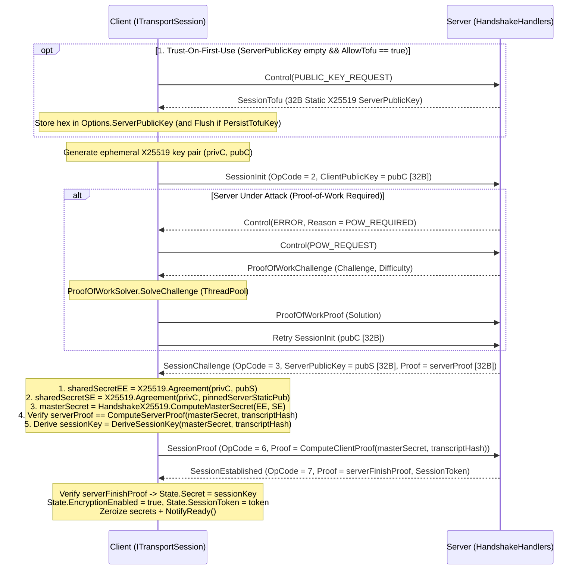

**Namespace:** `Nalix.SDK.Transport.Extensions`  
**Assembly:** `Nalix.SDK`

`HandshakeExtensions.HandshakeAsync` thực hiện handshake mật mã phía client trên bất kỳ `ITransportSession` nào ([TcpSession](./tcp-session.md), [UdpSession](./udp-session.md) hoặc [WebSocketSession](./websocket-session.md)). Nó dẫn xuất khóa đối xứng 32 byte (`session.State.Secret`), bật mã hóa khung (`session.State.EncryptionEnabled = true`), lấy `session.State.SessionToken` 8 byte, và báo `TransportSession.NotifyReady()`.

## Ánh xạ mã nguồn

- `src/Nalix.SDK/Transport/Extensions/HandshakeExtensions.cs`
- `src/Nalix.SDK/Options/TransportOptions.cs`
- `src/Nalix.Codec/ProtocolFrames/Session/SessionInit.cs`
- `src/Nalix.Codec/ProtocolFrames/Session/SessionChallenge.cs`
- `src/Nalix.Codec/ProtocolFrames/Session/SessionProof.cs`
- `src/Nalix.Codec/ProtocolFrames/Session/SessionEstablished.cs`
- `src/Nalix.Codec/ProtocolFrames/Session/SessionTofu.cs`
- `src/Nalix.Codec/ProtocolFrames/Security/ProofOfWorkChallenge.cs`
- `src/Nalix.Codec/ProtocolFrames/Security/ProofOfWorkProof.cs`

## Chữ ký công khai

```csharp
namespace Nalix.SDK.Transport.Extensions;

public static class HandshakeExtensions
{
    public static ValueTask HandshakeAsync(
        this ITransportSession session,
        CancellationToken ct = default);
}
```

## Máy trạng thái handshake nhiều giai đoạn



## Chế độ bảo mật & cơ chế bảo vệ

### 1. Định danh ghim khóa so với Trust-On-First-Use (TOFU)

| Cấu hình | Hành vi |
| :--- | :--- |
| **Đã cung cấp `Options.ServerPublicKey` (`string?` dạng hex)** | Phân tích khóa công khai X25519 tĩnh 32 byte đã ghim của server (`Bytes32.Parse`) và thực hiện ECDH kép (`sharedSecretEE` + `sharedSecretSE`) mà không gửi `PUBLIC_KEY_REQUEST`. |
| **`ServerPublicKey` null/rỗng và `Options.AllowTofu == true` (mặc định)** | Gửi `Control(ControlType.PUBLIC_KEY_REQUEST)` trước, chờ `SessionTofu` (`OpCode = 8`), lưu khóa hex vào `Options.ServerPublicKey`, và ghi bền qua `ConfigurationManager.Instance.UpdateValue<TransportOptions>` + `Flush()` khi `Options.PersistTofuKey == true`. |
| **`ServerPublicKey` null/rỗng và `Options.AllowTofu == false`** | Ném `NetworkException` trước khi gửi bất kỳ gói tin nào. |

### 2. Tự động giải Proof-of-Work (`POW_REQUIRED`)

Khi `ConnectionGuard` yêu cầu Proof-of-Work phía server, server trả lời `SessionInit` bằng `Control(ControlType.ERROR, ProtocolReason.POW_REQUIRED)`. `HandshakeAsync` xử lý việc này một cách trong suốt:
1. Gửi `Control(ControlType.POW_REQUEST)` và chờ `ProofOfWorkChallenge`.
2. Giải bài toán SHA-256 với các bit 0 đứng đầu trên `ThreadPool` (`ProofOfWorkSolver.SolveChallenge`), dùng ngân sách giải riêng `30_000` ms (`PowSolveTimeoutMs`).
3. Gửi `ProofOfWorkProof` và tự động gửi lại `SessionInit`.

### 3. Xóa khóa tạm thời & hoàn tác

- `HandshakeAsync` đưa `TransportSession` vào trạng thái đang thương lượng trong khi chạy (tạm dừng ping keepalive nền) và xóa khóa riêng X25519 tạm thời cùng các bí mật ECDH trung gian (`CryptographicOperations.ZeroMemory`) trong khối `finally`.
- Mỗi bước handshake dùng `session.Options.ConnectTimeoutMillis` (hoặc `5000` ms khi `ConnectTimeoutMillis <= 0`).

## Ví dụ sử dụng

```csharp
using System;
using Nalix.SDK.Options;
using Nalix.SDK.Transport;
using Nalix.SDK.Transport.Extensions;

TransportOptions options = new()
{
    Address = "127.0.0.1",
    Port = 57206,
    // Tùy chọn: ghim khóa công khai X25519 tĩnh 32 byte của server dạng hex (tắt TOFU)
    ServerPublicKey = "a1b2c3d4e5f60718293a4b5c6d7e8f90a1b2c3d4e5f60718293a4b5c6d7e8f90",
    AllowTofu = false
};

using TcpSession session = new(options);
await session.ConnectAsync();
await session.HandshakeAsync();

Console.WriteLine($"Encrypted: {session.State.EncryptionEnabled}, Token: 0x{session.State.SessionToken:X16}");
```

## API liên quan

- [Resume Extensions](./resume-extensions.md)
- [Cipher Extensions](./cipher-extensions.md)
- [Transport Session](./transport-session.md)
- [Handshake Protocol (Server)](../security/handshake.md)
- [Transport Options](../options/sdk/transport-options.md)
