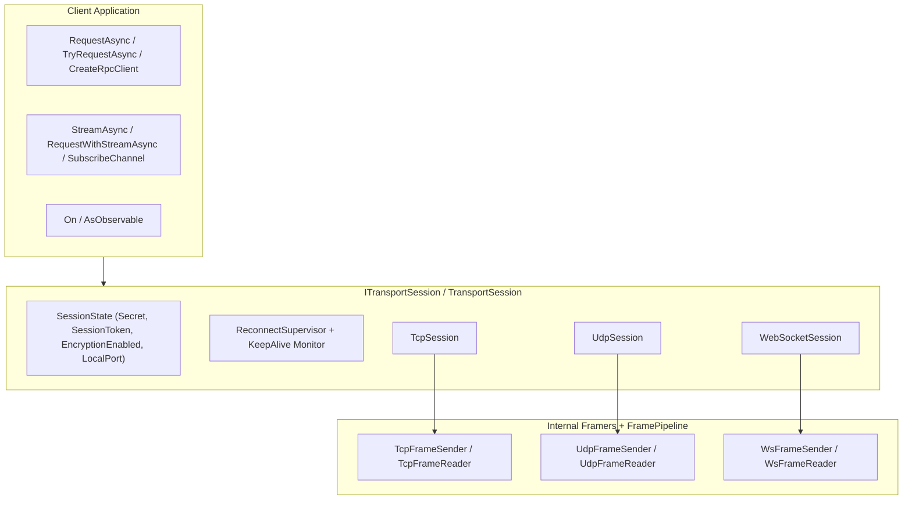

**Namespaces:** `Nalix.SDK`, `Nalix.SDK.Transport`, `Nalix.SDK.Transport.Extensions`, `Nalix.SDK.Extensions`, `Nalix.SDK.Options`  
**Assembly:** `Nalix.SDK`

`Nalix.SDK` là gói transport và giao thức phía client của Nalix. Nó cung cấp các phiên client cụ thể (`TcpSession`, `UdpSession`, `WebSocketSession`), một contract phiên trừu tượng/interface (`TransportSession` / `ITransportSession`), handshake X25519 với TOFU/ghim khóa và giải Proof-of-Work, tiếp tục phiên 0-RTT, xoay khóa HKDF (`RekeyAsync`), các helper yêu cầu/phản hồi có ghép cặp (`RequestAsync` / `TryRequestAsync`), streaming (`StreamAsync` / `RequestWithStreamAsync`), và các RPC client proxy được sinh từ mã nguồn (`CreateRpcClient<T>`).

:::important[Chỉ dành cho gói phía client]
`Nalix.SDK` chỉ được thiết kế cho ứng dụng client (desktop, mobile, Unity, Godot, Blazor WASM, console client). Ứng dụng server nên dùng `Nalix.Hosting`, `Nalix.Runtime` và `Nalix.Network`.
:::

## Ánh xạ mã nguồn

- `src/Nalix.SDK/Transport/` (`ITransportSession.cs`, `TransportSession.cs`, `SessionState.cs`, `TcpSession.cs`, `UdpSession.cs`, `WebSocketSession.cs`)
- `src/Nalix.SDK/Transport/Extensions/` (`HandshakeExtensions.cs`, `ResumeExtensions.cs`, `CipherExtensions.cs`, `RekeyExtensions.cs`, `RequestExtensions.cs`, `StreamExtensions.cs`, `HeaderStreamExtensions.cs`, `ChannelExtensions.cs`, `ObservableExtensions.cs`, `RpcExtensions.cs`, `PingExtensions.cs`, `DisconnectExtensions.cs`, `TimeSyncExtensions.cs`, `ControlExtensions.cs`, `TransportSessionSubscriptions.cs`)
- `src/Nalix.SDK/Extensions/` (`ProtocolStringExtensions.cs`, `SubscriptionExtensions.cs`)
- `src/Nalix.SDK/Options/` (`TransportOptions.cs`, `WebSocketTransportOptions.cs`, `RequestOptions.cs`, `RequestOutcome.cs`)
- `src/Nalix.SDK/IThreadDispatcher.cs`, `src/Nalix.SDK/InlineDispatcher.cs`, `src/Nalix.SDK/TimeSyncCalculator.cs`

## Kiến trúc client



## Bản đồ tham chiếu API

### Phiên transport
- [Transport Session (ITransportSession & TransportSession)](./transport-session.md): Contract cơ sở, `SessionState`, `ReconnectSupervisor`, dò keepalive và điều phối trực tiếp các yêu cầu đang chờ.
- [TCP Session (TcpSession)](./tcp-session.md): Client stream tin cậy có khung với `ConnectWithProxyAsync` và `Send` đồng bộ.
- [UDP Session (UdpSession)](./udp-session.md): Client datagram có xác thực (`[8B SessionToken][Payload][4B XxHash32 MAC]`) với việc ghim cổng TCP đi kèm.
- [WebSocket Session (WebSocketSession)](./websocket-session.md): Client WebSocket binary `ws://` và `wss://` (tương thích với desktop và Blazor WASM).
- [Frame Reader và Sender](./frame-reader-and-sender.md): Khung TCP, UDP và WebSocket nội bộ, phân mảnh và theo dõi sequence.

### Mở rộng bảo mật, điều khiển & yêu cầu
- [Tổng quan Session Extensions](./tcp-session-extensions.md): Hướng dẫn đầy đủ về `RequestExtensions`, `StreamExtensions`, `HeaderStreamExtensions`, `ChannelExtensions`, `ObservableExtensions`, `RpcExtensions` và `RekeyExtensions`.
- [Handshake Extensions (HandshakeAsync)](./handshake-extensions.md): Handshake X25519 ECDH có xác thực, khám phá khóa TOFU và tự động giải thử thách Proof-of-Work.
- [Resume Extensions (ResumeSessionAsync & ConnectWithResumeAsync)](./resume-extensions.md): Tiếp tục phiên 0-RTT với chứng minh sở hữu `HmacKeccak256` và tự động quay lại handshake khi cần.
- [Cipher Extensions (UpdateCipherAsync & RekeyAsync)](./cipher-extensions.md): Chuyển bộ mật mã trực tiếp và xoay khóa HKDF giữa phiên.
- [Tiện ích điều khiển (PingAsync, DisconnectGracefullyAsync, SyncTimeAsync)](./control-utilities.md): Đo RTT, báo ngắt kết nối êm thấm và đồng bộ đồng hồ bằng EMA.
- [Subscriptions (On&lt;TPacket&gt;, CompositeSubscription)](./subscriptions.md): Đăng ký gói tin có kiểu rõ ràng.

### Tiện ích & tùy chọn
- [Thread Dispatching (IThreadDispatcher, InlineDispatcher)](./thread-dispatching.md): Chuyển luồng về main thread/UI cho Unity, MAUI, WPF và Godot.
- [Protocol String Extensions (ToDisplayString)](./protocol-string-extensions.md): Mô tả dễ đọc cho `ProtocolReason` và `ProtocolAdvice` trên giao diện.
- [Chẩn đoán phiên](./diagnostics.md): Các mẫu quan sát vòng đời và lỗi phía client.
- [Transport Options](../options/sdk/transport-options.md)
- [WebSocket Transport Options](../options/sdk/websocket-transport-options.md)
- [Request Options & RequestOutcome&lt;T&gt;](../options/sdk/request-options.md)

## Ví dụ bắt đầu nhanh

```csharp
using Nalix.SDK.Options;
using Nalix.SDK.Transport;
using Nalix.SDK.Transport.Extensions;

TransportOptions options = new()
{
    Address = "127.0.0.1",
    Port = 57206,
    AutoReconnectEnabled = true,
    KeepAliveIntervalMillis = 15_000
};

using TcpSession client = new(options);

// 1. Kết nối và thực hiện handshake X25519 có xác thực
await client.ConnectAsync();
await client.HandshakeAsync();

// 2. Gửi một yêu cầu có ghép cặp và chờ phản hồi
LoginResponse reply = await client.RequestAsync<LoginResponse>(
    new LoginRequest { Username = "Alice" },
    RequestOptions.Default.WithTimeout(3_000).WithEncrypt());

// 3. Ngắt kết nối một cách êm thấm
await client.DisconnectGracefullyAsync();
```

## API liên quan

- [Packet Contracts](../abstractions/packet-contracts.md)
- [Network Application (Hosting)](../hosting/network-application.md)
- [Handshake Protocol](../security/handshake.md)
