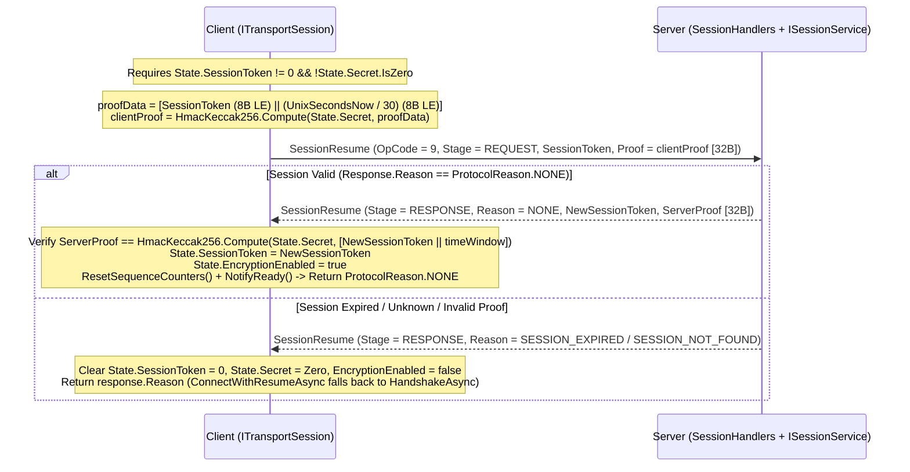

**Namespace:** `Nalix.SDK.Transport.Extensions`  
**Assembly:** `Nalix.SDK`

`ResumeExtensions` cho phép **tiếp tục phiên bằng mật mã 0-RTT** trên mọi `ITransportSession` khi kết nối lại tới máy chủ trong khoảng [SessionStoreOptions.SessionTtl](../options/network/session-store-options.md) (mặc định `5` phút). Nếu snapshot phiên của máy chủ đã hết hạn hoặc bị loại bỏ, `ConnectWithResumeAsync` và `ConnectWithResumeDetailedAsync` tự động quay về một [HandshakeAsync](./handshake-extensions.md) đầy đủ.

## Ánh xạ mã nguồn

- `src/Nalix.SDK/Transport/Extensions/ResumeExtensions.cs`
- `src/Nalix.Codec/ProtocolFrames/Session/SessionResume.cs`
- `src/Nalix.Codec/Security/Hashing/HmacKeccak256.cs`

## Tham chiếu API công khai

```csharp
namespace Nalix.SDK.Transport.Extensions;

public static class ResumeExtensions
{
    public static ValueTask<ProtocolReason> ResumeSessionAsync(
        this ITransportSession session,
        CancellationToken ct = default);

    public static ValueTask<bool> ConnectWithResumeAsync(
        this ITransportSession session,
        string? host = null,
        ushort? port = null,
        CancellationToken ct = default);

    public static ValueTask<ProtocolReason> ConnectWithResumeDetailedAsync(
        this ITransportSession session,
        string? host = null,
        ushort? port = null,
        CancellationToken ct = default);
}
```

## Luồng tiếp tục 0-RTT và bằng chứng sở hữu



### Bằng chứng sở hữu mật mã (`HmacKeccak256`)

1. **Bằng chứng của client**: `ResumeSessionAsync` tạo một bộ đệm 16 byte gồm `SessionToken` (`ulong`, little-endian tại `0..8`) và bucket thời gian 30 giây `Clock.UnixSecondsNow() / 30` (`long`, little-endian tại `8..16`), sau đó tính `HmacKeccak256.Compute(session.State.Secret.AsSpan(), proofData)` thành 32 byte mà không để lộ `Secret` trên đường truyền.
2. **Xác minh bằng chứng của máy chủ (hai chiều)**: Khi máy chủ chấp nhận yêu cầu tiếp tục (`response.Reason == ProtocolReason.NONE`), nó xoay vòng token thành `SessionToken` mới và ký `[NewSessionToken (8B LE) || (UnixSecondsNow / 30) (8B LE)]` với cùng `Secret`. Client xác minh `response.Proof` theo thời gian hằng số (`CryptographicOperations.FixedTimeEquals`) trước khi bật mã hóa.
3. **Đặt lại sequence**: Vì máy chủ đặt lại bộ đếm sequence của transport trên kết nối mới, `ResumeSessionAsync` gọi `session.ResetSequenceCounters()` sau khi xác minh thành công để cửa sổ sequence của client và máy chủ luôn đồng bộ.

## So sánh các phương thức

| Phương thức | Kiểu trả về | Hành vi |
| :--- | :--- | :--- |
| `ResumeSessionAsync` | `ValueTask<ProtocolReason>` | Giả định socket đã kết nối (`session.IsConnected == true`). Trả về `ProtocolReason.NONE` nếu phiên được tiếp tục, hoặc lý do lỗi `ProtocolReason` (`UNAUTHENTICATED`, `SESSION_EXPIRED`, `INTERNAL_ERROR`, v.v.). |
| `ConnectWithResumeAsync` | `ValueTask<bool>` | Gọi `ConnectAsync`, thử `ResumeSessionAsync` (trả về `true` khi `ProtocolReason.NONE`), và tự động quay về `HandshakeAsync` (trả về `false`) khi `Options.ResumeFallbackToHandshake` là `true`. |
| `ConnectWithResumeDetailedAsync` | `ValueTask<ProtocolReason>` | Giống `ConnectWithResumeAsync`, trả về `ProtocolReason.NONE` khi phiên hiện có được tiếp tục, hoặc `ProtocolReason` gốc cho biết vì sao việc tiếp tục thất bại trước khi quay về `HandshakeAsync`. Được `ReconnectSupervisor` dùng nội bộ. |

## Ví dụ sử dụng

```csharp
using System;
using Nalix.SDK.Options;
using Nalix.SDK.Transport;
using Nalix.SDK.Transport.Extensions;

using TcpSession client = new(new TransportOptions
{
    Address = "127.0.0.1",
    Port = 57206
});

// Kết nối và tự động tiếp tục nếu State.SessionToken đã có giá trị,
// hoặc thực hiện trao đổi khóa X25519 mới ở lần kết nối đầu tiên:
bool wasResumed = await client.ConnectWithResumeAsync();
Console.WriteLine(wasResumed ? "Resumed existing session (0-RTT)." : "Established new session.");
```

## API liên quan

- [Handshake Extensions](./handshake-extensions.md)
- [Transport Session](./transport-session.md)
- [Session Resume (Server)](../security/session-resume.md)
- [Session Store Options](../options/network/session-store-options.md)
