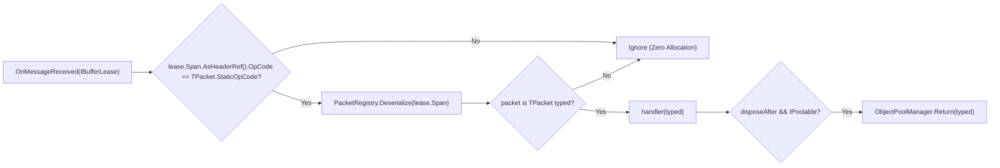

**Namespaces:** `Nalix.SDK.Transport.Extensions`, `Nalix.SDK.Extensions`  
**Assembly:** `Nalix.SDK`

`TransportSessionSubscriptions` và `SubscriptionExtensions` cung cấp các đăng ký `IDisposable` có kiểu mạnh (`On<TPacket>`, `OnExact<TPacket>`, `On(predicate, handler)`, `SubscribeTemp`) trên `ITransportSession.OnMessageReceived`, cùng với `CompositeSubscription` để nhóm vòng đời.

## Ánh xạ mã nguồn

- `src/Nalix.SDK/Transport/Extensions/TransportSessionSubscriptions.cs`
- `src/Nalix.SDK/Extensions/SubscriptionExtensions.cs`

## Tham chiếu API công khai

### 1. `TransportSessionSubscriptions` & `CompositeSubscription` (`Nalix.SDK.Transport.Extensions`)

```csharp
namespace Nalix.SDK.Transport.Extensions;

public static class TransportSessionSubscriptions
{
    public static IDisposable On<TPacket>(
        this ITransportSession client,
        Action<TPacket> handler,
        bool disposeAfter = true)
        where TPacket : class, IPacket, IPacketStaticOpcode;

    public static IDisposable OnExact<TPacket>(
        this ITransportSession client,
        Action<TPacket> handler)
        where TPacket : class, IPacket, IPacketStaticOpcode;

    public static IDisposable On(
        this ITransportSession client,
        Func<IPacket, bool> predicate,
        Action<IPacket> handler);

    [Obsolete("Use PacketAwaiter instead for single-use packet awaiting.")]
    public static IDisposable OnOnce<TPacket>(
        this ITransportSession client,
        Func<TPacket, bool> predicate,
        Action<TPacket> handler,
        bool disposeAfter = true)
        where TPacket : class, IPacket, IPacketStaticOpcode;

    [Obsolete("Use On<TPacket> instead.")]
    public static IDisposable SubscribeTemp<TPacket>(
        this ITransportSession client,
        Action<TPacket> onMessage,
        Action<Exception>? onDisconnected = null)
        where TPacket : class, IPacket, IPacketStaticOpcode;

    [Obsolete("Use On<TPacket> instead.")]
    public static IDisposable SubscribeTemp<TPacket>(
        this ITransportSession client,
        Func<TPacket, bool> predicate,
        Action<TPacket> onMessage,
        Action<Exception>? onDisconnected = null)
        where TPacket : class, IPacket, IPacketStaticOpcode;

    public static CompositeSubscription Subscribe(
        this ITransportSession _,
        params IDisposable[] subs);
}

public sealed class CompositeSubscription : IDisposable
{
    public CompositeSubscription(params IDisposable[] subs);

    public void Add(IDisposable sub);
    public void Dispose();
}
```

### 2. `SubscriptionExtensions` (`Nalix.SDK.Extensions`)

```csharp
namespace Nalix.SDK.Extensions;

public static class SubscriptionExtensions
{
    public static IDisposable SubscribeTemp(
        this TransportSession @this,
        EventHandler<IBufferLease> onMessageReceived,
        EventHandler<Exception> onDisconnected);
}
```

## Cách việc điều phối đăng ký hoạt động



- **Bộ lọc sơ bộ theo StaticOpCode nhanh**: `On<TPacket>` và `OnExact<TPacket>` kiểm tra `lease.Span.AsHeaderRef().OpCode == TPacket.StaticOpCode` trước khi gọi `PacketRegistry.Deserialize(lease.Span)`, nhờ đó tránh cấp phát khi giải tuần tự hóa các gói tin không liên quan.
- **Tự động trả về pool (`disposeAfter`)**: Khi `disposeAfter == true` (mặc định của `On<TPacket>`), nếu `TPacket` triển khai `IPoolable`, gói tin sau khi giải tuần tự hóa sẽ được trả tự động về `ObjectPoolManager` trong khối `finally` sau khi `handler(typed)` hoàn tất.
- **Hủy đăng ký theo nhóm (`CompositeSubscription`)**: Gom nhiều handle `IDisposable` do `On<TPacket>`, `OnExact<TPacket>`, `On(predicate, handler)` hoặc `AsObservable` trả về, rồi hủy đăng ký tất cả cùng lúc khi một màn hình, cảnh hoặc view model bị hủy.

## Ví dụ sử dụng

```csharp
using System;
using Nalix.SDK.Transport;
using Nalix.SDK.Transport.Extensions;

// 1. Gom nhiều đăng ký bằng session.Subscribe(...)
using CompositeSubscription subscriptions = session.Subscribe(
    session.On<ChatBroadcastPacket>(pkt =>
        Console.WriteLine($"[{pkt.Channel}] {pkt.Sender}: {pkt.Text}")),

    session.OnExact<PlayerSpawnPacket>(pkt =>
        SpawnTeammateAvatar(pkt))
);

// 2. Hoặc thêm một đăng ký khác một cách động
subscriptions.Add(
    session.On(
        predicate: pkt => pkt is WorldEventPacket,
        handler: pkt => HandleWorldEvent((WorldEventPacket)pkt)));

// 3. Hủy đăng ký tất cả handler cùng lúc khi kết thúc cảnh
subscriptions.Dispose();
```

## API liên quan

- [Thread Dispatching (IThreadDispatcher)](./thread-dispatching.md)
- [Session Extensions (SubscribeChannel, AsObservable)](./tcp-session-extensions.md)
- [Transport Session](./transport-session.md)
