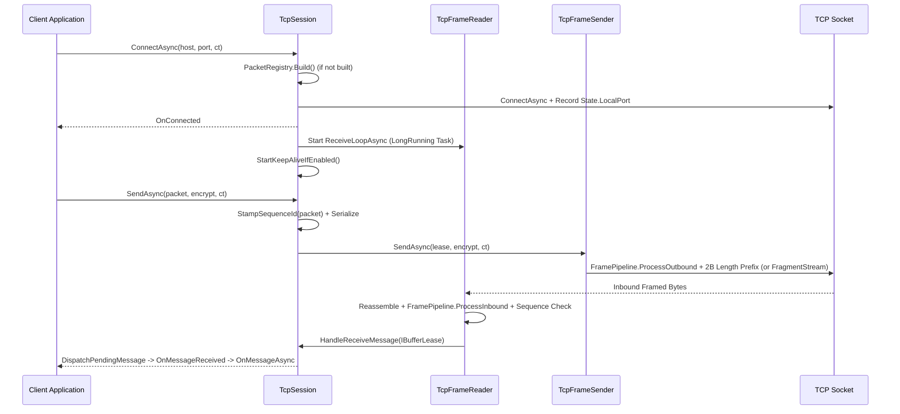

**Namespace:** `Nalix.SDK.Transport`  
**Assembly:** `Nalix.SDK`

`TcpSession` (`[UnsupportedOSPlatform("browser")] public class TcpSession : TransportSession`) là phiên transport luồng đáng tin cậy trong `Nalix.SDK`, được xây dựng trên `TcpFrameSender` và `TcpFrameReader`.

## Ánh xạ mã nguồn

- `src/Nalix.SDK/Transport/TcpSession.cs`
- `src/Nalix.SDK/Transport/Internal/Tcp/TcpFrameReader.cs`
- `src/Nalix.SDK/Transport/Internal/Tcp/TcpFrameSender.cs`
- `src/Nalix.Codec/Transforms/FramePipeline.cs`

## Vòng đời kết nối và khung



## Tham chiếu API công khai

```csharp
namespace Nalix.SDK.Transport;

[UnsupportedOSPlatform("browser")]
public class TcpSession : TransportSession
{
    public const int HeaderSize = 2;

    public TcpSession(TransportOptions options, SessionState? state = null);

    public override TransportOptions Options { get; }
    public override bool IsConnected { get; }

    public override event EventHandler? OnConnected;
    public override event EventHandler<Exception>? OnDisconnected;
    public override event EventHandler<IBufferLease>? OnMessageReceived;
    public override event EventHandler<Exception>? OnError;
    public event Func<ReadOnlyMemory<byte>, Task>? OnMessageAsync;

    public override Task ConnectAsync(string? host = null, ushort? port = null, CancellationToken ct = default);
    public Task ConnectWithProxyAsync(byte[] proxyProtocolV2, string? host = null, ushort? port = null, CancellationToken ct = default);
    public override Task DisconnectAsync();

    public void Send(ReadOnlySpan<byte> data, bool encrypt = true);
    public override Task SendAsync(IPacket packet, CancellationToken ct = default);
    public override Task SendAsync(IPacket packet, bool? encrypt = null, CancellationToken ct = default);
    public override Task SendAsync(ReadOnlyMemory<byte> payload, bool? encrypt = null, CancellationToken ct = default);
    public override void ResetSequenceCounters();
}
```

### Các tính năng chính

| Tính năng | Chi tiết |
| :--- | :--- |
| **Gộp kết nối (Connect Coalescing)** | Các lệnh `ConnectAsync` đồng thời nhắm tới cùng `host` và `port` sẽ chia sẻ tác vụ kết nối đang thực hiện thay vì mở nhiều socket trùng lặp. |
| **Ghi nhận cổng cục bộ (`State.LocalPort`)** | Khi kết nối, `TcpSession` ghi `localEp.Port` vào `this.State.LocalPort` để một `UdpSession` đi kèm dùng chung `this.State` có thể bind đúng cổng cục bộ đó. |
| **`ConnectWithProxyAsync`** | Kết nối và gửi ngay một header PROXY Protocol v2 thô (`byte[] proxyProtocolV2`) trước khi kích hoạt `OnConnected` hoặc khởi động vòng nhận (dùng để kiểm thử việc trích xuất IP client qua reverse proxy). |
| **`Send(ReadOnlySpan<byte>, bool)` đồng bộ** | Hàm gửi đồng bộ không cấp phát bộ nhớ cho các span đã được tuần tự hóa trước. |
| **Điều phối trực tiếp cho yêu cầu đang chờ** | `HasDirectPendingDispatch = true` chuyển khung đến cho các observer `RequestAsync` / `PacketAwaiter` đang hoạt động qua bảng slot có khóa, trước khi gọi `OnMessageReceived`, tránh cấp phát delegate multicast cho mỗi yêu cầu. |
| **`OnMessageAsync`** | Khi có đăng ký, `TcpSession` gọi `lease.Retain()`, gọi `OnMessageAsync(lease.Memory)`, và tự động dispose lease đã giữ khi `Task` trả về hoàn tất. |

## Ví dụ sử dụng

```csharp
using System;
using System.Threading.Tasks;
using Nalix.Environment.Configuration;
using Nalix.SDK.Options;
using Nalix.SDK.Transport;
using Nalix.SDK.Transport.Extensions;

TransportOptions options = ConfigurationManager.Instance.Get<TransportOptions>();
options.Address = "127.0.0.1";
options.Port = 57206;

using TcpSession client = new(options);

client.OnConnected += (_, _) => Console.WriteLine("TCP connected.");
client.OnReady += (_, _) => Console.WriteLine("Session secured and ready.");
client.OnDisconnected += (_, ex) => Console.WriteLine($"Disconnected: {ex.Message}");

await client.ConnectAsync();
await client.HandshakeAsync();

LoginResponse response = await client.RequestAsync<LoginResponse>(
    new LoginPacket { Username = "Ghost" },
    RequestOptions.Default.WithTimeout(5_000).WithEncrypt());
```

## API liên quan

- [Transport Session](./transport-session.md)
- [UDP Session](./udp-session.md)
- [WebSocket Session](./websocket-session.md)
- [Session Extensions](./tcp-session-extensions.md)
- [Transport Options](../options/sdk/transport-options.md)
