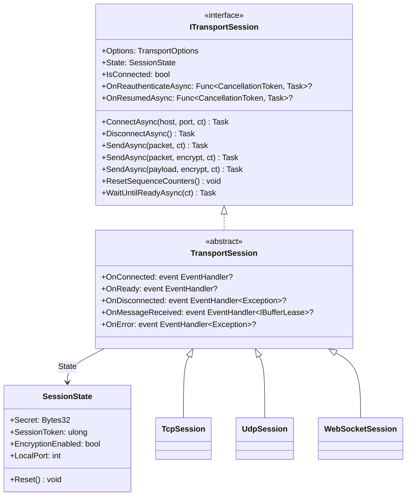

**Namespace:** `Nalix.SDK.Transport`  
**Assembly:** `Nalix.SDK`

`ITransportSession` và lớp cài đặt cơ sở trừu tượng `TransportSession` định nghĩa hợp đồng phiên client thống nhất cho [TcpSession](./tcp-session.md), [UdpSession](./udp-session.md) và [WebSocketSession](./websocket-session.md). Trạng thái bảo mật và kết nối tạm thời (`Secret`, `SessionToken`, `EncryptionEnabled`, `LocalPort`) được lưu trong `SessionState`, cho phép một `TcpSession` và `UdpSession` đi kèm chia sẻ khóa và token đã thương lượng một cách liền mạch.

## Ánh xạ mã nguồn

- `src/Nalix.SDK/Transport/ITransportSession.cs`
- `src/Nalix.SDK/Transport/TransportSession.cs`
- `src/Nalix.SDK/Transport/SessionState.cs`
- `src/Nalix.SDK/Transport/Internal/ReconnectSupervisor.cs`

## Cấu trúc lớp



## Tham chiếu `SessionState`

```csharp
namespace Nalix.SDK.Transport;

public class SessionState
{
    public Bytes32 Secret { get; set; }
    public ulong SessionToken { get; set; }
    public bool EncryptionEnabled { get; set; }
    public int LocalPort { get; set; }

    public SessionState();
    public void Reset();
}
```

| Thuộc tính | Kiểu | Mặc định | Mô tả |
| :--- | :--- | :--- | :--- |
| `Secret` | `Bytes32` | `Bytes32.Zero` | Khóa mã hóa đối xứng 32 byte được dẫn xuất trong `HandshakeAsync` hoặc xoay vòng qua `RekeyAsync`. |
| `SessionToken` | `ulong` | `0` | Token phiên Snowflake 8 byte do máy chủ cấp trong `SessionEstablished` / `SessionResume` (dùng cho tiếp tục 0-RTT và xác thực UDP). |
| `EncryptionEnabled` | `bool` | `false` | `true` khi `HandshakeAsync` hoặc `ResumeSessionAsync` hoàn tất; quyết định gói đi có được mã hóa mặc định hay không. |
| `LocalPort` | `int` | `0` | Cổng socket TCP cục bộ được ghi bởi `TcpSession.ConnectAsync`; `UdpSession` đi kèm dùng chung `SessionState` sẽ bind vào cổng này để ghim endpoint máy chủ (`SEC-30`). |

:::tip[Chia sẻ `SessionState` giữa TCP và UDP]
Truyền `tcpSession.State` vào constructor `UdpSession(options, tcpSession.State)` để phiên UDP tự động kế thừa `Secret`, `SessionToken`, `EncryptionEnabled` và `LocalPort` đã thương lượng từ handshake TCP!
:::

## Thành viên của `ITransportSession` & `TransportSession`

### Thuộc tính

| Thuộc tính | Kiểu | Mô tả |
| :--- | :--- | :--- |
| `Options` | `TransportOptions` | Cấu hình client bền vững ([TransportOptions](../options/sdk/transport-options.md)). |
| `State` | `SessionState` | Trạng thái phiên tạm thời (`Secret`, `SessionToken`, `EncryptionEnabled`, `LocalPort`). |
| `IsConnected` | `bool` | `true` khi socket bên dưới đang mở và phiên chưa bị dispose. |
| `OnReauthenticateAsync` | `Func<CancellationToken, Task>?` | Callback tùy chọn, được `ReconnectSupervisor` gọi sau khi kết nối lại tự động thực hiện handshake mới (trước khi báo `OnReady`). |
| `OnResumedAsync` | `Func<CancellationToken, Task>?` | Callback tùy chọn, được `ReconnectSupervisor` gọi sau khi kết nối lại tự động tiếp tục thành công một phiên hiện có (trước khi báo `OnReady`). |

### Sự kiện

| Sự kiện | Kiểu | Mô tả |
| :--- | :--- | :--- |
| `OnConnected` | `EventHandler?` | Được phát khi socket transport vật lý kết nối. |
| `OnReady` | `EventHandler?` | Được phát sau khi `HandshakeAsync` hoặc `ResumeSessionAsync` hoàn tất (và sau `OnReauthenticateAsync` / `OnResumedAsync` khi kết nối lại tự động). |
| `OnDisconnected` | `EventHandler<Exception>?` | Được phát khi kết nối đóng hoặc bị rớt. |
| `OnMessageReceived` | `EventHandler<IBufferLease>?` | Được phát đồng bộ cho mỗi khung đến đã giải mã/giải nén. Transport sở hữu `IBufferLease` và sẽ dispose khi sự kiện trả về (gọi `lease.Retain()` nếu cần giữ lại sau callback). |
| `OnError` | `EventHandler<Exception>?` | Được phát khi xảy ra lỗi transport, khung hoặc mật mã. |

### Phương thức

| Phương thức | Chữ ký | Mô tả |
| :--- | :--- | :--- |
| `ConnectAsync` | `Task ConnectAsync(string? host = null, ushort? port = null, CancellationToken ct = default)` | Kết nối tới `host`/`port` (mặc định là `Options.Address` và `Options.Port`) và tự động gọi `PacketRegistry.Build()` nếu chưa được build. |
| `DisconnectAsync` | `Task DisconnectAsync()` | Đánh dấu việc ngắt kết nối là chủ đích (tắt tự động kết nối lại) và đóng transport bên dưới. |
| `SendAsync(IPacket, ...)` | `Task SendAsync(IPacket packet, CancellationToken ct = default)` | Tự động gán `packet.Header.SequenceId` nếu bằng `0`, tuần tự hóa `packet`, và gửi theo `State.EncryptionEnabled`. |
| `SendAsync(IPacket, bool?, ...)` | `Task SendAsync(IPacket packet, bool? encrypt = null, CancellationToken ct = default)` | Tuần tự hóa và gửi `packet` với tùy chọn mã hóa được chỉ định tường minh. |
| `SendAsync(ReadOnlyMemory<byte>, ...)` | `Task SendAsync(ReadOnlyMemory<byte> payload, bool? encrypt = null, CancellationToken ct = default)` | Gửi byte thô đã được tuần tự hóa trước, với tùy chọn ghi đè mã hóa. |
| `ResetSequenceCounters` | `void ResetSequenceCounters()` | Đặt lại trạng thái `SequenceCounter` đi và đến (được gọi tự động trong `ConnectAsync`, `ResumeSessionAsync` và `RekeyAsync`). |
| `WaitUntilReadyAsync` | `Task WaitUntilReadyAsync(CancellationToken ct = default)` | Chờ mọi quá trình phục hồi `ReconnectSupervisor` đang diễn ra (bao gồm handshake/resume và `OnReauthenticateAsync` / `OnResumedAsync`). Hoàn tất ngay nếu đã kết nối. |
| `NextSequenceId` | `ushort NextSequenceId()` | Giữ chỗ `SequenceId` đi tiếp theo từ bộ đếm của phiên; `0` ("chưa đặt") được bỏ qua khi bộ đếm quay vòng. |
| `StampSequenceId` | `ushort StampSequenceId(IPacket packet)` | Đặt `packet.Header.SequenceId` từ `NextSequenceId()` khi giá trị hiện tại là `0`, và trả về giá trị gói mang theo; gói đã có `SequenceId` khác không thì giữ nguyên. Các session cụ thể gọi hàm này từ `SendAsync(IPacket, ...)` trước khi tuần tự hóa. |
| `Dispose` | `void Dispose()` | Đánh dấu việc ngắt kết nối là chủ đích, dừng giám sát keepalive, đóng transport và giải phóng các khóa. |

## Cơ chế chống chịu tích hợp sẵn

### 1. Tự động kết nối lại (`ReconnectSupervisor`)
Khi `Options.AutoReconnectEnabled = true` và xảy ra ngắt kết nối bất ngờ (ứng dụng không gọi `DisconnectAsync()`):
1. `ReconnectSupervisor` giãn cách lũy thừa bắt đầu từ `Options.ReconnectBaseDelayMillis` (`500` ms) và tối đa đến `Options.ReconnectMaxDelayMillis` (`30,000` ms), thử lại tối đa `Options.ReconnectMaxAttempts` lần (`0` = không giới hạn).
2. Gọi `ConnectWithResumeDetailedAsync` để thử tiếp tục phiên 0-RTT trước, quay về `HandshakeAsync` khi cần.
3. Gọi `OnResumedAsync` (nếu đã tiếp tục) hoặc `OnReauthenticateAsync` (nếu handshake mới) trước khi mở khóa `WaitUntilReadyAsync` và phát `OnReady`.

### 2. Thăm dò keepalive
Khi `Options.KeepAliveIntervalMillis > 0`, `TransportSession` chạy một vòng lặp nền gọi `PingAsync(Options.KeepAliveTimeoutMillis)` mỗi `KeepAliveIntervalMillis` (bỏ qua khi đang có quá trình handshake/resume). Nếu `Options.KeepAliveMissThreshold` (`3`) lần ping liên tiếp thất bại, `FaultFromKeepAliveAsync` sẽ đóng socket đã chết như một lỗi bất ngờ để `ReconnectSupervisor` có thể phục hồi.

## API liên quan

- [TCP Session](./tcp-session.md)
- [UDP Session](./udp-session.md)
- [WebSocket Session](./websocket-session.md)
- [Session Extensions](./tcp-session-extensions.md)
- [Transport Options](../options/sdk/transport-options.md)
