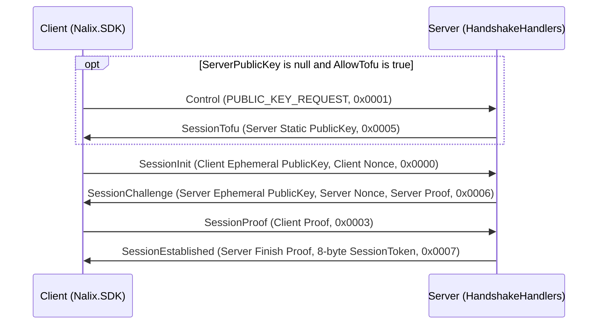

Nalix triển khai một handshake X25519 có xác thực, lấy cảm hứng từ Noise, bằng các khung giao thức phiên được tích hợp sẵn (`SessionInit`, `SessionChallenge`, `SessionProof`, `SessionEstablished`, `SessionTofu`), `HandshakeX25519` trong `Nalix.Codec.Security`, `HandshakeHandlers` trong `Nalix.Runtime.Handlers` và `HandshakeExtensions` trong `Nalix.SDK.Transport.Extensions`.

## Ánh xạ mã nguồn

- `src/Nalix.Codec/ProtocolFrames/Session/SessionInit.cs`
- `src/Nalix.Codec/ProtocolFrames/Session/SessionChallenge.cs`
- `src/Nalix.Codec/ProtocolFrames/Session/SessionProof.cs`
- `src/Nalix.Codec/ProtocolFrames/Session/SessionEstablished.cs`
- `src/Nalix.Codec/ProtocolFrames/Session/SessionTofu.cs`
- `src/Nalix.Codec/Security/HandshakeX25519.cs`
- `src/Nalix.Runtime/Handlers/HandshakeHandlers.cs`
- `src/Nalix.SDK/Transport/Extensions/HandshakeExtensions.cs`

## 1. Luồng handshake 4 thông điệp

| Bước | Chiều | Khung (`OpCode`, Kích thước) | Các trường payload |
| :---: | --- | --- | --- |
| **1** | Client $\rightarrow$ Server | `SessionInit` (`0x0000`, `70` B) | `PublicKey` (`Bytes32` ephemeral), `Nonce` (`Bytes32`) |
| **2** | Server $\rightarrow$ Client | `SessionChallenge` (`0x0006`, `102` B) | `PublicKey` (`Bytes32` ephemeral), `Nonce` (`Bytes32`), `Proof` (`Bytes32`) |
| **3** | Client $\rightarrow$ Server | `SessionProof` (`0x0003`, `38` B) | `Proof` (`Bytes32`) |
| **4** | Server $\rightarrow$ Client | `SessionEstablished` (`0x0007`, `46` B) | `Proof` (`Bytes32`), `SessionToken` (`ulong`) |



---

## 2. Trust on First Use (TOFU)

Nếu `TransportOptions.ServerPublicKey` là `null` hoặc rỗng và `TransportOptions.AllowTofu` là `true` (mặc định):

1. Client gửi một khung `Control` với `ControlType.PUBLIC_KEY_REQUEST` (`0x0001`).
2. `SystemControlHandlers` phản hồi bằng `SessionTofu` (`0x0005`, 38 byte) chứa `HandshakeHandlers.ServerPublicKey`.
3. Client ghim khóa nhận được vào `options.ServerPublicKey` (và lưu xuống đĩa nếu `PersistTofuKey = true`), sau đó tiếp tục với `SessionInit`.

---

## 3. Cấu trúc mật mã (`HandshakeX25519`)

`HandshakeX25519` kết hợp thỏa thuận **ephemeral-ephemeral** (`SharedSecret_EE`) và **static-ephemeral** (`SharedSecret_SE`, với khóa định danh X25519 tĩnh của máy chủ) bằng HKDF-Keccak256:

| Bước | Phương thức | Cấu trúc HKDF | Đầu vào |
| --- | --- | --- | --- |
| **Băm transcript** | `ComputeTranscriptHash` | `Keccak256.HashDataToFixed(144-byte length-prefixed transcript)` | `clientPublicKey`, `clientNonce`, `serverPublicKey`, `serverNonce` |
| **Khóa chính** | `ComputeMasterSecret` | `Hkdf.Extract(salt: Empty, ikm: sharedSecretEE \|\| sharedSecretSE)` | `sharedSecretEE`, `sharedSecretSE` (tổng 64 byte) |
| **Bằng chứng máy chủ** | `ComputeServerProof` | `Hkdf.Expand(masterSecret, "nalix-handshake/server-proof" \|\| transcriptHash)` | `masterSecret`, `transcriptHash` |
| **Bằng chứng client** | `ComputeClientProof` | `Hkdf.Expand(masterSecret, "nalix-handshake/client-proof" \|\| transcriptHash)` | `masterSecret`, `transcriptHash` |
| **Bằng chứng kết thúc máy chủ** | `ComputeServerFinishProof` | `Hkdf.Expand(masterSecret, "nalix-handshake/server-finish" \|\| transcriptHash)` | `masterSecret`, `transcriptHash` |
| **Khóa phiên** | `DeriveSessionKey` | `Hkdf.Expand(masterSecret, "nalix-handshake/session" \|\| clientNonce \|\| serverNonce \|\| transcriptHash)` | `masterSecret`, `clientNonce`, `serverNonce`, `transcriptHash` |
| **Khóa rekey** | `DeriveRekeySecret` | `Hkdf.Expand(currentSecret, "nalix-session/rekey")` | `currentSecret` |

### Phương thức công khai của `HandshakeX25519`

- `Bytes32 ComputeMasterSecret(Bytes32 sharedSecretEE, Bytes32 sharedSecretSE)`
- `Bytes32 ComputeServerProof(Bytes32 masterSecret, Bytes32 transcriptHash)`
- `Bytes32 ComputeClientProof(Bytes32 masterSecret, Bytes32 transcriptHash)`
- `Bytes32 ComputeServerFinishProof(Bytes32 masterSecret, Bytes32 transcriptHash)`
- `Bytes32 DeriveSessionKey(Bytes32 masterSecret, Bytes32 clientNonce, Bytes32 serverNonce, Bytes32 transcriptHash)`
- `Bytes32 DeriveRekeySecret(Bytes32 currentSecret)`
- `Bytes32 ComputeTranscriptHash(Bytes32 clientPublicKey, Bytes32 clientNonce, Bytes32 serverPublicKey, Bytes32 serverNonce)` — Đường dẫn trên stack không cấp phát bộ nhớ (`stackalloc byte[144]`).
- `bool TryComposeTranscriptBuffer(Span<byte> destination, out int written, Bytes32 clientPublicKey, Bytes32 clientNonce, Bytes32 serverPublicKey, Bytes32 serverNonce)` — Ghi transcript 144 byte (`4 * (sizeof(int) + 32)`) vào `destination` mà không cấp phát heap.
- `byte[] ComposeTranscriptBuffer(Bytes32 clientPublicKey, Bytes32 clientNonce, Bytes32 serverPublicKey, Bytes32 serverNonce)`

---

## 4. Triển khai phía máy chủ (`HandshakeHandlers`)

Được bật trên máy chủ qua `builder.UseSecureConnections(string? certificatePath = null)`:

- Lưu trạng thái thương lượng theo từng kết nối qua `HandshakeState` / `HandshakeContext` trên `connection.GetRuntimeState()`.
- Nếu `IProofOfWorkPolicy.IsUnderAttack` là `true` và `connection.Level < PermissionLevel.POW_VERIFIED`, `HandleSessionInitAsync` phản hồi bằng `Control(ControlType.ERROR, reasonCode: ProtocolReason.POW_REQUIRED)` trước khi cho phép thỏa thuận khóa.
- Khi xác minh `SessionProof`:
  1. Dẫn xuất khóa phiên 32 byte qua `HandshakeX25519.DeriveSessionKey` và gán cho `connection.Secret`.
  2. Đặt `connection.Level = PermissionLevel.ESTABLISHED` (nếu `< ESTABLISHED`) và đánh dấu trạng thái handshake là đã thiết lập.
  3. Dùng `connection.ConnectionId.ToUInt64()` làm `SessionToken` 64-bit, lưu phiên qua `ISessionService.SaveSessionAsync(connection)` (khi đã bật `.UseSessions()`), và gửi `SessionEstablished`.

## 5. Cách dùng SDK phía client (`HandshakeExtensions`)

```csharp
using Nalix.SDK.Options;
using Nalix.SDK.Transport;
using Nalix.SDK.Transport.Extensions;

using TcpSession session = new(new TransportOptions { Address = "127.0.0.1", Port = 57206 });
await session.ConnectAsync(ct);

// Thực hiện TOFU (nếu cần), PoW (nếu được yêu cầu) và handshake X25519 4 bước
await session.HandshakeAsync(timeoutMs: 10_000, ct: ct);

// session.State.EncryptionEnabled lúc này là true, và session.State.SessionToken đã có giá trị
```

## Chủ đề liên quan

- [AEAD & Envelope Encryption](./aead-and-envelope.md)
- [Proof-of-Work](./proof-of-work.md)
- [Session Resumption](./session-resume.md)
- [Session Rekey](./session-rekey.md)
- [Handshake Extensions (SDK)](../sdk/handshake-extensions.md)
