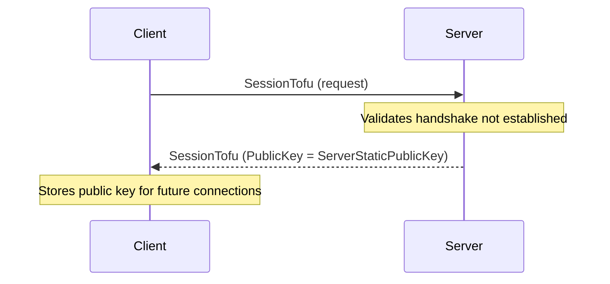

Trao đổi khóa TOFU cho phép client lấy khóa công khai tĩnh của máy chủ trước khi bắt đầu handshake X25519. Cơ chế này dùng khung giao thức `SessionTofu`.

## Ánh xạ mã nguồn

- `src/Nalix.Codec/ProtocolFrames/Session/SessionTofu.cs`
- `src/Nalix.Runtime/Handlers/HandshakeHandlers.cs`

## Tổng quan

Luồng TOFU diễn ra ngay từ đầu quá trình thiết lập kết nối, trước handshake. Nó cần thiết khi client chưa ghim khóa công khai tĩnh của máy chủ trong `TransportOptions.ServerPublicKey`.

Nếu client thử TOFU sau khi handshake đã được thiết lập, máy chủ sẽ từ chối yêu cầu.

### Luồng giao thức



## Tham chiếu API

### Gói SessionTofu

`SessionTofu` là gói Trust-On-First-Use, trong đó máy chủ trả về khóa công khai tĩnh của mình.

```csharp
namespace Nalix.Codec.ProtocolFrames;

[Packet]
[GenerateFormatter]
[SerializePackable(SerializeLayout.Explicit)]
public sealed partial class SessionTofu : PacketBase<SessionTofu>, IFixedSizeSerializable, IPacketValidatable
```

#### Thuộc tính

* `PublicKey` (`Bytes32`) — khóa công khai tĩnh của máy chủ (được điền trong phản hồi của máy chủ).

#### Phương thức

* `Initialize(Bytes32 publicKey)` — đặt opcode (`SYSTEM_CONTROL`), độ ưu tiên, cờ và khóa công khai.
* `Validate(out string?)` — đảm bảo `PublicKey` không phải giá trị 0.

## Cách dùng phía client

Luồng TOFU thường được xử lý tự động bởi `HandshakeExtensions.HandshakeAsync()` khi `TransportOptions.ServerPublicKey` chưa được cấu hình. SDK quản lý trao đổi khóa, lưu khóa công khai nhận được vào `ConfigurationManager`, rồi tiếp tục với handshake tiêu chuẩn.

```csharp
// Nếu ServerPublicKey chưa được đặt, HandshakeAsync sẽ tự thực hiện TOFU
await session.HandshakeAsync(cancellationToken);
```

## Xem thêm

* [Giao thức Handshake](handshake.md)
* [Tiếp tục phiên](./session-resume.md)
