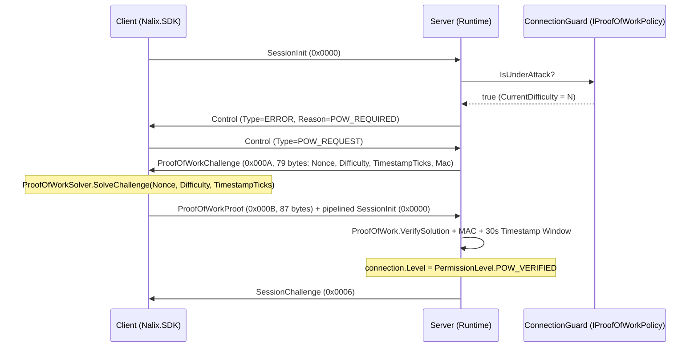

Nalix có một hệ thống challenge-response Proof-of-Work (PoW) thích ứng, không lưu trạng thái, được tích hợp vào luồng handshake X25519. Khi `ConnectionGuard` phát hiện tốc độ kết nối tăng cao hoặc áp lực về sức chứa, client phải giải một bài toán `Keccak256` với số bit 0 đứng đầu trước khi máy chủ thực hiện các phép toán X25519 tốn kém.

## Ánh xạ mã nguồn

- `src/Nalix.Codec/Security/ProofOfWork.cs` — Tạo challenge không trạng thái và xác minh lời giải
- `src/Nalix.Codec/Security/ProofOfWorkSolver.cs` — Bộ giải bài toán phía client
- `src/Nalix.Codec/ProtocolFrames/Security/ProofOfWorkChallenge.cs` — Gói challenge (`0x000A`, `79` byte)
- `src/Nalix.Codec/ProtocolFrames/Security/ProofOfWorkProof.cs` — Gói proof (`0x000B`, `87` byte)
- `src/Nalix.Abstractions/Security/IProofOfWorkPolicy.cs` — Contract chính sách độ khó động
- `src/Nalix.Runtime/Handlers/ProofOfWorkHandlers.cs` — Handler phía máy chủ xác minh proof
- `src/Nalix.Runtime/Handlers/SystemControlHandlers.cs` — Xử lý `ControlType.POW_REQUEST`
- `src/Nalix.Network/RateLimiting/Connection.Guard.cs` — Triển khai `IProofOfWorkPolicy`

## Cách hoạt động

### 1. Độ khó thích ứng (`ConnectionGuard : IProofOfWorkPolicy`)

`ConnectionGuard` tính `CurrentDifficulty` từ hai đầu vào được cấu hình trên `ConnectionQuotaOptions`:

1. **Tốc độ kết nối EWMA (`EnableAdaptiveMode`)**:
   - `rate <= AdaptivePowStartRate` $\rightarrow$ `AdaptivePowMinDifficulty`
   - `rate >= AdaptivePowMaxRate` $\rightarrow$ `AdaptivePowMaxDifficulty`
   - Nội suy tuyến tính ở khoảng giữa.
2. **PoW theo sức chứa (`EnableCapacityBasedPoW`)**:
   - Kích hoạt tăng độ khó PoW khi số kết nối đang hoạt động vượt quá `CapacityPoWThreshold` (`0.0..1.0`, mặc định `0.75` của `MaxConnections`).

Khi `CurrentDifficulty > AdaptivePowMinDifficulty`, `IsUnderAttack` trả về `true`.

### 2. Luồng challenge-response



### 3. Tạo challenge không trạng thái (`ProofOfWork`)

- **`(Bytes32 Nonce, Bytes32 Mac) CreateChallenge(byte difficulty, ulong connectionId, long timestampTicks)`**:
  - Sinh `Nonce` 32 byte từ CSPRNG.
  - Tính `Mac` 32 byte bằng `HmacKeccak256` trên `Nonce (32B) || Difficulty (1B) || TimestampTicks (8B) || ConnectionId (8B)`, dùng khóa bí mật 32 byte tồn tại theo vòng đời tiến trình.
- **`bool VerifySolution(ReadOnlySpan<byte> nonce, byte difficulty, long timestampTicks, ulong connectionId, ReadOnlySpan<byte> providedMac, long solution)`**:
  - Xác minh tag `HmacKeccak256` theo thời gian hằng số và kiểm tra timestamp của challenge còn nằm trong cửa sổ TTL cho phép (`30_000` ms).
  - Xác minh rằng `Keccak256(Nonce || Difficulty || TimestampTicks || Solution)` có ít nhất `difficulty` bit 0 đứng đầu.

### 4. Bộ giải phía client (`ProofOfWorkSolver`)

```csharp
using Nalix.Codec.Security;

long solution = ProofOfWorkSolver.SolveChallenge(
    nonce: challenge.Nonce.AsSpan(),
    difficulty: challenge.Difficulty,
    timestampTicks: challenge.TimestampTicks);
```

### 5. Các khung giao thức

| Frame | OpCode | Kích thước trên dây | Trường |
| --- | :---: | ---: | --- |
| `ProofOfWorkChallenge` | `0x000A` (`POW_CHALLENGE`) | `79` byte | `Header` (6B) + `Nonce` (32B) + `Difficulty` (1B) + `TimestampTicks` (8B) + `Mac` (32B) |
| `ProofOfWorkProof` | `0x000B` (`POW_PROOF`) | `87` byte | `Header` (6B) + `Nonce` (32B) + `Difficulty` (1B) + `TimestampTicks` (8B) + `Mac` (32B) + `Solution` (8B) |

## Cấu hình (`ConnectionQuotaOptions`)

| Thuộc tính | Mặc định | Mô tả |
| --- | ---: | --- |
| `EnableAdaptiveMode` | `false` | Bật việc điều chỉnh độ khó PoW thích ứng theo tốc độ kết nối EWMA. |
| `AdaptivePowMinDifficulty` | `12` | Độ khó cơ sở khi lưu lượng bình thường (`0..32`). |
| `AdaptivePowMaxDifficulty` | `24` | Độ khó PoW tối đa trong điều kiện bị flood (`0..32`). |
| `AdaptivePowStartRate` | `10.0` | Tốc độ kết nối (kết nối/giây) mà tại đó bắt đầu tăng độ khó PoW. |
| `AdaptivePowMaxRate` | `100.0` | Tốc độ kết nối (kết nối/giây) mà tại đó đạt `AdaptivePowMaxDifficulty`. |
| `EnableCapacityBasedPoW` | `true` | Bật việc tăng độ khó PoW khi số kết nối đang hoạt động vượt `CapacityPoWThreshold`. |
| `CapacityPoWThreshold` | `0.5` | Tỷ lệ kết nối đang hoạt động (`0.1..1.0` của `MaxConnections`) kích hoạt PoW theo sức chứa. |

## API liên quan

- [Khung có sẵn](./../codec/packets/built-in-frames.md)
- [Tùy chọn hạn mức kết nối](../options/network/connection-quota-options.md)
- [Mức quyền](./permission-level.md)
- [Connection Guard](../network/connection/connection-guard.md)
- [Giao thức Handshake](./handshake.md)
