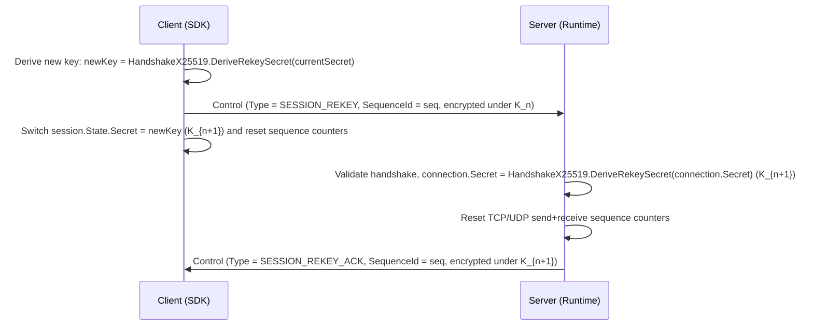

Rekey phiên cho phép xoay vòng khóa đối xứng giữa phiên để ngăn bộ đếm sequence bị tràn và giới hạn khoảng thời gian khóa bị phơi lộ của các kết nối tồn tại lâu dài.

## Ánh xạ mã nguồn

- `src/Nalix.SDK/Transport/Extensions/RekeyExtensions.cs` — Extension của SDK phía client
- `src/Nalix.Runtime/Handlers/SystemControlHandlers.cs` — Handler control phía máy chủ

## Cách hoạt động

### Luồng xoay vòng khóa



### Khi nào nên rekey

- **Tràn bộ đếm sequence**: Bộ đếm sequence 16-bit sẽ quay vòng sau 65,535 khung. Rekey sẽ đặt lại chúng.
- **Giảm khoảng thời gian bị lộ**: Xoay vòng khóa giới hạn lượng dữ liệu được mã hóa dưới một khóa duy nhất.
- **Phiên tồn tại lâu dài**: Máy chủ game, kết nối IoT và bảng điều khiển liên tục nên rekey định kỳ.

### Sử dụng phía client

SDK cung cấp `RekeyAsync()` trên `TransportSession`:

```csharp
using Nalix.SDK.Transport;

// Rekey sau mỗi 50,000 gói tin hoặc theo bộ hẹn giờ
await session.RekeyAsync();
```

Extension method này thực hiện các bước sau:

1. Dẫn xuất khóa phiên mới (`K_{n+1}`) từ bí mật hiện tại (`K_n`) bằng HKDF.
2. Gửi một gói `Control` với `Type = SESSION_REKEY`, được mã hóa bằng `K_n`.
3. Chuyển ngay `session.State.Secret` sang `K_{n+1}` và đặt lại bộ đếm sequence cục bộ để giải mã được `SESSION_REKEY_ACK` của máy chủ (được mã hóa bằng `K_{n+1}`).
4. Chờ `SESSION_REKEY_ACK` từ máy chủ (được đối chiếu theo `SequenceId`).

### Hành vi phía máy chủ

Handler `SystemControlHandlers.HandleSessionRekey` thực hiện:

1. Xác nhận handshake đã được thiết lập (`connection.GetRuntimeState().HandshakeEstablished`) và gói control đến ở dạng đã mã hóa (`context.EncryptedOnWire`).
2. Tính thế hệ khóa tiếp theo: `connection.Secret = HandshakeX25519.DeriveRekeySecret(connection.Secret)`.
3. Đặt lại bộ đếm sequence gửi/nhận của TCP và (nếu có) UDP.
4. Phản hồi bằng `Control(SESSION_REKEY_ACK)` với cùng `SequenceId` để đối chiếu.

### Gói giao thức

| Gói | OpCode | Chiều | Trường |
| --- | --- | --- | --- |
| `Control` | `SYSTEM_CONTROL` | Client → Server | `Type = SESSION_REKEY`, `SequenceId` |
| `Control` | `SYSTEM_CONTROL` | Server → Client | `Type = SESSION_REKEY_ACK`, `SequenceId` khớp với yêu cầu |

## Ghi chú bảo mật

- Gói control được truyền dưới dạng mã hóa (`[PacketEncryption(true)]` trên kết nối) — nó đi qua cipher phiên hiện tại.
- Cả hai bên đều dẫn xuất khóa mới bằng HKDF-Expand với nhãn tĩnh `nalix-session/rekey`. Không có khóa nào được gửi trực tiếp trên đường truyền, nhờ đó rekey phiên có tính bảo mật thuận tiến (perfect forward secrecy).
- Chỉ chấp nhận transport tin cậy (TCP) cho tín hiệu Rekey.
- Nếu handshake chưa được thiết lập, kết nối sẽ bị ngắt ngay lập tức.
- Việc đặt lại bộ đếm sequence ngăn các khung cũ hoặc bị phát lại từ chu kỳ khóa trước được chấp nhận.

## API liên quan

- [Khôi phục phiên](./session-resume.md)
- [Giao thức Handshake](./handshake.md)
- [AEAD và Envelope](./aead-and-envelope.md)
