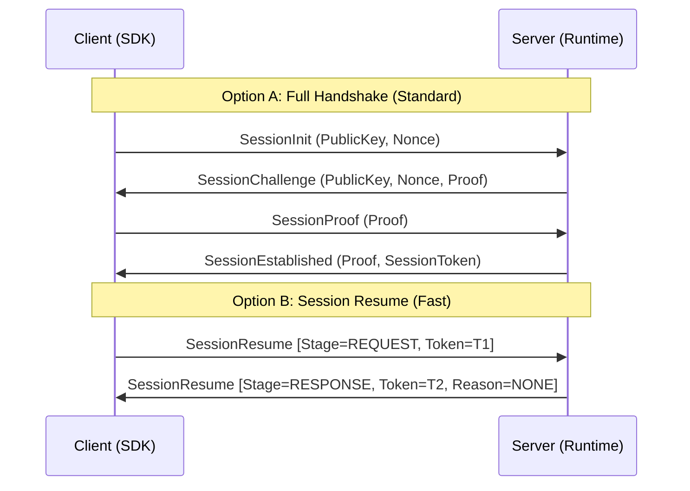

Khôi phục phiên cho phép kết nối lại với độ trễ thấp bằng cách bỏ qua handshake X25519 đầy đủ. Client có thể thiết lập lại một phiên bảo mật bằng các bí mật đối xứng đã thương lượng trước đó và một session token hợp lệ.

## Ánh xạ mã nguồn

- `src/Nalix.Codec/ProtocolFrames/Session/SessionResume.cs`
- `src/Nalix.Runtime/Handlers/SessionHandlers.cs`
- `src/Nalix.Runtime/Sessions/SessionService.cs`
- `src/Nalix.Abstractions/Networking/Sessions/ISessionService.cs`
- `src/Nalix.Abstractions/Networking/Sessions/ISessionFactory.cs`
- `src/Nalix.Abstractions/Networking/Sessions/ISessionStore.cs`
- `src/Nalix.SDK/Transport/Extensions/ResumeExtensions.cs`

## 1. Thiết kế và lý do

Nalix dùng gói `SessionResume` với một máy trạng thái `Stage` để quản lý trạng thái phiên. Gói này hỗ trợ các giai đoạn `REQUEST` và `RESPONSE` để máy chủ có thể khôi phục hoặc từ chối phiên chỉ trong một lượt khứ hồi.

- **Khôi phục nguyên tử**: Máy chủ áp dụng snapshot phiên đã khôi phục và trả về một token phản hồi mới trong một lượt khứ hồi duy nhất.
- **Tái nhập không trạng thái**: Một phiên có thể được khôi phục ngay lập tức miễn là `SessionToken` 8 byte và `Secret` liên quan còn hợp lệ.
- **Xoay vòng token**: Máy chủ có thể trả về một `SessionToken` đã xoay vòng trong phản hồi thành công.

---

## 2. Handshake so với khôi phục phiên

---

## 3. Đặc tả giao thức

### Cấu trúc gói tin

`SessionResume` là một gói tín hiệu có kích thước cố định, mang theo giai đoạn, session token, proof và lý do kết quả cần thiết cho việc khôi phục.

---

## 4. Chi tiết triển khai

### Logic xử lý phía máy chủ (`SessionHandlers.HandleAsync`)

Khi một yêu cầu `SessionResume` (`0x0002`, `SESSION_SIGNAL`) đến `SessionHandlers.HandleAsync`:

1. Gói tin đến được kiểm tra để đảm bảo các trường `Stage` (`SessionResumeStage.REQUEST`), `SessionToken` và `Proof` đúng cấu trúc.
2. Máy chủ gọi `ISessionService.ConsumeAsync(packet.SessionToken, entry => ...)` để xác thực và tiêu thụ `SessionEntry` đã lưu một cách nguyên tử.
3. Bên trong predicate, nó xác minh `Proof` theo thời gian hằng số bằng `HmacKeccak256.Compute` trên bộ đệm 16 byte `SessionToken (8B LE) || TimeWindow (8B LE, UnixSeconds / 30)` qua các cửa sổ thời gian `[t - 1, t, t + 1]` (các bucket 30 giây).
4. Nếu xác thực thành công, runtime khôi phục `Secret`, `Algorithm`, `Level` của kết nối và trạng thái đã lưu, đồng thời đánh dấu trạng thái handshake là đã thiết lập.
5. Runtime lưu kết nối đang hoạt động dưới `ConnectionId` mới (`newToken`) qua `ISessionService.SaveSessionAsync(connection)`, tính proof phản hồi của máy chủ (`HmacKeccak256` trên `newToken (8B LE) || TimeWindow (8B LE)`), và gửi `SessionResume` (`Stage = RESPONSE`, `SessionToken = newToken`, `Reason = ProtocolReason.NONE`, `Proof = responseProof`).
6. Nếu xác thực, tra cứu token hoặc xác minh proof thất bại, máy chủ gửi `SessionResume` (`Stage = RESPONSE`) với `ProtocolReason` tương ứng với lỗi và đóng kết nối.

---

## 5. Bảo mật và vận hành

- **Bảo mật token**: Token không thay thế được bí mật đối xứng, nhưng cần được coi là dữ liệu nhạy cảm vì nó định danh một phiên đang hoạt động.
- **Chính sách xoay vòng**: Client phải cập nhật `session.State.SessionToken` cục bộ ngay khi nhận được `RESPONSE` thành công. SDK đã làm việc này trong `src/Nalix.SDK/Transport/Extensions/ResumeExtensions.cs`.
- **Vô hiệu hóa**: Phiên bị vô hiệu hóa khi client ngắt kết nối tường minh hoặc sau khi TTL (Time-To-Live) của session store đã cấu hình hết hạn.

---

## Tài liệu liên quan

- [Giao thức Handshake (X25519)](./handshake.md)
- [Contract phiên](../abstractions/session-contracts.md)
- [Định danh Snowflake](../framework/snowflake.md)
- [Tiện ích resume của SDK](../sdk/resume-extensions.md)
