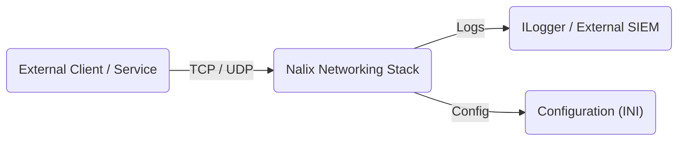
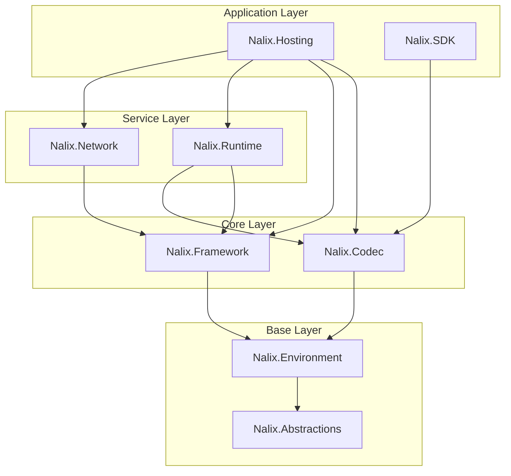
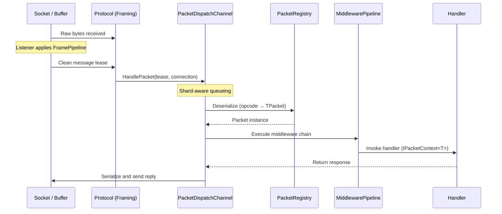

Kiến trúc của Nalix được thiết kế cho truyền thông mạng thông lượng cao, độ trễ thấp, tập trung vào đường dữ liệu không cấp phát bộ nhớ (zero-allocation) và thực thi nhận biết shard. Trang này giải thích cách các package của framework liên hệ với nhau, dữ liệu chảy qua hệ thống ra sao và mỗi thành phần nằm ở đâu trong thiết kế tổng thể.

## Bối cảnh hệ thống

Ở mức cao nhất, Nalix là một stack truyền thông mạng nằm giữa các client bên ngoài và logic ứng dụng của bạn.

## Sơ đồ phụ thuộc gói

Nalix dùng kiến trúc gói theo module. Mỗi package có một trách nhiệm rõ ràng và một chiều phụ thuộc được xác định rõ.

| Tầng | Package | Trách nhiệm |
| :--- | :--- | :--- |
| Hosting | `Nalix.Hosting` | Bộ xây dựng fluent, vòng đời ứng dụng, tự động khám phá |
| Transport | `Nalix.Network` | Listener TCP/UDP, vòng đời kết nối, cầu nối protocol, session store |
| Dispatch | `Nalix.Runtime` | Điều phối gói tin, middleware, biên dịch handler |
| Pipeline | `Nalix.Runtime` | Giới hạn tốc độ, kiểm soát đồng thời, middleware, thực thi dispatch |
| Infrastructure | `Nalix.Framework` | DI, lập lịch tác vụ, pool đối tượng, định danh |
| Codec | `Nalix.Codec` | Tuần tự hóa, registry gói tin, framing, nén, mật mã |
| Environment | `Nalix.Environment` | Cấu hình, thư mục, sinh số ngẫu nhiên, tiện ích clock/thời gian |
| Contracts | `Nalix.Abstractions` | Abstraction dùng chung, thuộc tính gói tin, contract kết nối |
| Client | `Nalix.SDK` | Session transport, đối chiếu request/response, luồng handshake và resume |

## Tách biệt máy chủ và client

Nalix tách rõ trách nhiệm giữa host máy chủ và SDK phía client.

**Máy chủ (host dày):** Host sở hữu socket listener, quản lý kết nối, connection hub và dispatch channel nhận biết shard. Nó chịu trách nhiệm về khả năng mở rộng (sharding worker), bảo mật (kiểm soát truy cập, giới hạn tốc độ) và điều phối ứng dụng (middleware, biên dịch handler).

**Client (SDK mỏng):** SDK tập trung vào quản lý session, đối chiếu request/response tự động và mã hóa/nén trong suốt. Client không nhúng hạ tầng dispatch hay middleware. Nó gửi và nhận gói tin trực tiếp.

**Contract dùng chung:** Định nghĩa gói tin (POCO được đánh dấu `[SerializePackable]`) nên nằm trong một assembly dùng chung, được cả project máy chủ và project client tham chiếu.

## Hành trình của gói tin

Hiểu cách gói tin đi qua hệ thống là chìa khóa để gỡ lỗi và tối ưu hiệu quả.

## Các thành phần cốt lõi

### 1. Transport và listener

- **`TcpListenerBase`**: Listener TCP có đồng thời cao, dùng `SocketAsyncEventArgs`. Xử lý việc chấp nhận socket, kiểm soát truy cập và chuỗi bắt đầu nhận thông qua `Protocol.OnAccept(...)`.
- **`UdpListenerBase`**: Listener datagram không trạng thái, có sẵn ánh xạ session đã xác thực và giới hạn tốc độ không khóa.
- **Connection guard**: Kiểm soát truy cập ở giai đoạn sớm, từ chối endpoint ngay ở mức socket trước khi cấp phát bất kỳ tài nguyên ứng dụng nào.

### 2. Protocol (cầu nối)

Interface `IProtocol` kết nối trạng thái transport do listener quản lý với dispatch. Trong trường hợp thông thường, `ProcessMessage(...)` nhận một lease đã được biến đổi và chuyển nó cho `PacketDispatchChannel`.

### 3. Điều phối theo shard

`PacketDispatchChannel` là động cơ của Nalix. Nó cung cấp:

- **Sharding worker**: Nhiều vòng lặp worker (tương ứng số nhân CPU) ngăn hiện tượng head-of-line blocking. Một handler chậm không làm nghẽn các gói tin không liên quan.
- **Wake-signaling**: Mỗi worker dispatch chờ trên một tín hiệu đánh thức có thể tái sử dụng và không cấp phát bộ nhớ. Mỗi khi một kết nối sẵn sàng mới, producer chỉ đánh thức đúng một worker đang chờ, không cần polling bằng timer.
- **Ưu tiên**: Hỗ trợ sẵn `PacketPriority` (`URGENT`, `HIGH`, `MEDIUM`, `LOW`, `NONE`).

### 4. Registry gói tin

`PacketRegistry` là danh mục gói tin dùng chung trong toàn bộ process. Nó được điền tự động bởi một **Source Generator** phát hiện các kiểu gói tin trong quá trình biên dịch. Khi chạy, gọi `PacketRegistry.Build()` sẽ đóng băng danh mục, mang lại khả năng tra cứu và giải tuần tự hóa cực nhanh cho mọi kiểu gói tin đã đăng ký cũng như các gói tín hiệu có sẵn.

### 5. Quản lý instance

Nalix dùng `InstanceManager` (mẫu service-locator được tối ưu để phân giải không cấp phát bộ nhớ) thay vì các container DI thông thường. Nhờ vậy, các service dùng chung như logger, registry gói tin và service ứng dụng có thể được phân giải trong lúc thực thi hot path mà không tốn chi phí container hay cấp phát.

## Bảo vệ và kiểm soát áp lực

Runtime mạng được thiết kế để chạy với các cơ chế kiểm soát áp lực luôn bật mặc định:

| Thành phần | Mục đích |
| :--- | :--- |
| `ConnectionGuard` | Kiểm soát truy cập ở mức socket; từ chối endpoint trước khi cấp phát tài nguyên ứng dụng |
| `TokenBucketLimiter` | Bảo vệ trước các đợt tăng đột biến request, với burst và tốc độ bổ sung có thể cấu hình |
| `PolicyRateLimiter` | Giới hạn tốc độ theo opcode và theo endpoint, dựa trên metadata của handler |
| `TimingWheel` | Quản lý timeout khi nhàn rỗi với độ phức tạp lập lịch O(1) |

## Mã của bạn đặt ở đâu?

| Mã của bạn | Package / tầng nào |
| :--- | :--- |
| Định nghĩa gói tin (POCO) | Assembly contract dùng chung → `Nalix.Abstractions` + `Nalix.Framework` |
| Lớp handler | Project máy chủ → đăng ký với `PacketDispatchChannel` |
| Middleware | Project máy chủ → triển khai `IPacketMiddleware<TPacket>` từ `Nalix.Abstractions` |
| Tùy chỉnh protocol | Project máy chủ → kế thừa `Protocol` từ `Nalix.Network` |
| Logic session phía client | Project client → dùng `TcpSession` từ `Nalix.SDK` |
| Cấu hình | File INI → được `ConfigurationManager` từ `Nalix.Environment` tải |

## Xem trong thực tế

- [Bắt đầu nhanh](../../quickstart.md): Xây dựng một máy chủ và client hoàn chỉnh chỉ trong vài phút.
- [Blueprint máy chủ](../../guides/getting-started/server-blueprint.md): Tìm hiểu cấu trúc project được khuyến nghị cho môi trường production.
- [Danh sách kiểm tra production](../../guides/deployment/production-checklist.md): Xem cách các tầng kiến trúc ánh xạ vào một bản triển khai thực tế.
