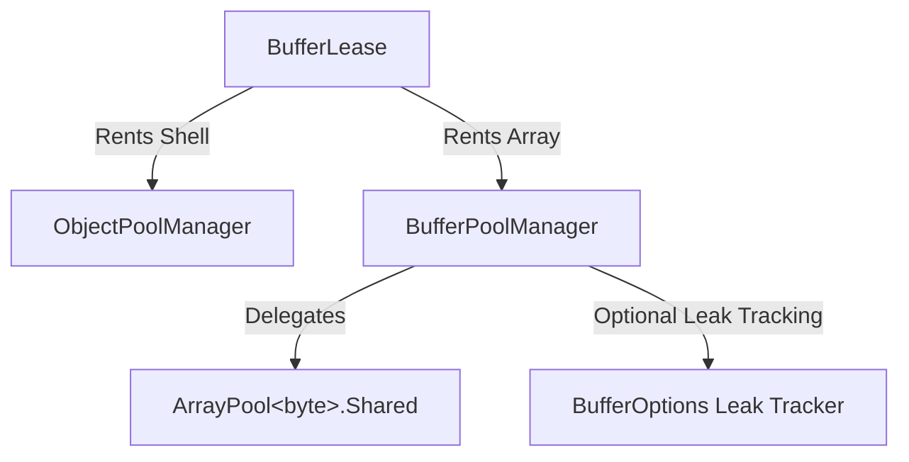

`BufferLease` là nền tảng quản lý bộ nhớ của Nalix. Nó cung cấp một lớp trừu tượng có đếm tham chiếu và có pool trên các mảng byte thô, giúp các pipeline mạng không cấp phát bộ nhớ (zero-allocation).

---

## 1. Khái niệm cốt lõi

Trong mạng hiệu năng cao, Garbage Collector (GC) là nút thắt chính. Việc cấp phát `new byte[]` cho mỗi gói tin đi ra tạo ra "nhiễu heap", dẫn đến các lần GC tạm dừng.

Nalix giải quyết vấn đề này bằng **Pooled Buffer Lease** (`BufferLease` được hỗ trợ bởi `BufferPoolManager` và `ArrayPool<byte>.Shared`). Thay vì cấp phát bộ nhớ mới, bạn **thuê** một bộ đệm có sẵn, dùng nó, rồi **trả** lại pool. `BufferLease` tự động hóa vòng đời này bằng đếm tham chiếu nguyên tử và theo dõi rò rỉ tùy chọn (`BufferOptions`).

### Cấu trúc phân cấp của buffer



---

## 2. Tạo gói tin đi ra

Để gửi dữ liệu mà không cấp phát bộ nhớ, hãy theo mẫu **Rent-Serialize-Commit-Send** (Thuê - Tuần tự hóa - Xác nhận - Gửi).

### Triển khai từng bước

```csharp
public async ValueTask BroadcastUpdate(IConnection connection, GameUpdate packet)
{
    // 1. RENT: Lấy một lease từ pool.
    // Thao tác này là O(1) và không cấp phát trên heap.
    using var lease = BufferLease.Rent(packet.Length);

    // 2. SERIALIZE: Ghi trực tiếp vào toàn bộ dung lượng của lease.
    // lease.SpanFull cho bạn quyền truy cập vào toàn bộ mảng đã thuê.
    int written = packet.Serialize(lease.SpanFull);

    // 3. COMMIT: Cập nhật độ dài của lease cho khớp với dữ liệu thực đã ghi.
    // Điều này đảm bảo các thành phần phía sau (nén, mã hóa)
    // chỉ xử lý các byte hợp lệ.
    lease.CommitLength(written);

    // 4. SEND: Truyền ReadOnlyMemory<byte> cho transport.
    // Transport sẽ truyền dữ liệu đi. Khối 'using' đảm bảo
    // buffer được trả về pool ngay cả khi gửi thất bại.
    await connection.TCP.SendAsync(lease.Memory);
}
```

---

## 3. Vòng đời và đếm tham chiếu

`BufferLease` hỗ trợ đếm tham chiếu thông qua `Retain()` và `Dispose()`.

### Mẫu giữ tham chiếu

Nếu bạn cần truyền một lease cho tác vụ nền bất đồng bộ hoặc hàng đợi broadcast, bạn phải gọi `Retain()`.

```csharp
public void HandleIncoming(IBufferLease lease)
{
    // Chúng ta muốn xử lý lease này ở chế độ nền
    lease.Retain(); // Tăng số tham chiếu lên 2

    _ = Task.Run(() =>
    {
        try
        {
            ProcessLongRunning(lease.Memory);
        }
        finally
        {
            lease.Dispose(); // Giảm số tham chiếu
        }
    });

    // Lease gốc được framework giải phóng tại đây (số tham chiếu về 1)
}
```

---

## 4. Nâng cao: Chuyển quyền sở hữu

Trong một số trường hợp, bạn có thể muốn "tách" mảng bên dưới khỏi lease (ví dụ khi truyền nó cho một API cũ tự quản lý bộ nhớ).

```csharp
if (lease.ReleaseOwnership(out byte[]? buffer, out int start, out int length))
{
    // Lease giờ đã "rỗng" và sẽ không trả buffer về pool khi Dispose.
    // BẠN giờ chịu trách nhiệm trả 'buffer' về pool bằng tay!
    bufferPool.Return(buffer);
}
```

:::danger[Rò rỉ bộ nhớ]
Việc giải phóng quyền sở hữu sẽ bỏ qua cơ chế an toàn tự động của `BufferLease`. Chỉ dùng khi bạn đang triển khai hạ tầng cấp thấp tùy chỉnh.
:::

---

## 5. Danh sách kiểm tra hiệu năng

| Hành động | Mức ảnh hưởng | Vì sao? |
| :--- | :--- | :--- |
| **Dùng `using var`** | Quan trọng | Đảm bảo trả về pool một cách xác định. |
| **Tránh `lease.Span` trong `async`** | Quan trọng | `Span<T>` không thể dùng qua ranh giới `await`. |
| **Ưu tiên `lease.Memory`** | Cao | `ReadOnlyMemory<byte>` an toàn cho async và không cấp phát bộ nhớ. |
| **Khớp dung lượng** | Trung bình | Thuê kích thước gần với độ dài gói tin giúp giảm phân mảnh nội bộ. |

---

## Thông tin liên quan

- [Đường dẫn nóng không cấp phát bộ nhớ](./zero-allocation.md)
- [Tham chiếu API quản lý buffer](../../api/environment/memory/buffer-management.md)
- [API phiên transport](./low-level-session-apis.md)
