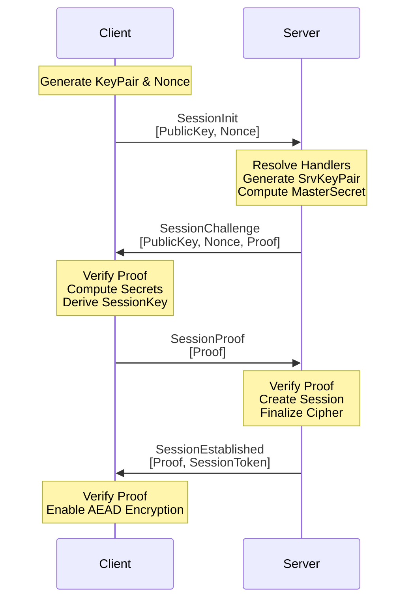

Nalix triển khai giao thức handshake bảo mật cao, theo mô hình zero-trust, dựa trên **X25519 (Curve25519)** Elliptic Curve Diffie-Hellman (ECDH). Giao thức này đảm bảo mỗi session được mã hóa bằng một khóa phiên duy nhất, không bao giờ được truyền trên đường truyền.

## Đường dẫn mã nguồn

- `src/Nalix.Codec/ProtocolFrames/Session/SessionInit.cs`
- `src/Nalix.Codec/ProtocolFrames/Session/SessionChallenge.cs`
- `src/Nalix.Codec/ProtocolFrames/Session/SessionProof.cs`
- `src/Nalix.Codec/ProtocolFrames/Session/SessionEstablished.cs`
- `src/Nalix.Codec/ProtocolFrames/Session/SessionTofu.cs`
- `src/Nalix.Codec/Security/HandshakeX25519.cs`
- `src/Nalix.Runtime/Handlers/HandshakeHandlers.cs`
- `src/Nalix.SDK/Transport/Extensions/HandshakeExtensions.cs`

## Đảm bảo bảo mật

- **Thỏa thuận chung**: Cả client và server đều đóng góp vào khóa phiên cuối cùng.
- **Perfect Forward Secrecy (PFS)**: Khóa tạm thời (ephemeral) được dùng cho mọi session.
- [x] **Xác minh danh tính**: Trong production, cần ghim khóa công khai X25519 của server để chống tấn công man-in-the-middle (MitM) (hoặc dùng Trust-On-First-Use tường minh qua `SessionTofu` khi `TransportOptions.AllowTofu = true` trong môi trường phát triển).
- [x] **Proof-of-Work thích ứng**: Khi được bật, server có thể yêu cầu client giải một bài toán PoW trước khi handshake tiếp tục, nhằm làm chậm các đợt flood kết nối tự động. Xem [Proof-of-Work](../../api/security/proof-of-work.md).

:::danger[Danh tính bắt buộc]
Mọi máy chủ Nalix phải có file `certificate.private`. Mặc định, host tải file này từ `Directories.ConfigurationDirectory`. Bạn có thể ghi đè đường dẫn này bằng `builder.UseSecureConnections("path/to/certificate.private")` khi khởi tạo host.

Client nên tải khóa công khai dạng hex từ `certificate.public` vào `TransportOptions.ServerPublicKey` để bật tính năng ghim khóa công khai.
:::

- [x] **Toàn vẹn transcript**: Mọi thông điệp handshake được băm vào một transcript để chống giả mạo hoặc tấn công phát lại.

## Quy trình handshake

Sơ đồ dưới đây minh họa giao tiếp giữa **Nalix SDK** và các handler của **Nalix Server**.

## Các giai đoạn giao thức

### 1. SessionInit

SDK khởi tạo bằng cách gửi khóa công khai tạm thời và một nonce ngẫu nhiên đủ mạnh về mặt mật mã qua khung `SessionInit`. Không có dữ liệu nhạy cảm nào được gửi ở bước này.

### 2. SessionChallenge

Server phản hồi bằng khóa công khai tạm thời của mình và một `Proof` qua khung `SessionChallenge`. Proof là một digest có khóa được tính trên transcript handshake bằng master secret đã dẫn xuất (qua `HandshakeX25519.ComputeServerProof`), chứng minh server sở hữu khóa riêng tương ứng mà không lộ khóa đó.

### 3. SessionProof

SDK kiểm tra proof của server. Nếu hợp lệ, nó tính `ClientProof` của riêng mình và gửi lại qua khung `SessionProof`. Bước này xác nhận với server rằng client đã dẫn xuất thành công cùng một bí mật chung.

### 4. SessionEstablished

Xác nhận cuối cùng. Server gửi khung `SessionEstablished` chứa `SessionToken`. SDK dùng token này để xác thực datagram UDP, và kết nối từ đây được mã hóa đầy đủ bằng khóa phiên đã dẫn xuất.

## Chi tiết triển khai

- **Mã hóa**: `src/Nalix.Runtime/Handlers/HandshakeHandlers.cs` và `src/Nalix.SDK/Transport/Extensions/HandshakeExtensions.cs` đặt cipher đang hoạt động thành `CipherSuiteType.Chacha20Poly1305` cho session đã thiết lập.
- **Token tiếp tục**: `SessionEstablished` trả về `SessionToken` hiện tại, sau đó SDK lưu vào `SessionState.SessionToken`.

## Chủ đề liên quan

- [Tiếp tục session](./session-resumption.md)
- [Mô hình mã hóa](./encryption-model.md)
- [Thiết kế không cấp phát bộ nhớ](../internals/zero-allocation.md)
