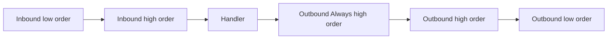

Trang này giải thích cách `MiddlewarePipeline` nằm trong đường đi của request Nalix và cách tận dụng nó cho chính sách và khả năng quan sát ở mức ứng dụng.

## Mô hình middleware

Nalix dùng một tầng middleware duy nhất, hiệu năng cao, được vận hành bởi `MiddlewarePipeline`. Pipeline này thực thi **sau** khi gói tin được giải tuần tự hóa và phân giải metadata, nhờ đó bạn có đầy đủ ngữ cảnh cho mọi request.


### Pipeline middleware

`MiddlewarePipeline` chạy với toàn bộ ngữ cảnh thực thi gói tin. Middleware thường tiêu thụ trạng thái này thông qua `IPacketContext<TPacket>`, trong khi runtime hỗ trợ nó bằng một instance `PacketContext<TPacket>` được tái sử dụng từ pool, mang theo gói tin đã giải tuần tự hóa, trạng thái kết nối và metadata handler đã cache.

Hãy dùng khi bạn cần:

- Kiểm tra quyền truy cập
- Áp dụng timeout
- Giới hạn tốc độ hoặc giới hạn đồng thời
- Ghi audit log với ngữ cảnh handler
- Kiểm tra chính sách theo tenant hoặc sản phẩm

**Đánh đổi:** Vì chạy sau khi giải tuần tự hóa, gói tin đã được cấp phát bộ nhớ. Để từ chối sớm các lưu lượng bị lỗi, hãy dựa vào `ConnectionGuard` hoặc việc kiểm tra của `Protocol`.

## Biến đổi mức thấp

Các thao tác buffer mức thấp như giải mã, giải nén và kiểm tra khung thô được tích hợp vào **`FramePipeline`**. Pipeline này được thực thi trực tiếp bởi các **Listener** (TCP/UDP) ở tầng transport, trước khi gói tin đến middleware runtime.

## Thứ tự thực thi

Thứ tự middleware được điều khiển bởi thuộc tính, không phải thứ tự đăng ký thô. Pipeline đọc `MiddlewareOrderAttribute` và `MiddlewareStageAttribute` từ mỗi kiểu middleware.
Nếu thiếu `MiddlewareOrderAttribute`, thứ tự mặc định là `0`. Nếu thiếu `MiddlewareStageAttribute`, giai đoạn mặc định là `Inbound`.

| Nhóm giai đoạn | Hành vi nguồn |
| --- | --- |
| Inbound | Sắp xếp theo `MiddlewareOrder` tăng dần. |
| Outbound | Sắp xếp theo `MiddlewareOrder` giảm dần. |
| Outbound với `AlwaysExecute=true` | Lưu trong một nhóm outbound-always riêng, sắp xếp giảm dần, và được thực thi sau handler ngay cả khi outbound thông thường bị bỏ qua. |



Ví dụ đăng ký:

```csharp
PacketDispatchChannel dispatch = new(options =>
{
    // Đăng ký middleware vào MiddlewarePipeline
    options.WithMiddleware(new PermissionMiddleware());
    options.WithMiddleware(new RateLimitMiddleware());
    options.WithMiddleware(new AuditMiddleware());
});
```

## Metadata đóng vai trò gì

Middleware trở nên mạnh mẽ vì dispatcher phân giải metadata **trước** khi pipeline chạy.

Middleware có thể đọc:

- `PacketOpcode`: opcode của handler
- Quy tắc quyền (`[PacketPermission]`)
- Quy tắc timeout (`[PacketTimeout]`)
- Quy tắc giới hạn tốc độ (`[PacketRateLimit]`)
- Các thuộc tính tùy chỉnh do source generator `PacketHandlerGenerator` thu thập

Luồng thông thường:

1. Khai báo thuộc tính trên các method handler
2. `PacketHandlerGenerator` thu thập chúng lúc biên dịch vào `PacketMetadata`
3. Đọc metadata đã phân giải trong middleware qua `context.Attributes`

## Hướng dẫn quyết định

| Nhu cầu | Lựa chọn phù hợp nhất |
| :--- | :--- |
| Từ chối khung dữ liệu lỗi trước khi tạo gói tin | `Protocol` / `ConnectionGuard` |
| Giải mã hoặc giải nén một khung | `FramePipeline` (Transport) |
| Chặn gói tin theo mức quyền | `MiddlewarePipeline` |
| Áp dụng quy tắc timeout theo handler | `MiddlewarePipeline` |
| Đọc thẻ tenant tùy chỉnh từ metadata | `MiddlewarePipeline` |
| Giới hạn tốc độ theo opcode hoặc endpoint | `MiddlewarePipeline` |
| Kiểm toán các lần gọi handler | `MiddlewarePipeline` |

## Các lỗi thường gặp

:::warning[Lỗi thường gặp: quên gọi next()]
Nếu một middleware không gọi `await next(ct)`, pipeline request bị rút ngắn. Điều này có chủ đích trong các tình huống từ chối, nhưng có thể gây ra việc rớt gói âm thầm nếu xảy ra do vô tình.
:::

:::warning[Lỗi thường gặp: giả định về thứ tự]
Thứ tự thực thi middleware dùng `MiddlewareOrderAttribute`, không phải thứ tự chèn vào. Nếu nhiều middleware có cùng giá trị thứ tự, không nên dựa vào thứ tự tương đối giữa chúng.
:::

## Xem trong thực tế

- [Middleware tùy chỉnh từ đầu đến cuối](../../guides/extensibility/custom-middleware.md): Tạo một middleware tùy chỉnh và một metadata provider.
- [Luồng xác thực UDP](../../guides/networking/udp-security.md): Xem cách middleware xác thực được dùng trong một tình huống thực tế.
- [Request/Response TCP](../../guides/networking/tcp-patterns.md): Quan sát middleware trong luồng TCP tiêu chuẩn.
