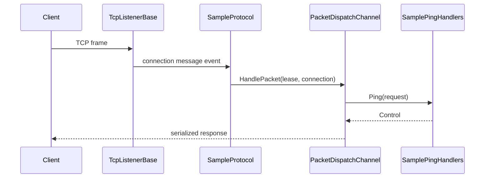

:::danger[Triển khai mức thấp]
Hướng dẫn này minh họa cách cấu hình thủ công runtime Nalix **mà không dùng** hosting builder `NetworkApplication`. Đây là chủ đề nâng cao, chỉ khuyến nghị cho các thư viện transport chuyên biệt hoặc tinh chỉnh hiệu năng mức thấp.

Với 99% ứng dụng, hãy dùng [Hosting Builder](../../quickstart.md) hoặc [Blueprint máy chủ](../../guides/getting-started/server-blueprint.md).
:::

Các bước gồm:

1. Đăng ký các service dùng chung
2. Xây dựng một packet dispatcher
3. Chuyển tiếp thông điệp từ `Protocol` vào dispatch
4. Khởi động một `TcpListenerBase` tùy chỉnh
5. Gửi một request và nhận một response

Ví dụ được giữ ở mức tối giản có chủ đích để bạn có thể sao chép cấu trúc trước và tối ưu sau.

## Máy chủ

### 1. Đăng ký các service dùng chung

```csharp
InstanceManager.Instance.Register<ILogger>(logger);
```

### 2. Tạo handler

```csharp
[PacketController("SamplePingHandlers")]
public sealed class SamplePingHandlers
{
    [PacketOpcode(0x1001)]
    public ValueTask<Control> Ping(IPacketContext<Control> request)
    {
        request.Packet.Type = ControlType.PONG;
        return ValueTask.FromResult(request.Packet);
    }
}
```

### 3. Xây dựng dispatcher

```csharp
PacketDispatchChannel dispatch = new(options =>
{
    options.WithHandler(() => new SamplePingHandlers());
});

dispatch.Activate();
```

### 4. Nối protocol với dispatch

```csharp
public sealed class SampleProtocol : Protocol
{
    private readonly PacketDispatchChannel _dispatch;

    public SampleProtocol(PacketDispatchChannel dispatch) => _dispatch = dispatch;

    public override IFrameProcessor FrameProcessor => DefaultFrameProcessor.Instance;
    public override IOpCodeExtractor OpCodeExtractor => DefaultOpCodeExtractor.Instance;

    public override void ProcessMessage(object? sender, IConnectionEventArgs args)
        => _dispatch.HandlePacket(args.Lease, args.Connection);
}
```

### 5. Khởi động listener

```csharp
public sealed class SampleTcpListener : TcpListenerBase
{
    public SampleTcpListener(
        ushort port,
        IProtocol protocol,
        IConnectionHub hub,
        IConnectionGuard guard)
        : base(port, protocol, hub, guard) { }
}

IConnectionHub hub = new ConnectionHub();
IConnectionGuard guard = new ConnectionGuard();
SampleTcpListener listener = new(57206, new SampleProtocol(dispatch), hub, guard);
listener.Activate();
```

`TcpListenerBase.Activate(...)` là đồng bộ. Chỉ dùng `NetworkApplication.RunAsync()` khi bạn muốn tầng hosting tự quản lý khởi động và tắt máy.

:::warning[Tự quản lý hub và guard khi cấu hình thủ công]
Các constructor hiện tại của `TcpListenerBase` yêu cầu một `IConnectionHub` và một `IConnectionGuard`. Hosting builder tự tạo và nối các phụ thuộc này cho bạn. Ở chế độ thủ công, hãy tự tạo hub và guard và giải phóng chúng khi máy chủ tắt.
:::

## Client

Client dùng `Nalix.SDK` để kết nối và thực hiện các thao tác request/response có kiểu mạnh:

```csharp
using Contracts;
using Nalix.SDK.Transport.Extensions;

// 1. Thiết lập kết nối
await session.ConnectAsync();

// 2. Request/Response trong một dòng
Control response = await session.RequestAsync<Control>(
    new Control { Type = ControlType.PING },
    options: RequestOptions.Default.WithTimeout(3_000)
);

Console.WriteLine(response.Type); // PONG
```

## Luồng đầy đủ



Cấu trúc đầu cuối này vẫn hoạt động y hệt với một kiểu gói tin tùy chỉnh nếu bạn thay `Control` bằng contract gói tin của riêng mình trong handler và mẫu client.

## Nên tùy chỉnh gì tiếp theo

- thêm middleware
- thêm thuộc tính gói tin như timeout, quyền truy cập hoặc giới hạn tốc độ
- chuyển một số handler sang `PacketContext<TPacket>` khi bạn cần gửi thủ công một cách tường minh hoặc khi làm việc với gói tin tùy chỉnh
- nhớ rằng **Listener** xử lý biến đổi khung thô (Pipeline) trong khi **Protocol** xử lý các thông điệp thuần túy qua `ProcessMessage(...)`

## Trang nên đọc tiếp

- [Hướng dẫn TCP Patterns](../../guides/networking/tcp-patterns.md)
- [Hướng dẫn Custom Middleware](../../guides/extensibility/custom-middleware.md)
- [API Packet Dispatch](../../api/runtime/routing/packet-dispatch.md)
- [Hướng dẫn Quickstart](../../quickstart.md)
