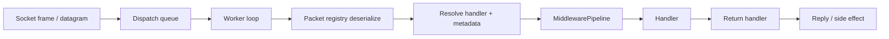

Trang này theo dõi toàn bộ hành trình của một request mạng từ byte socket thô đến khi handler được gọi và phản hồi. Hiểu đường đi này là điều thiết yếu để gỡ lỗi hiệu quả, đặt middleware đúng chỗ và tối ưu hiệu năng.

## Tổng quan đường đi của request

## Bước 1. Lưu lượng đi vào qua listener

Runtime bắt đầu với một listener:

- `TcpListenerBase` cho lưu lượng đáng tin cậy, có thứ tự
- `UdpListenerBase` cho datagram độ trễ thấp, có xác thực

Listener chấp nhận lưu lượng và chuyển nó vào protocol đang hoạt động.

## Bước 2. Protocol chuyển dữ liệu vào dispatch

`Protocol` là cầu nối giữa transport và dispatch ở tầng ứng dụng.

Nhiệm vụ của nó là:

- chấp nhận hoặc từ chối các kết nối đang hoạt động
- nhận lưu lượng đã được framing
- chuyển dữ liệu đến vào `PacketDispatchChannel`

Tại thời điểm này, runtime vẫn chỉ có byte, chưa có đối tượng gói tin.
Luồng này giống hệt nhau dù handler cuối cùng làm việc với gói tin có sẵn hay kiểu gói tin tùy chỉnh của bạn.

## Bước 3. Dispatch giải tuần tự hóa gói tin

Khi khung đã vào tầng ứng dụng, `PacketDispatchChannel` trước hết xếp công việc vào hàng đợi, sau đó vòng lặp worker dùng packet registry để giải tuần tự hóa nó thành một `IPacket`.

Trước bước này, các **Listener** có thể đã áp dụng giải mã hoặc giải nén qua `FramePipeline`.

Đây là bước chuyển từ công việc mức transport sang công việc mức ứng dụng.

Sau thời điểm này, middleware và handler có thể suy luận về:

- kiểu gói tin
- opcode
- trạng thái kết nối
- metadata của handler

## Bước 4. Metadata của handler được phân giải

Trước khi middleware gói tin chạy, runtime phân giải metadata gắn với handler được khớp.

Metadata này thường đến từ:

- các thuộc tính gói tin trên method handler, được `PacketHandlerGenerator` thu thập lúc biên dịch

Ví dụ:

- `PacketOpcode`
- `PacketPermission`
- `PacketTimeout`
- `PacketRateLimit`
- các thuộc tính tùy chỉnh về tenant hoặc tính năng

## Bước 5. Middleware gói tin áp dụng chính sách

Middleware gói tin chạy với toàn bộ ngữ cảnh thực thi gói tin, thường được dùng dưới dạng `IPacketContext<TPacket>`.
Bên dưới, runtime cung cấp một triển khai `PacketContext<TPacket>` được tái sử dụng từ pool.

Đây là nơi diễn ra các kiểm tra nhận biết ứng dụng:

- kiểm tra quyền truy cập
- xử lý timeout
- giới hạn tốc độ
- giới hạn đồng thời
- quyết định audit và chính sách

Đến giai đoạn này, runtime đã biết cả gói tin lẫn metadata của handler.

## Bước 6. Handler chạy

Nếu middleware cho phép request đi qua, handler được thực thi.

Handler có thể:

- trả về một gói tin
- trả về một kết quả bất đồng bộ được hỗ trợ
- gửi thủ công qua kết nối
- thực hiện các hiệu ứng phụ mà không phản hồi

## Bước 7. Return handler quyết định những gì được gửi

Nalix hỗ trợ nhiều dạng giá trị trả về của handler.

Return handler nội bộ chuyển chúng thành hành vi outbound, ví dụ:

- gửi một gói phản hồi
- gửi văn bản hoặc byte
- bỏ qua công việc outbound
- hoàn tất mà không có phản hồi

Đây là lý do handler không cần tự xây dựng mọi đường phản hồi.

## Tóm tắt

Đường đi của request dễ suy luận nhất khi chia thành ba giai đoạn:

| Giai đoạn | Thành phần | Điểm mở rộng của bạn |
| :--- | :--- | :--- |
| **Transport** | Listener → Protocol → FramePipeline | Kiểm tra `Protocol` tùy chỉnh |
| **Dispatch** | Queue → Worker → Deserialize → Metadata → Middleware | `MiddlewarePipeline`, metadata provider |
| **Application** | Handler → Return handler → Reply | Lớp handler, lựa chọn kiểu trả về |

Nếu bạn biết vấn đề của mình thuộc giai đoạn nào, bạn thường biết cần tùy chỉnh thành phần Nalix nào.

## Xem trong thực tế

- [Bắt đầu nhanh](../../quickstart.md): Theo dõi một gói Ping/Pong xuyên suốt toàn bộ vòng đời.
- [Request/Response TCP](../../guides/networking/tcp-patterns.md): Xem vòng đời áp dụng cho mẫu request/reply tiêu chuẩn.
- [Danh sách kiểm tra production](../../guides/deployment/production-checklist.md): Quan sát vòng đời trong môi trường hiệu năng cao.
