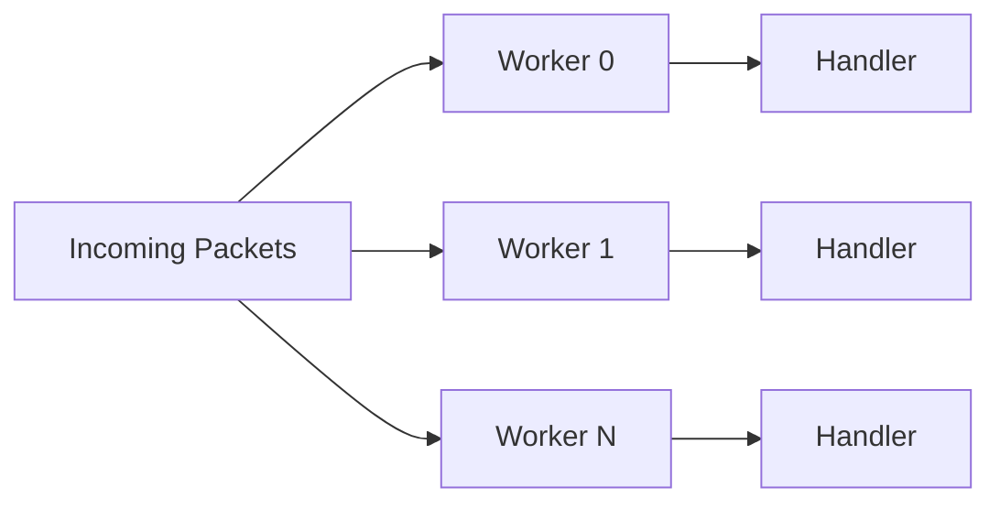

:::warning[Chủ đề nâng cao]
Trang này mô tả cơ chế nội bộ của framework, như giới hạn Span, căn chỉnh cấu trúc và chi phí GC.
:::

Nalix được thiết kế để giảm độ trễ và tối đa hóa thông lượng trên hot path của tầng mạng. Trang này giải thích các kỹ thuật cụ thể được dùng và vì sao chúng quan trọng với khối lượng công việc thực tế.

## 1. Đường dữ liệu không cấp phát bộ nhớ

Các stack mạng truyền thống chịu áp lực GC lớn do cấp phát bộ đệm liên tục. Nalix loại bỏ điều này bằng cách đưa toàn bộ tài nguyên trên hot path vào pool.

:::tip
Hãy theo dõi thời gian tạm dừng GC và số byte được cấp phát như các chỉ số hiệu năng chính khi kiểm thử tải.
:::

Để xem toàn bộ luồng từ đầu đến cuối về cách các tối ưu này phối hợp trong một tình huống thực tế, hãy xem hướng dẫn [Thiết kế không cấp phát bộ nhớ (Zero-Allocation)](./zero-allocation.md).

### Pool bộ đệm (`BufferPoolManager` + `ArrayPool<byte>.Shared`)

Thay vì cấp phát `byte[]` cho mỗi yêu cầu, Nalix dùng `BufferPoolManager` bọc `ArrayPool<byte>.Shared`, với căn chỉnh bucket theo lũy thừa của hai và một byte sentinel chẩn đoán (`0xA5`) để phát hiện tràn bộ đệm khi trả về. `BufferLease` sau đó cung cấp các lát cắt thuộc quyền sở hữu trên các mảng đã thuê, giúp việc thuê trên hot path ổn định và tránh tạo rác trên heap theo từng yêu cầu.

- **Shared array pool có phát hiện tràn** — `BufferPoolManager` thuê từ `ArrayPool<byte>.Shared` và đánh dấu một byte sentinel `0xA5` ở cuối, nhờ đó các lần ghi vượt giới hạn được phát hiện chắc chắn khi bộ đệm được trả về.
- **Cấp phát lock-free** — Giảm tranh chấp luồng khi thuê với tần suất cao, nhờ dùng cache cục bộ theo luồng.
- **Theo dõi lease nguyên tử** — Các instance `BufferLease` được pool bằng free-list lock-free với **bộ đếm nguyên tử O(1)**, tránh chi phí tuyến tính của việc đếm phần tử trong collection truyền thống.
- **Ưu tiên Span** — Dùng `Span<byte>` và `ReadOnlySpan<byte>` để cắt lát mà không sao chép dữ liệu.
- **Vòng đời xác định** — `BufferLease` triển khai `IDisposable`, bảo đảm bộ đệm được trả về pool sau khi handler chạy xong.

### Context và đối tượng có thể pool (cục bộ theo luồng và chỉ mục theo kiểu)

`PacketContext<TPacket>` cụ thể lúc chạy và các đối tượng nội bộ trên hot path được tái sử dụng qua framework `ObjectPoolManager` / `ObjectPool`. Để loại bỏ hoàn toàn lock và chi phí tra cứu dictionary trên hot path:

- **Đường nhanh cục bộ theo luồng**: Một cache slot theo luồng (`ThreadLocalCache<T>`) giữ một instance của mỗi kiểu trên mỗi luồng, cho phép thao tác thuê/trả với độ phức tạp $O(1)$ và không dùng lock.
- **Bucket chỉ mục theo kiểu**: Các định danh số nguyên được cấp tuần tự và duy nhất (`PoolType<T>.Id`) làm chỉ mục cho một mảng tra cứu phẳng (`_typePoolsArray`), bỏ qua reflection hoặc băm `Type` tốn kém.
- **Giảm 88% độ trễ**: Thiết kế lai này giảm chi phí object pooling từ **188 ns** xuống **22.8 ns** trong khi vẫn giữ **0 B** cấp phát trên heap. Code handler thường nên dùng context thông qua interface `IPacketContext<TPacket>`.

## 2. Dispatch bất đồng bộ được quản lý

Nalix lên lịch các vòng lặp dispatch qua `TaskManager.ScheduleWorker()` trên ThreadPool của .NET. Cách này tránh chi phí tự quản lý luồng, đồng thời vẫn cho runtime tự điều chỉnh số worker và ngân sách drain theo khối lượng công việc hiện tại.

- **Ngân sách drain được quản lý** — Một "drain budget" bảo đảm mỗi chu kỳ đánh thức xử lý một lô gói tin trước khi nhường luồng, cân bằng giữa độ trễ và thông lượng.
- **Thực thi song song** — Số worker được điều chỉnh theo số lõi CPU logic ở chế độ tự động.
- **Gộp đánh thức** — Tín hiệu đánh thức `IValueTaskSource` cho từng worker (không cấp phát, không dùng timer) chỉ đánh thức một worker đang chờ cho mỗi kết nối vừa sẵn sàng, tránh tạo áp lực không cần thiết lên thread pool.

## 3. Định danh Snowflake 64-bit

Nalix dùng một định danh Snowflake 64-bit tùy chỉnh để theo dõi tác vụ nội bộ và liên kết gói tin.

| Lựa chọn thiết kế | Lý do |
| :--- | :--- |
| Bố cục đóng gói 64-bit | `[Type: 8 bits \| Timestamp: 32 bits (Unix seconds since 2025-01-01) \| Sequence: 14 bits \| MachineId: 10 bits]` |
| Timestamp 1 giây + sequence 14 bit | Cho phép **16.384 ID mỗi giây** trên mỗi node (`MaxSequence = 16383`), với tối đa **1.024 node** (`MaxMachineId = 1023`) và **256 loại thực thể**, sử dụng vòng lặp CAS `Interlocked` lock-free |
| Thứ tự xác định | ID Snowflake có thể sắp xếp theo thời điểm tạo và được gắn kiểu bởi `SnowflakeType`, nhờ đó thứ tự tự nhiên trong log và chẩn đoán |

## 4. Tra cứu registry theo OpCode

`PacketRegistry` dùng một bảng `PacketDeserializer?[]` được lập chỉ mục theo OpCode kiểu `ushort` để xác định kiểu gói tin.

- **Truy cập O(1)** — Một bảng cố định 65536 phần tử được xây dựng một lần khi khởi động. OpCode `ushort` của mỗi gói tin trỏ trực tiếp vào mảng.
- **Không có chi phí dictionary** — Tra cứu bảng chỉ là một phép truy cập chỉ mục mảng, không băm, không probing và không qua dictionary.
- **OpCode tĩnh** — Kiểu gói tin được xác định bằng một giá trị `ushort` được định nghĩa lúc biên dịch qua interface `IPacketStaticOpcode`, loại bỏ việc tính toán băm lúc chạy.

## 5. Tiền biên dịch metadata

Metadata của middleware và handler không được phân giải bằng reflection cho mỗi yêu cầu.

- **Handler đã biên dịch** — Các method handler được bọc trong delegate đã biên dịch sẵn khi `Build()`. Không có reflection nào xảy ra khi gọi handler.
- **Cache attribute** — Metadata gói tin (quyền, timeout, giới hạn tốc độ, giới hạn đồng thời) được phân giải một lần khi đăng ký handler và được cache cùng với mục gói tin trong registry.

## 6. Nén LZ4

`LZ4Codec` cung cấp nén và giải nén khối có pool, được tối ưu cho payload mạng.

- **Bảng băm có pool** — `LZ4HashTablePool` quản lý các bảng băm tái sử dụng để tránh cấp phát khi nén.
- **API dựa trên Span** — Cả `Encode` và `Decode` đều nhận đầu vào `ReadOnlySpan<byte>` và đầu ra `Span<byte>`, hỗ trợ tích hợp zero-copy với pool bộ đệm.
- **Đầu ra dạng lease** — `Encode(input, out BufferLease lease, out int bytesWritten)` tạo ra một lease bộ đệm có pool, sẵn sàng để truyền trực tiếp qua mạng.

## Duy trì hiệu năng trong ứng dụng của bạn

Để giữ các đặc tính hiệu năng này trong handler và middleware của riêng bạn:

1. **Luôn dispose `BufferLease` và `PacketScope<T>`** — Rò rỉ tài nguyên có pool sẽ làm giảm thông lượng theo thời gian.
2. **Tránh chặn trong handler** — Dùng `async`/`await` cho I/O. Với công việc theo lịch, hãy dùng `TaskManager` hoặc `TimingWheel` thay vì `Task.Delay`.
3. **Ưu tiên `ValueTask` làm kiểu trả về của handler** — Tránh cấp phát `Task` không cần thiết trên các đường thực thi đồng bộ (đã hoàn thành).
4. **Dùng `IPacketContext.Packet`** — Truy cập gói tin đã giải tuần tự hóa từ context thay vì tạo instance mới.

## Benchmark

Để xem dữ liệu hiệu năng đo được về tuần tự hóa, mã hóa, nén và hạ tầng, hãy xem mục [Benchmark](../../benchmarks/index.md).

## Trang tiếp theo nên đọc

- [Kiến trúc](./architecture.md) — Tổng quan các thành phần theo lớp
- [Hệ thống gói tin](../how-packets-work.md) — Bố cục tuần tự hóa và định dạng trên đường truyền
- [Quản lý bộ đệm](../../api/environment/memory/buffer-management.md) — Chi tiết API của pool bộ đệm
- [Object Pooling](../../api/framework/memory/object-pooling.md) — Chi tiết API tái sử dụng đối tượng
- [LZ4](../../api/codec/lz4.md) — Chi tiết API nén
