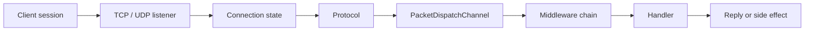
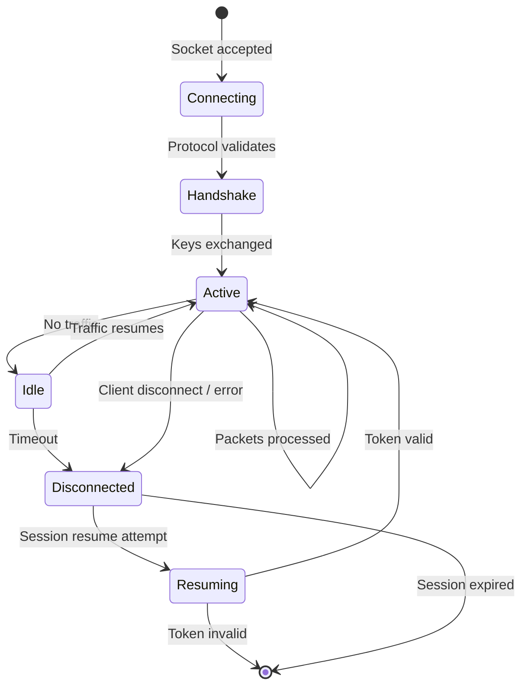

Nalix được thiết kế quanh mô hình máy chủ thời gian thực với các phiên sống lâu, luồng dispatch có thể dự đoán và các điều khiển giới hạn tốc độ tường minh. Trang này giải thích tư duy runtime đứng sau tầng mạng, cách phiên, dispatch và cơ chế bảo vệ phối hợp với nhau.

## Mô hình tư duy



## Vòng đời phiên

Lúc chạy, Nalix duy trì trạng thái cho từng kết nối, chứ không chỉ cho từng thông điệp riêng lẻ. Trạng thái bền vững này là điều giúp các mẫu thời gian thực trở nên khả thi.



Trạng thái kết nối gồm:

| Trạng thái | Mô tả |
| :--- | :--- |
| Connection ID | Định danh duy nhất của phiên |
| Remote endpoint | IP và cổng nguồn |
| Permission level | Mức ủy quyền (`NONE`, `USER`, `TENANT_ADMINISTRATOR`, `SYSTEM_ADMINISTRATOR`, v.v.) |
| Cipher state | Thuật toán mã hóa đang hoạt động và shared secret |
| Diagnostics | Số byte gửi/nhận, thời gian hoạt động, ping, số lỗi |

Đây là lý do `Connection` và `ConnectionHub` nằm ở trung tâm của mô hình thời gian thực.

## Luồng yêu cầu

Một yêu cầu TCP điển hình đi theo đường sau:

1. Socket được chấp nhận bởi `TcpListenerBase`.
2. Listener và protocol đưa kết nối vào luồng nhận đang hoạt động.
3. **Listener** nhận một frame và thực thi `FramePipeline` (giải mã/giải nén).
4. **Protocol** đã được phân giải nhận thông điệp đã xử lý qua `ProcessMessage(...)`.
5. Thông điệp được chuyển vào `PacketDispatchChannel`.
6. Dispatch giải tuần tự hóa gói tin, chạy middleware và gọi handler.
7. Handler trả về hoặc gửi phản hồi.

Với ứng dụng client, mô hình tư duy đơn giản nhất là:

- **TCP** = luồng lệnh/yêu cầu đáng tin cậy, có thứ tự
- **Dispatch** = điểm vào của ứng dụng
- **Middleware** = lớp thực thi chính sách

## Datagram độ trễ thấp (UDP)

Nalix hỗ trợ runtime UDP thông qua `UdpListenerBase` cho các trường hợp không cần độ tin cậy:

| Trường hợp sử dụng | Vì sao dùng UDP |
| :--- | :--- |
| Cập nhật trạng thái game | Các cập nhật vị trí/vận tốc, trong đó giá trị mới nhất quan trọng hơn mọi giá trị |
| Telemetry | Dữ liệu cảm biến hoặc số liệu tần suất cao, chấp nhận mất gói thỉnh thoảng |
| Discovery | Broadcast tìm kiếm dịch vụ |
| Tín hiệu không quan trọng | Heartbeat, ping trạng thái |

Đường UDP vẫn yêu cầu định danh phiên và xác thực. Hãy nghĩ về nó như cùng một logic ứng dụng, nhưng với đặc tính transport khác:

- Phiên phải được thiết lập qua TCP trước
- Mỗi datagram gồm một tiền tố session token
- Connection secret phải được khởi tạo
- `IsAuthenticated(...)` có thể áp dụng các kiểm tra datagram riêng của ứng dụng sau khi kiểm tra token, endpoint và chống phát lại

Các điểm này phản ánh luồng listener có sẵn trong `src/Nalix.Network/Listeners/UdpListener/UdpListener.Receive.cs`, nơi datagram được xác định bằng token trước, sau đó được đối chiếu với trạng thái kết nối đang hoạt động.

## Giới hạn tốc độ và bảo vệ

Hệ thống thời gian thực là hệ thống dễ sập nhanh nhất khi không kiểm soát được áp lực. Nalix tích hợp cơ chế bảo vệ ở nhiều tầng:

| Thành phần | Tầng | Mục đích |
| :--- | :--- | :--- |
| `ConnectionGuard` | Socket | Từ chối endpoint trước khi cấp phát tài nguyên |
| `DatagramGuard` | Transport | Giới hạn gói UDP theo từng IP, không dùng lock (bảo vệ chống UDP Flood) |
| `TokenBucketLimiter` | Dispatch | Bảo vệ trước các đợt tăng đột biến yêu cầu bằng ngân sách burst |
| `PolicyRateLimiter` | Dispatch | Giới hạn tốc độ theo từng opcode và từng endpoint |
| `TimingWheel` | Transport | Quản lý timeout nhàn rỗi với độ phức tạp O(1) để dọn dẹp kết nối |

Đây không phải các tiện ích tùy chọn. Chúng là một phần giúp động cơ ổn định dưới lưu lượng thực tế.

## Metadata gói tin trên đường thời gian thực

Attribute của handler trở thành hành vi lúc chạy thông qua metadata được cache:

```csharp
[PacketOpcode(0x3001)]
[PacketPermission(PermissionLevel.USER)]
[PacketTimeout(3000)]
[PacketRateLimit(requestsPerSecond: 30, burst: 10)]
public ValueTask<PositionAck> HandlePosition(
    IPacketContext<PositionUpdate> context)
{
    // Metadata-driven enforcement happens before this code runs
}
```

Metadata được phân giải một lần khi đăng ký handler, sau đó được tái sử dụng qua dispatch và middleware cho mỗi yêu cầu. Điều này giữ cho đường thời gian thực nhanh và nhất quán.

## Trang tiếp theo nên đọc

- [Kiến trúc](./architecture.md) — Tổng quan các thành phần theo lớp
- [Middleware](./middleware-pipeline.md) — Middleware bộ đệm và middleware gói tin
- [Packet Dispatch](../../api/runtime/routing/packet-dispatch.md) — Tham chiếu API dispatch
- [TCP Request/Response](../../guides/networking/tcp-patterns.md) — Hướng dẫn mẫu TCP
- [UDP Auth Flow](../../guides/networking/udp-security.md) — Hướng dẫn xác thực UDP
