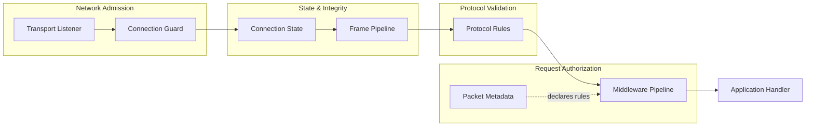

Trang này giải thích các quyết định bảo mật được đưa ra ở đâu trong Nalix và các tầng khác nhau phối hợp với nhau thế nào để bảo vệ ứng dụng của bạn.

## Ánh xạ mã nguồn

- `src/Nalix.Network/Protocols/Protocol.PublicMethods.cs`
- `src/Nalix.Network/Listeners/UdpListener/UdpListener.Receive.cs`
- `src/Nalix.Runtime/Handlers/HandshakeHandlers.cs`
- `src/Nalix.Runtime/Handlers/SessionHandlers.cs`
- `src/Nalix.SDK/Transport/Extensions/HandshakeExtensions.cs`
- `src/Nalix.SDK/Transport/Extensions/ResumeExtensions.cs`

Nalix không coi bảo mật là một tính năng tách biệt. Thay vào đó, bảo mật được phân bố qua các tầng transport, connection, metadata và middleware. Thiết kế này cho phép bạn đặt các kiểm tra ở điểm rẻ nhất và phù hợp nhất trên đường xử lý yêu cầu.

## Các tầng bảo mật



### Tầng 1: Cho phép kết nối ở transport

`ConnectionGuard` hoạt động ở mức socket. Nó có thể từ chối kết nối dựa trên địa chỉ IP, tần suất thử kết nối hoặc các tiêu chí endpoint khác, trước khi bất kỳ tài nguyên ứng dụng nào được cấp phát.

### Tầng 2: Trạng thái kết nối

`Connection` mang ngữ cảnh phiên đang hoạt động, mà nhiều quyết định bảo mật phụ thuộc vào:

- **Permission level** — `PermissionLevel` là enum (ví dụ `NONE`, `USER`, `TENANT_ADMINISTRATOR`, `SYSTEM_ADMINISTRATOR`)
- **Định danh phiên** — Connection ID và session token
- **Trạng thái cipher** — Thuật toán mã hóa đang hoạt động và shared secret
- **Remote endpoint** — IP và cổng nguồn

### Tầng 3: Quy tắc protocol

Triển khai `Protocol` kiểm soát những kết nối nào được chấp nhận (`ValidateConnection`) và cách các frame được xử lý. Các triển khai protocol tùy chỉnh có thể áp dụng thêm quy tắc cho phép kết nối.

### Tầng 4: Metadata của handler

Yêu cầu bảo mật được khai báo trực tiếp trên method handler bằng attribute:

```csharp
using System.Threading.Tasks;
using Nalix.Abstractions.Networking.Packets;

[PacketController("AccountHandlers")]
public sealed class AccountHandlers
{
    [PacketOpcode(0x2001)]
    [PacketPermission(PermissionLevel.USER)]
    [PacketTimeout(5000)]
    [PacketRateLimit(requestsPerSecond: 10)]
    public ValueTask<AccountResponse> GetProfile(
        IPacketContext<ProfileRequest> context)
    {
        // Only executed if permission, timeout, and rate limit checks pass
    }
}
```

Các attribute này được phân giải một lần khi đăng ký handler và được cache dưới dạng `PacketMetadata`. Middleware đọc metadata đã cache tại thời điểm xử lý yêu cầu, không dùng reflection trên hot path.

### Tầng 5: Thực thi bằng middleware

Thực thi ở mức yêu cầu nằm ở middleware gói tin. Middleware có sẵn gồm:

| Middleware | Thực thi |
| :---: | :---: |
| `PermissionMiddleware` | Từ chối gói tin từ kết nối có mức quyền thấp hơn `PermissionLevel` yêu cầu |
| `TimeoutMiddleware` | Hủy việc thực thi handler vượt quá timeout đã khai báo |
| `RateLimitMiddleware` | Giới hạn tốc độ theo opcode và theo endpoint qua `PolicyRateLimiter` và `TokenBucketLimiter` |

Các quy tắc transport mức thấp (kiểm tra giải mã, tính toàn vẹn frame) được thực thi bởi **`FramePipeline`** và tầng **`Protocol`** trước khi giải tuần tự hóa gói tin.

## Handshake và mật mã

Nalix có sẵn luồng thỏa thuận khóa X25519 tích hợp:

1. Client tạo cặp khóa X25519 tạm thời và gửi frame `SessionInit` chứa public key và nonce
2. Server tạo cặp khóa tạm thời của mình, tính shared secret và gửi frame `SessionChallenge`
3. Client xác minh bằng chứng và gửi frame `SessionProof`; server phản hồi bằng `SessionEstablished`
4. Các lưu lượng sau đó được mã hóa bằng trạng thái cipher phiên đang hoạt động

Trạng thái handshake được lưu trên đối tượng `Connection`. Sau khi handshake hoàn tất, `Secret` và trạng thái cipher của kết nối được thiết lập, cho phép mã hóa/giải mã transport một cách trong suốt.

### Chống DDoS bằng Proof-of-Work

Khi bật PoW thích ứng (`ConnectionQuotaOptions.EnableAdaptiveMode`), server tự động tăng độ khó PoW khi tốc độ kết nối tăng. Client phải giải một bài toán Keccak-256 với số bit không đầu bằng 0 trước khi handshake tiếp tục. Điều này trong suốt với client hợp lệ dưới tải bình thường (độ khó = 0), nhưng làm cho các đợt flood kết nối tự động trở nên tốn kém về tính toán trong thời gian bị tấn công.

### Rekey phiên

Các phiên sống lâu có thể đổi khóa đối xứng giữa chừng qua giao thức Session Rekey. Thao tác này đặt lại bộ đếm sequence 16-bit (tránh tràn sau 65.535 frame) và giới hạn cửa sổ phơi lộ mật mã. Cả client và server đều dẫn xuất khóa mới bằng HKDF-Expand với nhãn tĩnh `nalix-session/rekey` từ secret hiện tại, mà không truyền bất kỳ khóa nào qua đường truyền. Quá trình này được khởi tạo bằng gói điều khiển kiểu `SESSION_REKEY` và được xác nhận bằng `SESSION_REKEY_ACK`.

## Session Resume

Giao thức session resume cho phép client kết nối lại mà không phải thực hiện lại toàn bộ handshake. Nó dùng gói `SessionResume` thống nhất với `SessionResumeStage`:

1. Client gửi `SessionResume` với `Stage = REQUEST` và một session token
2. Server xác minh token qua `ISessionStore`
3. Nếu hợp lệ, server khôi phục trạng thái kết nối (quyền, cipher, attribute) và phản hồi với `Stage = RESPONSE`
4. Nếu không hợp lệ, server phản hồi với một `ProtocolReason` cho biết lỗi

## Xác thực UDP

Hãy coi UDP là một đường datagram đã được xác thực, chứ không phải một bản sao kém chặt chẽ của TCP.

Yêu cầu cho lưu lượng UDP an toàn:

- Định danh phiên phải được thiết lập trước
- Mỗi datagram phải có tiền tố session token (8 byte)
- Connection secret phải được khởi tạo
- `IsAuthenticated(...)` phải xác thực datagram trước khi xử lý
- Nên bật kiểm tra chống phát lại

## Tư thế bảo mật được khuyến nghị

Với hầu hết các triển khai production:

1. Thiết lập một phiên đáng tin cậy qua handshake TCP
2. Giữ trạng thái định danh và quyền trên đối tượng `Connection`
3. Khai báo quy tắc ở mức gói tin bằng attribute của handler
4. Thực thi quy tắc bằng pipeline middleware có sẵn
5. Coi UDP là phần mở rộng đã xác thực của một phiên đã được thiết lập
6. Bật `ConnectionGuard` để kiểm soát cho phép kết nối ở mức socket
7. Cấu hình giới hạn tốc độ và cổng đồng thời cho các endpoint công khai

## Trang tiếp theo nên đọc

- [Giao thức Handshake](./handshake-protocol.md) — Chi tiết handshake X25519
- [Session Resumption](./session-resumption.md) — Tham chiếu giao thức resume
- [Permission Levels](../../api/security/permission-level.md) — Tham chiếu enum quyền
- [AEAD and Envelope](../../api/security/aead-and-envelope.md) — API mã hóa
- [UDP Auth Flow](../../guides/networking/udp-security.md) — Hướng dẫn xác thực UDP
- [Custom Middleware](../../guides/extensibility/custom-middleware.md) — Xây dựng middleware bảo mật
