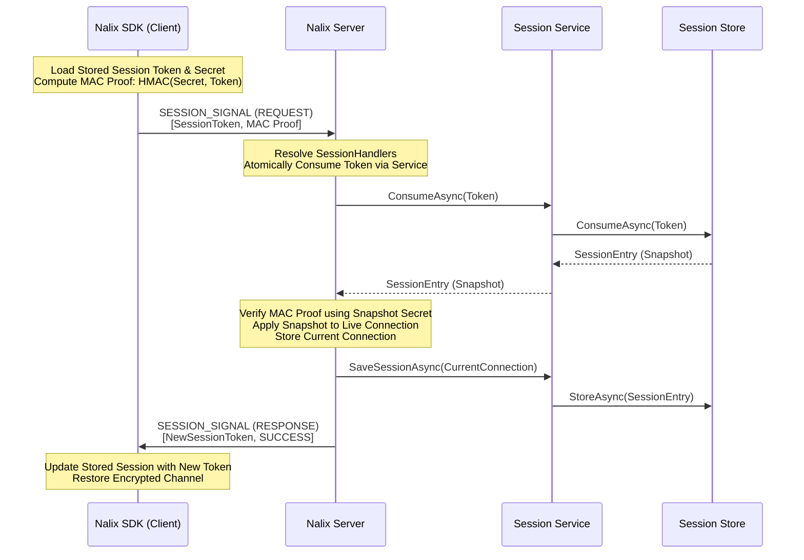

Session Resumption là một giao thức hiệu năng cao trong Nalix, cho phép client kết nối lại và khôi phục trạng thái trước đó mà không cần thực hiện lại [X25519 Handshake](./handshake-protocol.md) đầy đủ. Điều này rất quan trọng với ứng dụng di động, nơi việc chuyển mạng (ví dụ từ Wi-Fi sang 5G) hoặc mất kết nối ngắn là chuyện thường gặp.

## Ánh xạ mã nguồn

- `src/Nalix.Codec/ProtocolFrames/Session/SessionResume.cs`
- `src/Nalix.Runtime/Handlers/SessionHandlers.cs`
- `src/Nalix.SDK/Transport/Extensions/ResumeExtensions.cs`
- `src/Nalix.Runtime/Sessions/SessionService.cs`

## Tính năng chính

- **Kết nối lại nhanh**: Việc resume hoàn tất trong một chu kỳ yêu cầu-phản hồi.
- **Lưu trữ trạng thái**: Khôi phục mức xác thực, quyền và các attribute tùy chỉnh của kết nối.
- **Xoay vòng token**: Mỗi lần resume thành công trả về một session token mới cho lần kết nối lại tiếp theo.
- **Xác thực zero-trust**: Dùng bằng chứng sở hữu dựa trên HMAC để xác minh client thực sự sở hữu session secret.

## Quy trình Resume

Sơ đồ sau minh họa cách **Nalix SDK** dùng token đã lưu để tiếp tục một phiên trên **Nalix Server**.

## Tiêu thụ token nguyên tử

Để ngăn **Race Condition** và các tấn công **Double-Resume**, Nalix dùng cơ chế "Atomic Consumption". Khi một yêu cầu resume đến:

1. Server cố gắng xóa token khỏi `ISessionService` ngay lập tức qua `ConsumeAsync(...)`.
2. Nếu token đã được dùng hoặc không tồn tại, yêu cầu bị từ chối ngay.
3. Điều này bảo đảm một token bị đánh cắp không thể dùng hai lần, ngay cả khi hai yêu cầu đến cùng một mili giây.

## Xoay vòng và bảo mật

`SessionToken` là một "mục tiêu di động". Sau khi resume thành công:

- Token cũ bị vô hiệu hóa nhờ việc tiêu thụ nguyên tử.
- Một token mới được cấp cho client.
- Secret (được dẫn xuất trong handshake ban đầu) vẫn giữ nguyên, duy trì entropy bảo mật cho tầng mã hóa.

## Hướng dẫn triển khai

Mặc định, mô hình Nalix Hosting tự xử lý session resumption. Tuy nhiên, bạn có thể kiểm soát hành vi bằng cách triển khai `ISessionStore` tùy chỉnh (ví dụ dùng Redis cho cụm phân tán).

Để resume hoạt động đầu cuối:

1. Đăng ký hỗ trợ session trên server bằng `UseSessions()`.
2. Đăng ký một store bằng `UseSessionStore(...)` khi service bộ nhớ trong mặc định không đủ.
3. Đặt `SessionStoreOptions.MinAttributesForPersistence` đủ thấp so với metadata mà các phiên đã xác thực thực sự mang theo.
4. Đặt `SessionStoreOptions.SessionTtl` bằng cửa sổ resume mong muốn cho phiên đã ngắt kết nối.
5. Giữ `TransportOptions.ResumeEnabled` được bật trên client, và giữ token `SessionState` cùng secret của client giữa các lần thử kết nối lại.

:::note[Thời gian chờ nhàn rỗi không phải cửa sổ resume]
`TimingWheelOptions.IdleTimeoutMs` đóng một kết nối đang sống khi nó ngừng gửi lưu lượng. `SessionStoreOptions.SessionTtl` quyết định trạng thái phiên đã ngắt kết nối còn có thể resume trong bao lâu sau khi kết nối đã mất. Hai cài đặt này không ngụ ý nhau.
:::

## Chính sách cửa sổ phát lại

Bằng chứng resume là `HMAC-Keccak256(Secret, SessionToken || (UnixSecondsNow() / 30))` — một bucket thời gian 30 giây, được kiểm tra với `t-1`, `t`, `t+1` để chịu được lệch đồng hồ. Trong cửa sổ khoảng 90 giây đó, bằng chứng tự nó mang tính xác định và có thể tái tạo, nhưng phát lại nó không cho phép resume lần thứ hai: `SessionToken` bị tiêu thụ nguyên tử (`ISessionService.ConsumeAsync` → `ConcurrentDictionary.TryRemove`) ở lần thành công **đầu tiên**, nên lần resume thứ hai với cùng token — kể cả khi bằng chứng giống hệt từng byte và vẫn còn hợp lệ — bị từ chối với `SESSION_EXPIRED`. Token, không phải bucket thời gian, là nonce dùng một lần.

Xem `tests/Nalix.Network.Tests/InMemorySessionStoreTests.cs::ConsumeAsync_ReplayedTokenWithinSameTimeBucket_RejectedOnSecondAttempt` và `tests/Nalix.Framework.Tests/Cryptography/SessionResumeProofTests.cs` để thấy hai nửa của đảm bảo này (tiêu thụ nonce so với tính xác định của bằng chứng).

:::caution[Resume không có TLS: một man-in-the-middle đang hoạt động có thể chiếm quyền resume]
Token dùng một lần chỉ chặn lần resume *thứ hai*, không chặn lần *đầu tiên*. Yêu cầu `SessionResume` đi qua đường truyền dưới dạng văn bản thuần, và bằng chứng của nó chỉ gắn với token và bucket thời gian — không gắn với kết nối mới hay thử thách từ server. Một kẻ tấn công nằm trên đường truyền có thể chặn yêu cầu của client và gửi chính các byte đó trước từ kết nối của chúng; khi đó server resume phiên tại kết nối của kẻ tấn công.

Kẻ tấn công đó vẫn không biết session secret, nên không thể đọc lưu lượng hay tạo frame mã hóa mới. Nhưng một lần resume khôi phục **cùng secret** và đặt lại bộ đếm sequence nhận TCP/UDP về `0` (`SessionHandlers.HandleAsync`), nên các frame mã hóa mà kẻ tấn công đã ghi lại từ nạn nhân sẽ lại được chấp nhận — các yêu cầu đã gửi trước đó có thể bị phát lại với mức quyền của nạn nhân. Các frame văn bản thuần cũng đến được handler mà không cần `[PacketEncryption(true)]` (xem [Securing Your Server](../../guides/securing-your-server.md#bắt-buộc-mã-hóa-trên-handler-nhạy-cảm)).

Khi đứng sau TLS (`wss://` hoặc proxy kết thúc TLS), yêu cầu không thể bị quan sát hay chặn, nên rủi ro này không áp dụng. Với TCP thuần không TLS, hãy kết thúc TLS trước Nalix, hoặc tắt resume ở client (`TransportOptions.ResumeEnabled = false`) để mỗi lần kết nối lại đều thực hiện handshake mới.
:::

## Chính sách bọc bộ đếm sequence

Mỗi hướng transport được bảo vệ bởi một `SequenceCounter` đơn điệu, dùng như một phần của nonce AEAD. `SequenceCounter.Next()` ném `CipherException` nếu việc tăng sẽ vượt qua `uint.MaxValue`, từ chối tái sử dụng nonce. Để tránh chạm vào guard này như một lỗi trực tiếp, mọi đường gửi (`TcpFrameSender`, `UdpFrameSender`, `WsFrameSender` ở client; `PacketPipeline.ProcessAndSendAsync` ở server) giờ kiểm tra `ISequenceCounter.IsApproachingOverflow(margin: 1_000_000)` **trước khi** giữ số sequence tiếp theo:

- Phía client: ném `CipherException`, và cơ chế xử lý ngoại lệ không nghiêm trọng hiện có sẽ báo lỗi qua `OnError` và ngắt kết nối — client cần kết nối lại và handshake lại, hoặc gọi `RekeyExtensions.RekeyAsync` chủ động trước thời điểm này để xoay khóa và đặt lại bộ đếm.
- Phía server: gọi trực tiếp `IConnection.Disconnect(...)` để đóng kết nối sạch sẽ thay vì ném ngoại lệ giữa chừng khi gửi.

`ResumeFrom(lastKnownSeq, safetyGap)` (dùng khi khôi phục phiên) bão hòa tại `uint.MaxValue` thay vì quay vòng, nên bộ đếm đã resume không bao giờ có thể âm thầm rơi xuống dưới giá trị cuối đã biết và cấp lại nonce — lần gọi `Next()` kế tiếp sẽ thất bại rõ ràng qua cùng guard tràn.

## Chủ đề liên quan

- [Giao thức Handshake](./handshake-protocol.md)
- [Mô hình mạng](./architecture.md)
- [Session Store APIs](../../api/network/session-store.md)
