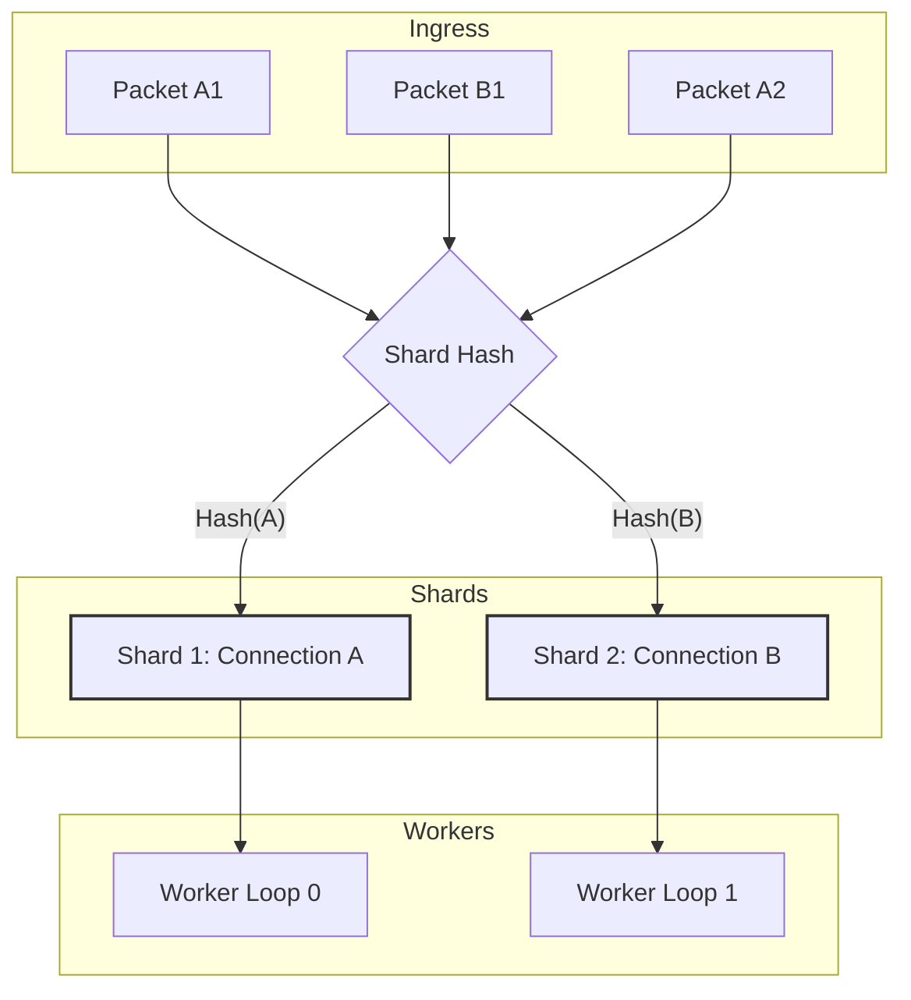

:::warning[Chủ đề nâng cao]
Trang này mô tả đồng bộ hóa đa luồng và các kiến trúc mở rộng song song phức tạp. Nếu bạn mới bắt đầu, hãy xem [Bắt đầu nhanh](../../quickstart.md).
:::

Nalix dùng kiến trúc dispatch nhận biết shard để mở rộng xử lý gói tin trên nhiều lõi CPU, đồng thời giữ thứ tự gửi nghiêm ngặt cho từng kết nối.

:::note[Backbone phía server]
Hệ thống sharding và dispatch là một phần của tầng `Nalix.Runtime`, đóng vai trò backbone hiệu năng cao cho các server dựa trên Nalix. Trong khi SDK lo phần transport và framing, việc điều phối ở Runtime bảo đảm các handler phía server có thể mở rộng trên nhiều lõi mà không gây data race hay mất tính nhất quán tuần tự.
:::


## 1. Mô hình Affinity

Một thách thức cốt lõi trong lập trình mạng hiệu năng cao là giữ thứ tự gói tin trong một phiên (ví dụ luồng TCP hoặc phiên UDP) trong khi vẫn mở rộng số worker. Nalix giải quyết điều này bằng **Hashed Connection Affinity**.

### Cách hoạt động

1. Khi một gói tin đến, `PacketDispatchChannel` xác định `IConnection` nguồn.
2. Kết nối được ánh xạ vào một **shard queue** nội bộ cụ thể dựa trên hash của nó.
3. Mỗi shard chỉ được xử lý độc quyền bởi một trong các **Worker Loop** đã cấu hình tại mọi thời điểm.
4. Nhờ đó, các gói tin từ Kết nối A không bao giờ "vượt" nhau, ngay cả khi server có 64 lõi.



---

## 2. Cấu hình shard cho production

Bạn có thể điều chỉnh mức song song của ứng dụng bằng cách thay đổi số shard (worker loop) trong hosting builder.

### Danh sách kiểm tra tối ưu cho production

| Tùy chọn | Mặc định | Chiến lược điều chỉnh |
| --- | --- | --- |
| `Drain.Count` (`WithDispatchLoopCount`) | `0` / `null` (tự động) | Đặt tường minh để có số loop xác định, hoặc giữ chế độ tự động. |
| `MinDispatchLoops` / `MaxDispatchLoops` | `1` / `64` | Giới hạn việc chọn số loop tự động theo năng lực của host. |
| `MaxDrainPerWake` | `2,048` | Giới hạn trên cho drain budget. Drain thực tế dùng `Clamp(ProcessorCount * MaxDrainPerWakeMultiplier, MinDrainPerWake, MaxDrainPerWake)`. |
| `MaxDrainPerWakeMultiplier` | `5` | Hệ số nhân với `ProcessorCount` để tính drain budget thực tế cho mỗi chu kỳ đánh thức. |

```csharp
using Nalix.Hosting;

var builder = NetworkApplication.CreateBuilder();

builder.ConfigureDispatchOptions(options =>
{
    // 1. Core Affinity: Match physical cores to avoid context switching
    options.WithDispatchLoopCount(Environment.ProcessorCount / 2);
    
    // 2. Auto-mode guardrails (used only when the loop count is auto)
    options.Drain.MinDispatchLoops = 2;
    options.Drain.MaxDispatchLoops = 32;

    // 3. Throughput Tuning: Process 16 packets per wake to improve cache locality
    options.Drain.MaxDrainPerWakeMultiplier = 16;
});
```

---

## 3. Tương tác nâng cao

### Ảnh hưởng đến độ ưu tiên của shard

Trong khi một shard xử lý gói tin tuần tự, nó **nhận biết độ ưu tiên**. Mỗi shard duy trì nhiều hàng đợi nội bộ (Urgent, High, Normal, Low).

Một `Protocol` tùy chỉnh có thể ảnh hưởng hàng đợi mà gói tin rơi vào bằng cách đặt **Priority Byte** trong header Nalix trước khi chuyển giao:

```csharp
using Nalix.Abstractions.Networking;
using Nalix.Abstractions.Networking.Packets;
using Nalix.Framework.Memory.Buffers;

public override void ProcessMessage(object sender, IConnectionEventArgs args)
{
    IBufferLease lease = args.Lease;
    
    // Example: Elevate priority for Handshake or Control packets
    if (IsHighPriority(lease))
    {
        // 3 is the Priority offset in the Nalix header (OpCode:2, Flags:1)
        lease.Span[3] = (byte)PacketPriority.HIGH;
    }
    
    _dispatch.HandlePacket(lease, args.Connection);
}
```

### Logic sharding tùy chỉnh và Shard Key

Hệ thống dispatch xác định "Shard Key" theo **Object Identity** của instance `IConnection` được truyền vào dispatcher. Mặc định, mỗi kết nối socket vật lý có identity riêng và do đó có shard riêng.

Để triển khai logic sharding tùy chỉnh (ví dụ affinity theo người dùng hoặc theo phòng), bạn phải dùng một **Shard Proxy** (còn gọi là Virtual Connection).

#### Cách triển khai Shard Proxy:

1. **Định nghĩa một instance dùng chung**: Tạo một instance duy nhất của đối tượng đại diện cho shard (ví dụ `UserContext` hoặc `RoomContext`).
2. **Truyền proxy vào dispatch**: Thay vì truyền kết nối vật lý thô vào `_dispatch.HandlePacket`, hãy truyền instance proxy dùng chung.
3. **Bảo đảm tuần tự**: Vì cả hai kết nối vật lý cùng dùng một instance proxy, chúng chia sẻ cùng `ConnectionState` nội bộ trong dispatcher, nên đảm bảo không bao giờ được xử lý song song.

#### Tình huống production: Affinity theo người dùng

Nếu một người chơi đăng nhập từ nhiều thiết bị (ví dụ điện thoại và máy tính bảng), và bạn cần bảo đảm trạng thái của họ được cập nhật tuần tự trên mọi thiết bị để tránh race condition trong cơ sở dữ liệu hoặc logic game.

```csharp
using Nalix.Abstractions.Networking;
using Nalix.Framework.Memory.Buffers;

// A minimal proxy that the dispatcher uses as a Shard Key
public sealed class UserShardProxy : IConnection
{
    // The physical connection we are currently wrapping (if needed for sending)
    public IConnection PhysicalConnection { get; }
    public long UserID { get; }

    public UserShardProxy(long userId, IConnection physical)
    {
        UserID = userId;
        PhysicalConnection = physical;
    }

    // DISPATCHER NOTE: The dispatcher uses RuntimeHelpers.GetHashCode(connection)
    // for bucket selection. For the proxy to work as a shard key, you MUST
    // reuse the SAME object instance for all connections belonging to the same Shard.
    
    // Delegate required members...
    public ulong ConnectionId => PhysicalConnection.ConnectionId;
    public INetworkEndpoint NetworkEndpoint => PhysicalConnection.NetworkEndpoint;
    // ... other IConnection members
}

// In your Protocol or Middleware:
public void RouteToUserShard(IConnection rawConnection, IBufferLease packet)
{
    // Retrieve the shared proxy instance from your session manager.
    // Ensure this returns the EXACT SAME instance for the same UserId.
    var proxy = SessionManager.GetOrCreateUserShard(rawConnection.UserId!);
    
    // The dispatcher now treats all packets for this 'proxy' instance 
    // as a single sequential stream (Shard).
    _dispatch.HandlePacket(packet, proxy);
}
```

:::tip[Hướng dẫn triển khai đầy đủ]
Để xem ví dụ đầy đủ từng bước về cách triển khai `ShardProxy` và đăng ký một router tùy chỉnh trong hosting builder, hãy xem [Hướng dẫn Custom Packet Router](../../guides/extensibility/custom-packet-router.md).
:::

---

## 4. Xử lý lỗi và backpressure

Một thiết lập production đáng tin cậy phải xử lý các lỗi dispatch và ngoại lệ theo từng gói tin một cách nhẹ nhàng.

### Hook lỗi toàn cục

Đăng ký một observer toàn cục để bắt các ngoại lệ thoát khỏi logic handler, trước khi chúng kích hoạt lỗi ở mức protocol:

```csharp
using Nalix.Hosting;
using Nalix.Abstractions.Networking.Packets;

builder.ConfigureDispatchOptions(options =>
{
    options.WithErrorHandling((exception, opCode) => 
    {
        Log.Error($"Dispatch failed for OpCode 0x{opCode:X4}: {exception.Message}");
    });
});
```

### Backpressure với DispatchOptions + DropPolicy

Backpressure của hàng đợi theo từng kết nối được điều khiển bởi `DispatchOptions` (`MaxPerConnectionQueue` + `DropPolicy`):

- **DropNewest**: Từ chối gói tin đến. An toàn nhất cho độ trễ thời gian thực.
- **DropOldest**: Xóa phần đầu của hàng đợi để nhường chỗ. Bảo đảm dữ liệu luôn mới.
- **Coalesce**: Bỏ các gói tin trùng lặp (theo khóa) và chỉ giữ gói mới nhất. Hữu ích cho khối lượng công việc đồng bộ snapshot trạng thái.
- **Block**: Chờ chỗ trống trong hàng đợi chỉ trên các đường mã gọi `PushCore(..., noBlock: false)`. Đường `PacketDispatchChannel.HandlePacket(...)` hiện tại dùng `noBlock: true`, nên tràn ở chế độ block sẽ thất bại nhanh thay vì làm treo luồng listener.

:::warning
`DropPolicy.Block` vẫn là chính sách rủi ro đối với các tích hợp dispatch tùy chỉnh gọi trực tiếp đường chặn. Tuy nhiên, trên điểm vào dispatch gói tin thông thường, mã nguồn hiện tại chọn ngữ nghĩa thất bại nhanh thay vì chặn luồng đọc transport.
:::

---

## 5. Giám sát sức khỏe shard

Dùng các báo cáo chẩn đoán có sẵn để xác định điểm nóng hoặc shard mất cân bằng.

```csharp
// Get a human-readable report of shard status
string report = dispatchChannel.GenerateReport();
Console.WriteLine(report);
```

Báo cáo cung cấp:

- **Total Packets**: Tổng tải trên tất cả các shard.
- **Ready Connections**: Các kết nối đang chờ worker lấy việc.
- **Top Connections**: Các kết nối có nhiều công việc chờ nhất trong hàng đợi shard của chúng.

---

## Thực hành tốt nhất

- **Tránh chặn shard**: Không bao giờ dùng `Thread.Sleep()` hoặc các khối đồng bộ dài trong handler. Vì một worker chỉ xử lý một shard tại một thời điểm, một worker bị chặn sẽ làm đông cứng mọi kết nối được gán cho shard đó.
- **Mở rộng theo CPU**: Hướng tới `DispatchLoopCount` gần với số lõi vật lý của bạn đối với logic bị giới hạn bởi CPU.
- **Gom lô**: Dùng cài đặt `MaxDrainPerWake` để điều chỉnh "độ mịn" của các worker loop. Lô lớn hơn cải thiện cache locality nhưng có thể gây jitter.
