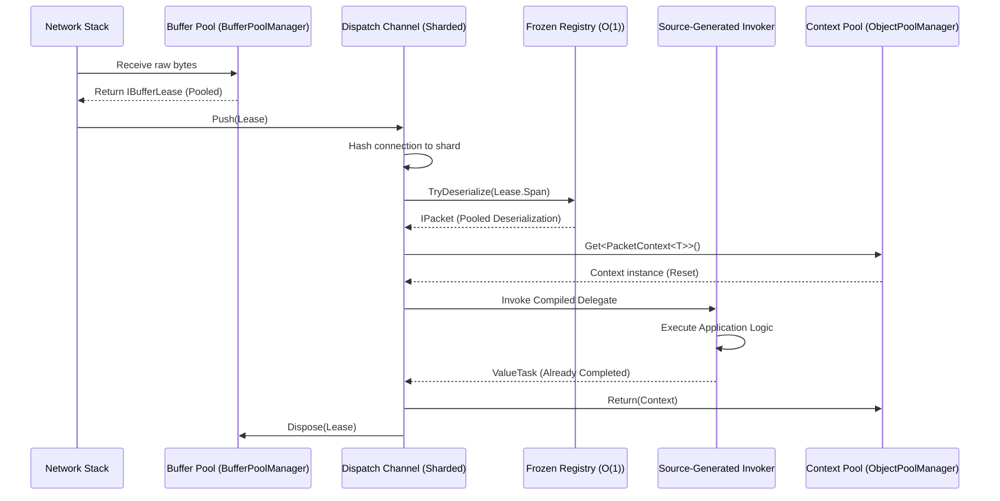

:::warning[Chủ đề nâng cao]
Trang này mô tả các tối ưu hiệu năng cực đoan và vòng đời bộ nhớ ở mức thấp. Nếu bạn mới bắt đầu, hãy xem [Bắt đầu nhanh](../../quickstart.md).
:::

Để hỗ trợ hàng nghìn kết nối đồng thời với độ trễ dưới mili giây, Nalix triển khai một "Zero-Allocation Hot Path". Trong lúc lưu lượng cao điểm, vòng lặp mạng cốt lõi thực thi mà không kích hoạt bất kỳ cấp phát nào trên managed heap.

## Hành trình tích hợp



---

## 1. Định nghĩa gói tin hiệu quả

Hiệu năng cao bắt đầu từ cách bạn định nghĩa dữ liệu. Dùng `SerializeLayout.Explicit` để framework có thể dùng các bộ giải tuần tự hóa bit-blitting chuyên biệt.

```csharp
using Nalix.Codec.DataFrames;
using Nalix.Abstractions.Serialization;

[GenerateFormatter]
[SerializePackable(SerializeLayout.Explicit)]
public sealed partial class HighFreqUpdate : PacketBase<HighFreqUpdate>, IFixedSizeSerializable, IPacketStaticOpcode
{
    public static ushort StaticOpCode => 0x5001;

    [SerializeOrder(0)] public int EntityId { get; set; }
    [SerializeOrder(1)] public float PositionX { get; set; }
    [SerializeOrder(2)] public float PositionY { get; set; }
}
```

:::tip
Dùng `struct` cho các gói tin nhỏ, tần suất cao đảm bảo chúng nằm trên stack hoặc trong `PacketContext` có pool, tránh hoàn toàn cấp phát trên heap.
:::

## 2. Thiết lập và biên dịch

Nalix "nung" các handler và tra cứu gói tin trong lúc khởi động, do `NetworkApplicationBuilder` xử lý tự động:

1. **Registry chỉ mục trực tiếp** — `PacketRegistry` dùng metadata do source generator (`PacketRegistryGenerator`) sinh ra để điền một bảng chỉ mục trực tiếp `PacketDeserializer?[65536]` (`s_table[opcode]`) và các delegate dispatch nhanh đã ghép, phục vụ tra cứu O(1) không cấp phát.
2. **Dispatch do source generator sinh ra** — `PacketHandlerGenerator` sinh các delegate invoker không cấp phát tại thời điểm biên dịch, loại bỏ chi phí reflection.

```csharp
using Nalix.Hosting;

var app = NetworkApplication.CreateBuilder()
    .MapHandlers<GameController>() // invokers generated at build time
    .Build(); // lookups frozen at startup
```

Nếu bạn không dùng tầng hosting, hãy điền thủ công các tùy chọn dispatch:

```csharp
var channel = new PacketDispatchChannel(options =>
{
    options.WithHandler(() => new MyController());
});
```

Về mặt khái niệm, trình biên dịch biến method handler của bạn thành một delegate tĩnh như sau:

```csharp
public static ValueTask<object?> CompiledInvoker(object? instance, PacketContext<HighFreqUpdate> ctx)
    => ((MyController)instance!).HandleUpdate(ctx);
```

Delegate này được cache trong một `FrozenDictionary`, cho tra cứu O(1) với chi phí thấp hơn `Dictionary` thông thường.

## 3. Quy trình pooling

### Thuê bộ đệm

Dữ liệu đến được lưu trong một `BufferLease` dựa trên `ArrayPool<byte>.Shared` thông qua `BufferPoolManager`, với căn chỉnh bucket theo lũy thừa của hai và một byte sentinel chẩn đoán (`0xA5`) để phát hiện tràn bộ đệm khi lease được trả về. Chính các vỏ `BufferLease` cũng được pool qua free-list lock-free với bộ đếm nguyên tử O(1).

```csharp
using BufferLease lease = BufferLease.Rent(1024);
// use lease.Span for zero-copy slicing
```

### Tạo gói tin đi

Khi gửi một gói tin, đừng dùng `new byte[]` — hãy thuê một lease, tuần tự hóa vào đó, rồi gửi lát bộ nhớ:

```csharp
[PacketOpcode(0x5002)]
public async ValueTask SendResponse(IPacketContext<MyPacket> context)
{
    var response = new MyResponse { Status = 200 };

    using var lease = BufferLease.Rent(response.Length);
    int written = response.Serialize(lease.SpanFull);
    lease.CommitLength(written);

    await context.Connection.TCP.SendAsync(lease.Memory);
}
```

### Object pooling (không lock / không cấp phát)

Nalix pool metadata context đến và các đối tượng hot-path khác bằng mô hình `ObjectPool` lai:

- **Cache cục bộ theo luồng, không lock** — `ThreadLocalCache<T>` bỏ qua pool trung tâm, lưu và lấy trên cùng một luồng mà không có chi phí đồng bộ hóa.
- **Phân giải ID theo chỉ mục phẳng** — ID kiểu lúc biên dịch (`PoolType<T>.Id`) trỏ trực tiếp vào một mảng pool được cấp phát sẵn, loại bỏ lock, quét hay tính băm khi tra cứu kiểu generic.

Điều này bảo đảm việc thuê và trả đối tượng chạy trong khoảng ~22 ns với 0 B được cấp phát.

### Mẫu: handler hiệu năng cao

Để giữ đường xử lý không cấp phát, handler của bạn phải:

1. **Nhận `IPacketContext<T>`** — dùng context có pool và gói tin (có thể là struct).
2. **Hoàn thành đồng bộ khi có thể** — nếu buộc phải `await`, chỉ await một `ValueTask`/`Task` mà bạn biết đã hoàn thành.
3. **Tránh closure** — lambda bắt biến cục bộ sẽ cấp phát một đối tượng closure.

```csharp
[PacketOpcode(0x5001)]
public ValueTask HandleUpdate(IPacketContext<HighFreqUpdate> context)
{
    var packet = context.Packet;
    GlobalState.UpdateEntity(packet.EntityId, packet.PositionX, packet.PositionY);
    return ValueTask.CompletedTask;
}
```

:::danger[Rủi ro hủy bỏ và use-after-free]
Khi viết handler bất đồng bộ (`async ValueTask`), bạn **phải** truyền `context.CancellationToken` vào mọi lệnh I/O (như `SendAsync`).

**Vì sao?** Nalix dùng cache `ObjectPool` rất tích cực cho mọi gói tin. Nếu kết nối bị rớt, dispatcher ngay lập tức hủy pipeline đang chờ và trả gói tin về pool. Nếu lệnh `SendAsync` của bạn không nhận cancellation token, nó sẽ trở thành một task mồ côi, tiếp tục đọc từ một gói tin đã được pool xóa hoặc đã được gán cho kết nối mới — gây ra `ArgumentException` (ví dụ "Buffer too small") hoặc hỏng bộ nhớ.
:::

### Mẫu: đường cực nóng (bỏ qua bộ nhớ thô của `IProtocol` tùy chỉnh)

Với các gói tin mà ngay cả giải tuần tự hóa bit-blitting cũng quá tốn kém (ví dụ media streaming, lưu lượng proxy đã mã hóa), hãy bỏ qua `PacketDispatchChannel` và `PacketRegistry` bên trong triển khai `Protocol.ProcessMessage(...)` của bạn, và thao tác trực tiếp trên `args.Lease.Span`:

```csharp
public override void ProcessMessage(object? sender, IConnectionEventArgs args)
{
    ReadOnlySpan<byte> raw = args.Lease.Span;
    if (raw.AsHeaderRef().OpCode == 0x7001)
    {
        // Points directly to the pooled IBufferLease.Span with zero deserialization.
        ProcessRawStream(raw, args.Connection);
        return;
    }

    _dispatch.HandlePacket(args.Lease, args.Connection);
}
```

:::important[Bảo mật so với hiệu năng]
Bỏ qua `PacketDispatchChannel` cũng bỏ qua việc thực thi middleware (`[PacketPermission]`, `[PacketRateLimit]`, `[PacketEncryption]`). Chỉ dùng cách này cho các luồng đã được xác thực.
:::

## 4. Đồng thời công bằng và quản lý độ ưu tiên

Để xử lý hàng nghìn kết nối đồng thời mà không để một loại gói tin lưu lượng lớn (như cập nhật di chuyển) chiếm hết CPU, Nalix dùng hệ thống dispatch chia shard và nhận biết độ ưu tiên.

**Thread affinity**: mọi gói tin từ một kết nối được xử lý tuần tự trên cùng một lõi, tránh race condition mà không cần lock. **Song song**: các kết nối khác nhau được phân bổ trên tất cả các lõi có sẵn.

```csharp
builder.ConfigureDispatchOptions(options => {
    // Match shards to CPU cores (default: Environment.ProcessorCount)
    options.WithDispatchLoopCount(Environment.ProcessorCount);
    // Increase the budget of packets processed per core wake-up
    options.Drain.MaxDrainPerWakeMultiplier = 12;
});
```

Nalix cũng triển khai lập lịch theo kết nối **có trọng số độ ưu tiên** qua 5 hàng đợi ưu tiên (`URGENT`, `HIGH`, `MEDIUM`, `LOW`, `NONE`): nếu một client làm ngập server bằng gói tin độ ưu tiên thấp, các gói tin độ ưu tiên cao vẫn được xử lý trước.

```csharp
[GenerateFormatter]
[SerializePackable(SerializeLayout.Explicit)]
public sealed partial class UrgentAlert : PacketBase<UrgentAlert>, IPacketStaticOpcode
{
    public static ushort StaticOpCode => 0x9001;

    public UrgentAlert()
    {
        Priority = PacketPriority.URGENT;
    }
}
```

Cấu hình backpressure theo kết nối và chính sách bỏ gói tin qua `DispatchOptions` (section `[Dispatch]` trong `assets/config.ini`):

```ini
[Dispatch]
MaxPerConnectionQueue = 1024
DropPolicy = DropNewest
BlockTimeout = 00:00:01
```

## 5. Xử lý lỗi không cấp phát

Xử lý ngoại lệ có thể tốn kém. Ngoại lệ chuẩn tốn chi phí do phải tạo stack trace — Nalix cache các ngoại lệ transport thường gặp (`ConnectionReset`, `SendFailed`, `MessageTooLarge`, `UdpPayloadTooLarge`, `UdpPartialSend`, `UdpSendFailed`) dưới dạng các trường static readonly thông qua lớp `Throw`, ghi đè `StackTrace` để bỏ qua việc quét stack tốn kém. `Throw.GetSocketError(SocketError)` trả về một `SocketException` đã cache cho các lỗi OS chuẩn.

Với các lỗi nghiệp vụ, hãy ưu tiên trả về một đối tượng kết quả thay vì ném ngoại lệ:

```csharp
public ValueTask<LoginResult> HandleLogin(LoginRequest request)
{
    if (!Valid(request))
        return ValueTask.FromResult(LoginResult.InvalidCredentials);
    // ...
}
```

Thay vì `try-catch` cho từng gói tin, hãy đăng ký một observer toàn cục — chỉ được gọi khi handler ném ngoại lệ:

```csharp
using Nalix.Hosting;

builder.ConfigureDispatchOptions(options =>
{
    options.WithErrorHandling((exception, opCode) =>
    {
        Logger.Error($"OpCode 0x{opCode:X4} failed: {exception.Message}");
        Metrics.HandlerErrors.WithLabels(opCode.ToString()).Inc();
    });
});
```

Mỗi kết nối tự theo dõi số lỗi của mình — Nalix gọi `connection.IncrementErrorCount()` mỗi khi một handler ném ngoại lệ. Bạn có thể theo dõi điều này trong middleware để ngắt kết nối của các client không ổn định mà không tốn thêm cấp phát nào:

```csharp
public sealed class HealthGuardMiddleware : IPacketMiddleware<IPacket>
{
    public async ValueTask InvokeAsync(IPacketContext<IPacket> context, Func<CancellationToken, ValueTask> next)
    {
        if (context.Connection.ErrorCount > 10)
        {
            context.Connection.Disconnect("Protocol violation threshold exceeded.");
            return;
        }
        await next(context.CancellationToken);
    }
}
```

## 6. Nguyên thủy tối ưu SIMD

Hướng không cấp phát cũng áp dụng cho các kiểm tra nguyên thủy mật mã. Mảng `byte[]` cấp phát bộ nhớ trên heap và cần so sánh tuần tự chậm. Nalix triển khai các kiểu giá trị tùy chỉnh như `Bytes32` cho payload 256-bit nghiêm ngặt (session secret, khóa X25519, hash handshake), dùng các intrinsic phần cứng AVX2/SSE2 để so sánh O(1) trực tiếp trên thanh ghi CPU:

```csharp
[MethodImpl(MethodImplOptions.AggressiveOptimization)]
public readonly bool Equals(Bytes32 other)
{
    if (Avx2.IsSupported)
    {
        // 256-bit AVX2 hardware acceleration — compares 32 bytes in a single CPU cycle
        Vector256<byte> v = Unsafe.ReadUnaligned<Vector256<byte>>(ref a);
        Vector256<byte> o = Unsafe.ReadUnaligned<Vector256<byte>>(ref b);
        // ...
    }
}
```

Điều này khiến các điểm kiểm tra bảo mật cốt lõi (như so sánh bằng chứng MAC HMAC khi session resumption) thực thi trong phần nhỏ của nano giây, miễn nhiễm với tấn công kênh bên dựa trên thời gian và với garbage collection.

## Xác minh không cấp phát

Xác minh một khối mã không cấp phát bộ nhớ nào trong unit test hoặc integration test:

```csharp
long startingBytes = GC.GetAllocatedBytesForCurrentThread();
await RunLoadTestAsync(); // e.g. dispatch 10,000 packets
long allocated = GC.GetAllocatedBytesForCurrentThread() - startingBytes;
Assert.Equal(0, allocated);
```

Hoặc dùng `MemoryDiagnoser` của BenchmarkDotNet để xác nhận handler thực sự "xanh" (0 B được cấp phát):

```csharp
[MemoryDiagnoser]
public class ProtocolBenchmarks
{
    [Benchmark]
    public async ValueTask HandlePacket()
        => await _dispatch.ExecutePacketHandlerAsync(_testPacket, _mockConnection);
}
```

## Giám sát nâng cao

- **Sức khỏe pool bộ đệm** (`BufferPoolManager`) — Bật `BufferOptions.EnableBufferLeakDetection` trên môi trường staging để bắt mọi instance `BufferLease` không được trả về vượt quá `SuspiciousThresholdSeconds`.
- **Sức khỏe dispatch** (`PacketDispatchChannel`) — `WakeSignals` cao so với số gói đã xử lý cho thấy batching hiệu quả; số `Ready Connections` tăng dần nghĩa là handler quá chậm hoặc `DispatchLoopCount` quá thấp.
- **Giám sát bằng CLI** — `dotnet-counters monitor -p <PID> --counters Nalix.Framework,System.Runtime[alloc-rate,gen-0-gc-count]`.

## Danh sách tóm tắt

- [x] Dùng `struct` hoặc `class` có pool cho gói tin.
- [x] Dùng `IPacketContext<T>` để tận dụng pooling ở mức frame.
- [x] Gắn `[PacketController]` cho các controller.
- [x] Dùng `[PacketOpcode]` để định tuyến không dùng reflection.
- [x] Dùng nguyên thủy SIMD (`Bytes32`) cho các kiểm tra bảo mật.
- [x] Trả về `ValueTask` từ handler.
- [x] Tránh `new`, LINQ và closure bên trong handler.
- [x] Dùng `Throw` để truyền ngoại lệ không cấp phát.
- [x] Xác minh bằng `[MemoryDiagnoser]` của BenchmarkDotNet.
