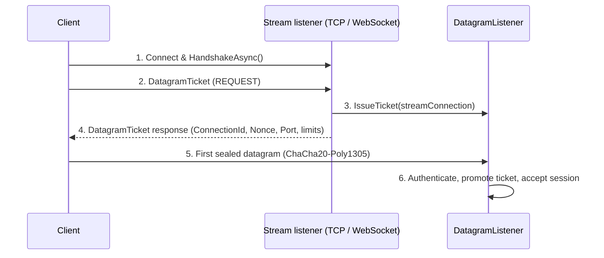

:::warning[Chủ đề nâng cao]
Trang này đề cập đến các chi tiết protocol ở mức thấp của transport datagram.
:::

Hướng dẫn này giải thích cấu trúc phiên mà `DatagramListener` và `DatagramSession` (Nalix Datagram Protocol, NDP qua UDP) đang sử dụng, theo cách dễ hiểu với client.

Hãy dùng nó khi bạn đã biết mình cần UDP và muốn hiểu các quy tắc về tin cậy và chống phát lại trước khi triển khai client.

## Ánh xạ mã nguồn

- `src/Nalix.Network/Listeners/Datagram/DatagramListener.Receive.cs`
- `src/Nalix.Network/Listeners/Datagram/DatagramListener.PublicMethods.cs`
- `src/Nalix.Runtime/Handlers/DatagramTicketHandlers.cs`
- `src/Nalix.Codec/Security/Datagram/DatagramKeySchedule.cs`
- `src/Nalix.SDK/Transport/DatagramSession.cs`

## Runtime mong đợi điều gì

Một phiên datagram được gắn với một stream session đã xác thực (TCP hoặc WebSocket) thông qua một **ticket** dùng một lần:

1. Client yêu cầu một ticket qua stream session (`DatagramTicket`, giai đoạn `REQUEST`). Máy chủ từ chối kèm một `ProtocolReason` khi handshake chưa hoàn tất (`UNAUTHENTICATED`), khi yêu cầu đã đến từ một phiên datagram (`STATE_VIOLATION`), hoặc khi không có datagram listener nào đang chạy (`SERVICE_UNAVAILABLE`).
2. `IDatagramTicketIssuer.IssueTicket(...)` chụp lại người dùng, mức quyền, thuật toán và secret của kết nối stream, tạo một nonce ngẫu nhiên 16 byte và trả về một `DatagramTicketInfo` (`ConnectionId`, `Nonce`, `Port`, `ExpiresInSeconds`, `IdleTimeoutMs`, `MaxMessageSize`, `ChannelCount`, `ReceiveBufferBytes`, `ChannelReceiveBufferBytes`). Mỗi kết nối stream chỉ có một ticket đang chờ: yêu cầu mới sẽ thay thế ticket trước.
3. Cả hai phía dẫn xuất khóa phiên từ secret của stream, connection id và nonce của ticket bằng HKDF xây dựng trên Keccak-256 (`DatagramKeySchedule`), với các secret riêng cho chiều client-đến-máy-chủ và máy-chủ-đến-client.
4. Mỗi datagram được niêm phong bằng ChaCha20-Poly1305 (`ChaCha20Poly1305DatagramProtection`). Chỉ có connection id được truyền ở dạng văn bản rõ.
5. Datagram đầu tiên phải được xác thực trong vòng `DatagramOptions.TicketLifetimeSeconds` (mặc định `10`); sau đó ticket đang chờ được nâng lên thành một phiên.

Trong mã nguồn (`DatagramListener.Receive.cs`), listener:

- loại bỏ các datagram dài hơn `DatagramEngine.MaxDatagramSize` (`1472` byte) hoặc có header sai định dạng (`DroppedMalformed`)
- loại bỏ các datagram có connection id không thuộc phiên nào và cũng không thuộc ticket đang chờ nào (`DroppedUnknown`)
- loại bỏ các datagram không qua được bước xác thực hoặc giải mã (`DroppedUnauthenticated`)
- hỏi `ConnectionGuard`, khi có cấu hình, trước khi chấp nhận phiên (`TotalGuardRejections`)

Chống phát lại là một phần của engine phiên (một cửa sổ phát lại bên trong `DatagramEngine`), và các phiên sống lâu sẽ xoay khóa sau `KeyUpdatePacketInterval` gói tin hoặc `KeyUpdateIntervalMs` mili giây.

## Luồng tổng quan



## Cấu trúc phía máy chủ

Host listener bằng builder; không có gì để kế thừa:

```csharp
using var app = NetworkApplication.CreateBuilder()
    .UseSecureConnections()
    .MapTcp<MyProtocol>().OnPort(57206).Bind()
    .MapDatagram<MyProtocol>().OnPort(57206).Bind()
    .Build();
```

`MapDatagram<T>()` cũng ánh xạ `DatagramTicketHandlers`, và chỉ có thể gọi một lần cho mỗi ứng dụng.

### Giữ stream session và datagram session gắn với nhau

Phiên datagram sống độc lập sau khi được chấp nhận: đóng kết nối stream không đóng nó. Mỗi `DatagramConnection` có `StreamConnectionId`, vì vậy khi kick hoặc đổi mức quyền, bạn cũng phải ngắt các kết nối datagram có `StreamConnectionId` trùng khớp.

## Cấu trúc phía client

```csharp
using TcpSession tcp = new(tcpOptions);
await tcp.ConnectAsync(host, port);
await tcp.HandshakeAsync();

// DatagramSession yêu cầu ticket qua phiên stream và tự dẫn xuất khóa của nó.
using DatagramSession udp = new(tcp);
await udp.ConnectAsync();           // host mặc định là địa chỉ của stream, port mặc định là ticket.Port
await udp.SendAsync(packet);
await udp.SendAsync(packet, DeliveryMethod.ReliableOrdered, channel: 0);
```

`ConnectAsync` ném `NetworkException` khi ticket bị từ chối hoặc phiên không được thiết lập trước khi ticket hết hạn. Các tham số `encrypt` của các phương thức gửi bị bỏ qua vì mỗi datagram đã được phiên niêm phong sẵn.

## Quy tắc transport

Với client, điều đó có nghĩa là:

- hoàn tất handshake của stream trước; secret của datagram được dẫn xuất từ đó
- giữ mỗi datagram trong giới hạn `DatagramEngine.MaxDatagramSize` (`1472` byte); thông điệp lớn hơn được engine phân mảnh, tối đa đến `MaxMessageSize` của ticket
- chọn `DeliveryMethod` và kênh cho từng thông điệp khi bạn cần độ tin cậy hoặc thứ tự
- coi UDP là đường datagram nhanh gắn với một stream session đã thiết lập, chứ không phải một giao thức xác thực độc lập

## Điều gì xảy ra khi thất bại

Listener ghi lại chẩn đoán cho:

- datagram sai định dạng
- phiên không xác định
- datagram chưa được xác thực
- lỗi nhận

Các datagram không hợp lệ bị loại bỏ trước khi đến logic protocol của bạn.

## Các trang liên quan

- [UDP Listener](../../api/network/datagram-listener.md)
- [UDP Session](../../api/sdk/datagram-session.md)
- [Connection Hub](../../api/network/connection/connection-hub.md)
- [Network Options](../../api/options/network/options.md)
