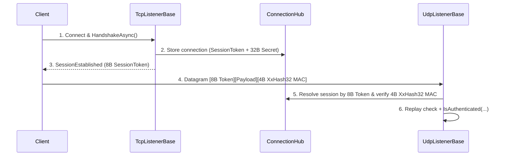

:::warning[Chủ đề nâng cao]
Trang này đề cập đến việc ghép kênh protocol ở mức thấp và các triển khai listener tùy chỉnh.
:::

Hướng dẫn này giải thích cấu trúc session UDP thực tế mà `UdpListenerBase` đang sử dụng, theo cách dễ hiểu với client.

Hãy dùng nó khi bạn đã biết mình cần UDP và muốn hiểu các quy tắc về tin cậy và chống phát lại trước khi triển khai client.

## Runtime mong đợi điều gì

Khi `UdpListenerBase` nhận một datagram, nó mong đợi một lớp bọc xác thực 12 byte bao quanh gói tin Nalix đã tuần tự hóa (kích thước datagram tối thiểu là **18 byte** = `SessionTokenSize (8) + PacketHeader.Size (6) + UdpMacTagSize (4)`):

- session token (`Snowflake`, 8 byte tại `[0..8]`)
- payload (tối thiểu là `PacketHeader` 6 byte của Nalix tại `[8..^4]`: `[OpCode(2), Flags(1), Priority(1), SequenceId(2)]`)
- thẻ xác thực `XxHash32` (4 byte tại `[^4..^0]`)

Trong mã nguồn (`UdpListener.Receive.cs`), listener kiểm tra:

- datagram dài ít nhất `18` byte (`8` token + `6` `PacketHeader.Size` + `4` thẻ `XxHash32`)
- token 8 byte phân giải được thành một kết nối đang hoạt động, chưa bị dispose trong `ConnectionHub`, với `Secret` khác không
- thẻ `XxHash32` 4 byte ở cuối khớp với `XxHash32.Compute(connection.Secret.AsSpan(), seed: XxHash32.Compute(datagram[..^4]))`
- endpoint từ xa khớp với endpoint đã ghim của kết nối (`IsPinnedEndpointMatch`)
- cửa sổ chống phát lại UDP (`connection.UdpReplayWindow.TryCheck(header.SequenceId)`) chấp nhận số thứ tự của gói
- `IsAuthenticated(...)` bạn ghi đè hoặc predicate của hosting trả về `true`

## Luồng tổng quan



## Cấu trúc phía máy chủ

### 1. Kế thừa `UdpListenerBase`

```csharp
public sealed class SampleUdpListener : UdpListenerBase
{
    public SampleUdpListener(IProtocol protocol, IConnectionHub hub) : base(protocol, hub) { }

    public override bool IsAuthenticated(IConnection connection, EndPoint remoteEndPoint, ReadOnlySpan<byte> payload)
    {
        // Add your own checks here:
        // - allowed endpoint
        // - session state
        // - region / shard ownership
        return !connection.Secret.IsZero;
    }
}
```

:::tip[Mẫu hiện đại được khuyến nghị]
Thay vì kế thừa `UdpListenerBase`, hãy dùng predicate của hosting trước khi
gọi `Build()`:
```csharp
using var app = NetworkApplication.CreateBuilder()
    .MapTcp<MyProtocol>().OnPort(57206).Bind()
    .MapUdp<MyProtocol>().OnPort(57206).WithAuthentication((conn, ep, data) =>
        conn.Level >= PermissionLevel.USER).Bind()
    .Build();
```
:::

### 2. Giữ TCP và UDP gắn với cùng một session

Đường UDP giả định đã có sẵn một kết nối được biết đến trong `ConnectionHub`.

Vì vậy, một mẫu phổ biến là:

1. xác thực hoặc handshake trên TCP trước
2. tạo/điền connection secret
3. lưu session vào `ConnectionHub`
4. cho phép các gói UDP tham chiếu tới ID session đó

## Bố cục gói tin phía client mang tính khái niệm

Listener kiểm tra ba phần sau:

```text
[8-byte session-token][payload (>= 6B PacketHeader)][4-byte XxHash32 MAC]
```

Token là ID session `Snowflake` được gán cho kết nối sau handshake TCP, còn thẻ 4 byte ở cuối được tính trên `[session-token][payload]` với seed là `connection.Secret` 32 byte.

## Mã giả cho việc gửi phía client

```csharp
// Using Nalix.SDK UdpSession handles this automatically:
await using var udp = new UdpSession(udpOptions, tcpSession.State);
await udp.ConnectAsync(host, port);
await udp.SendAsync(packet);

// Or manually constructing the wire datagram:
uint bodyHash = XxHash32.Compute(tokenAndPayload, seed: 0);
uint macTag = XxHash32.Compute(sharedSecret.AsSpan(), seed: bodyHash);
```

## Quy tắc transport

Runtime dùng tiền tố `SessionToken` 8 byte và thẻ xác thực `XxHash32` 4 byte ở cuối, được khóa bằng session secret X25519 32 byte được thiết lập qua TCP.

Với client, điều đó có nghĩa là:

- gửi session token 8 byte trước và gắn thẻ `XxHash32` 4 byte vào cuối (hoặc dùng `UdpSession`, lớp này tự làm cả hai việc)
- giữ tổng kích thước datagram đủ nhỏ để vừa với `MaxUdpDatagramSize` (mặc định `1440` byte)
- coi UDP là đường datagram nhanh gắn với một session TCP đã thiết lập, chứ không phải một giao thức xác thực độc lập

## Điều gì xảy ra khi thất bại

Listener ghi lại chẩn đoán cho:

- gói quá ngắn
- session không xác định
- gói chưa được xác thực
- lỗi nhận

Các gói không hợp lệ bị loại bỏ trước khi đến logic protocol của bạn.

## Quy trình triển khai khuyến nghị

Với một triển khai đơn giản:

1. thiết lập session qua TCP
2. gán/lưu session secret
3. trả ID session về cho client
4. cho phép client gửi datagram UDP có tiền tố là session token
5. xác minh trong `IsAuthenticated(...)` rằng session đã sẵn sàng cho UDP

## Các trang liên quan

- [UDP Listener](../../api/network/udp-listener.md)
- [UDP Session](../../api/sdk/udp-session.md)
- [Connection Hub](../../api/network/connection/connection-hub.md)
- [Network Options](../../api/options/network/options.md)
