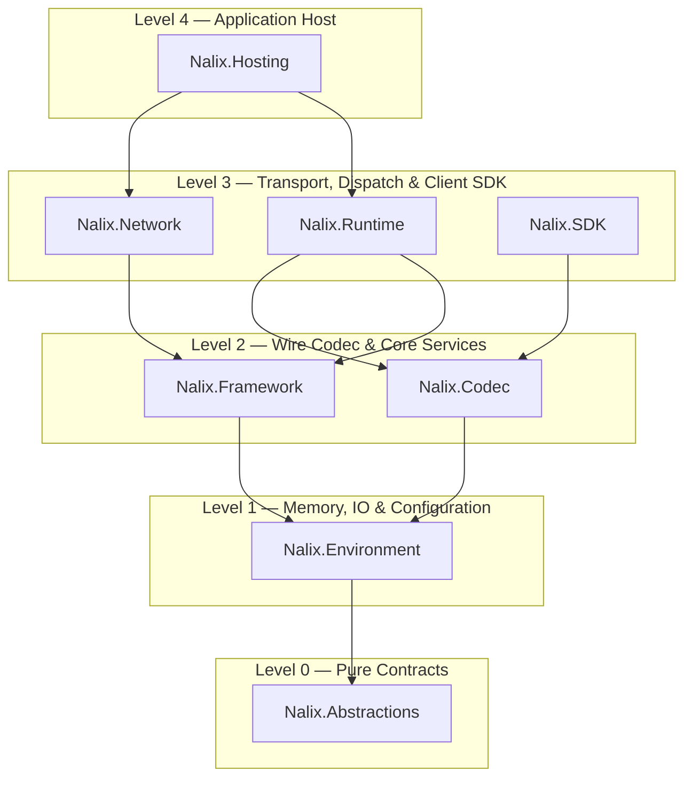

Nalix được tổ chức theo kiến trúc 5 cấp nghiêm ngặt (`Level 0` đến `Level 4`) không có phụ thuộc vòng, kèm theo các analyzer Roslyn và source generator lúc biên dịch. Bạn có thể cài các meta-package cấp cao để phát triển ứng dụng nhanh, hoặc tham chiếu độc lập các gói cấp thấp hơn.

:::tip[Mặc định an toàn]
- **Máy chủ:** Cài `Nalix.Hosting` — gói này kéo theo gián tiếp `Nalix.Network`, `Nalix.Runtime`, `Nalix.Framework`, `Nalix.Codec`, `Nalix.Environment` và `Nalix.Abstractions`.
- **Client:** Cài `Nalix.SDK` — gói này gián tiếp bao gồm `Nalix.Codec`, `Nalix.Environment` và `Nalix.Abstractions`.
- **Contract dùng chung:** Cài `Nalix.Abstractions` và `Nalix.Codec` trong thư viện lớp dùng chung giữa máy chủ và client.
:::

## Kiến trúc phụ thuộc 5 cấp

## Bản đồ gói lúc chạy

| Cấp | Gói | Mục đích | Kiểu công khai chính |
| :---: | :--- | :--- | :--- |
| **0** | [**Nalix.Abstractions**](./nalix-abstractions.md) | Interface không phụ thuộc, attribute cho gói tin/handler và metadata kiểm tra hợp lệ | `IPacket`, `IConnection`, `IBufferLease`, `IPacketContext<T>`, `PacketOpcodeAttribute`, `PacketHandlerAttribute` |
| **1** | [**Nalix.Environment**](./nalix-environment.md) | Nguyên thủy bộ nhớ có pool, reader/writer nhị phân, cấu hình INI, đồng hồ đơn điệu và CSPRNG của hệ điều hành | `BufferLease`, `DataReader`, `DataWriter`, `ConfigurationManager`, `Directories`, `Clock`, `TimingScope`, `Csprng` |
| **2** | [**Nalix.Codec**](./nalix-codec.md) | Tuần tự hóa nhị phân lúc biên dịch, nén LZ4, mã hóa AEAD và danh mục gói tin | `LiteSerializer`, `PacketRegistry`, `LZ4Codec`, `EnvelopeCipher`, `FramePipeline`, `PacketBase<TSelf>`, `PacketFactory<T>` |
| **2** | [**Nalix.Framework**](./nalix-framework.md) | Registry singleton/dịch vụ, lập lịch worker nền, ID Snowflake và pool tài nguyên | `InstanceManager`, `TaskManager`, `Snowflake`, `BufferPoolManager`, `ObjectPoolManager`, `ObjectMap<TKey, TValue>` |
| **3** | [**Nalix.Runtime**](./nalix-runtime.md) | Điều phối gói tin phía máy chủ theo shard, chuỗi middleware, giới hạn tốc độ và tiếp tục phiên | `PacketDispatchChannel`, `PermissionMiddleware`, `RateLimitMiddleware`, `TimeoutMiddleware`, `SessionService` |
| **3** | [**Nalix.Network**](./nalix-network.md) | Listener TCP, UDP và WebSocket, kết nối socket, bảo vệ khi chấp nhận kết nối và connection hub | `TcpListenerBase`, `UdpListenerBase`, `WebSocketListenerBase`, `Protocol`, `ConnectionHub`, `ConnectionGuard`, `SocketConnection` |
| **3** | [**Nalix.SDK**](./nalix-sdk.md) | Phiên TCP/UDP phía client, bắt tay X25519, tự động kết nối lại và request có ghép cặp | `TransportSession`, `TcpSession`, `UdpSession`, `SessionState`, `TransportOptions`, `RequestOptions` |
| **4** | [**Nalix.Hosting**](./nalix-hosting.md) | Bộ dựng máy chủ kiểu fluent, ánh xạ giao thức (`MapTcp`/`MapUdp`/`MapWebSocket`) và vòng đời host | `NetworkApplication`, `INetworkApplicationBuilder`, `DefaultProtocol`, `Bootstrap` |

## Công cụ lúc biên dịch (Roslyn Analyzers & Generators)

Nalix đi kèm ba gói Roslyn lúc biên dịch, được đóng gói sẵn bên trong gói NuGet `Nalix.Abstractions` dưới `analyzers/dotnet/cs` (nên mọi dự án tham chiếu bất kỳ gói Nalix nào đều tự động có phân tích và sinh mã lúc biên dịch):

| Gói | Vai trò | Thành phần chính |
| :--- | :--- | :--- |
| **Nalix.Analyzers** | Áp dụng 67 quy tắc analyzer lúc biên dịch (`NALIX001`–`NALIX078`, `NALIX100`–`NALIX107`) cho gói tin, handler, tuần tự hóa, contract RPC, bảo mật và quyền sở hữu bộ đệm | `NalixUsageAnalyzer`, `DiagnosticDescriptors` |
| **Nalix.Analyzers.CodeFixes** | Cung cấp 16 nhà cung cấp quick-fix cho IDE, xử lý 20 chẩn đoán analyzer đang hoạt động | `PacketOpcodeCodeFixProvider`, `SerializeOrderMissingCodeFixProvider`, `ResetForPoolCodeFixProvider`, v.v. |
| **Nalix.Analyzers.Generators** | Sinh mã C# không dùng reflection lúc biên dịch qua 7 source generator (cùng 8 chẩn đoán generator `NALIX059`–`NALIX068`) | `PacketHandlerGenerator`, `InstanceGenerator`, `SerializeFormatterGenerator`, `PacketRegistryGenerator`, `PacketSchemaGenerator`, `ConfigurationGenerator`, `RpcClientGenerator` |

## Bộ gói tối thiểu theo loại dự án

| Vai trò dự án | Gói NuGet khuyến nghị |
| :--- | :--- |
| **Máy chủ được host** *(khuyến nghị)* | `Nalix.Hosting` |
| **Máy chủ thủ công** *(khởi tạo tùy chỉnh)* | `Nalix.Network`, `Nalix.Runtime`, `Nalix.Framework`, `Nalix.Codec`, `Nalix.Environment`, `Nalix.Abstractions` |
| **Ứng dụng client** | `Nalix.SDK` |
| **Thư viện contract dùng chung** | `Nalix.Abstractions`, `Nalix.Codec` |

## Trang tham chiếu gói

- [Nalix.Abstractions](./nalix-abstractions.md)
- [Nalix.Environment](./nalix-environment.md)
- [Nalix.Codec](./nalix-codec.md)
- [Nalix.Framework](./nalix-framework.md)
- [Nalix.Runtime](./nalix-runtime.md)
- [Nalix.Network](./nalix-network.md)
- [Nalix.Hosting](./nalix-hosting.md)
- [Nalix.SDK](./nalix-sdk.md)
