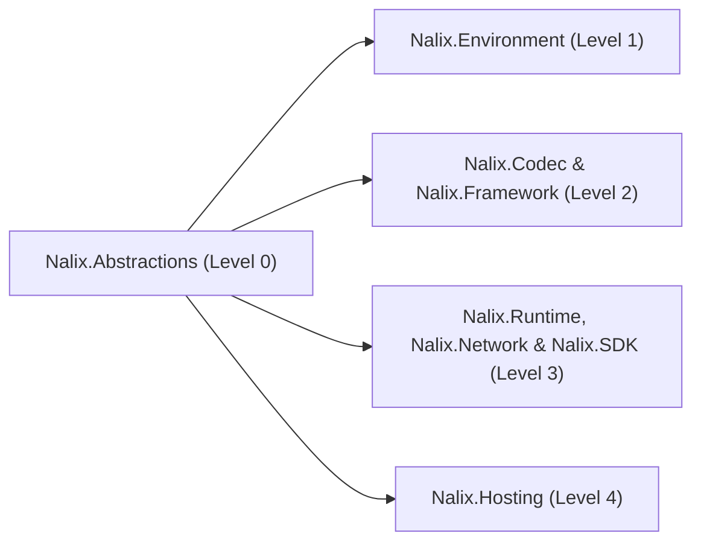

`Nalix.Abstractions` là nền tảng **cấp 0** của hệ sinh thái Nalix. Nó không có phụ thuộc gói bên ngoài nào và định nghĩa các interface dùng chung, kiểu giá trị, attribute và ngoại lệ được mọi máy chủ, client và assembly contract dùng chung sử dụng.

:::tip[Roslyn Analyzers & Source Generator đi kèm]
Gói NuGet `Nalix.Abstractions` đóng gói sẵn `Nalix.Analyzers.dll`, `Nalix.Analyzers.CodeFixes.dll` và `Nalix.Analyzers.Generators.dll` dưới `analyzers/dotnet/cs`. Khi tham chiếu `Nalix.Abstractions` (trực tiếp hoặc gián tiếp), tự động kích hoạt tất cả 75 chẩn đoán lúc biên dịch (`NALIX001`–`NALIX107`) và cả 7 source generator.
:::

## Vị trí trong kiến trúc



## Các nhóm contract cốt lõi

### 1. Contract gói tin & tuần tự hóa

Các kiểu này định nghĩa gói tin trên đường truyền và chỉ dẫn cho `SerializeFormatterGenerator` và `PacketRegistryGenerator` cách sinh formatter nhị phân và mục catalog không dùng reflection lúc biên dịch.

**Thành phần chính**

- `IPacket` — Interface cơ sở cho mọi gói tin trên đường truyền (`Header`, `Length`, `Serialize`, cùng `ResetForPool()` kế thừa từ `IPoolable`).
- `IPacketStaticOpcode` — Contract abstract tĩnh (`static abstract ushort StaticOpCode { get; }`) gắn kiểu gói tin với opcode 16 bit trên đường truyền.
- `IFixedSizeSerializable` — Contract abstract tĩnh (`static abstract int Size { get; }`) cho gói tin có kích thước cố định.
- `PacketAttribute` — Đánh dấu một lớp gói tin để tự động đăng ký lúc biên dịch vào `PacketRegistry`.
- `GenerateFormatterAttribute` — Chỉ dẫn `SerializeFormatterGenerator` sinh một formatter nhị phân có kiểu rõ ràng.
- `SerializePackableAttribute`, `SerializeOrderAttribute`, `SerializeIgnoreAttribute`, `SerializeHeaderAttribute`, `SerializeDynamicSizeAttribute` — Các điều khiển bố cục nhị phân chi tiết (`SerializeLayout.Explicit` hoặc `SerializeLayout.Sequential`).
- `PacketHeader` & `PacketFlags` — Header 6 byte trên đường truyền (`OpCode`, `Flags`, `Priority`, `SequenceId`) và các cờ bit (`NONE`, `COMPRESSED`, `ENCRYPTED`, `ALERT`, `FRAGMENTED`, `SYSTEM`).

### 2. Contract handler & middleware

Dùng ở phía máy chủ để định tuyến gói tin đến đến các method handler và chạy chuỗi middleware xuyên suốt.

**Thành phần chính**

- `PacketHandlerAttribute` — Đánh dấu một lớp là controller handler gói tin, được `PacketHandlerGenerator` phát hiện.
- `PacketOpcodeAttribute` — Gắn một method handler với một opcode 16 bit cụ thể.
- `PacketTransportAttribute` — Giới hạn một method handler trong một `NetworkTransport` cụ thể (`TCP`, `UDP`, `WEBSOCKET`).
- `PacketPermissionAttribute` — Khai báo `PermissionLevel` yêu cầu (`NONE`, `POW_VERIFIED`, `ESTABLISHED`, `GUEST`, `READ_ONLY`, `USER`, `SUPERVISOR`, `TENANT_ADMINISTRATOR`, `SYSTEM_ADMINISTRATOR`, `OWNER`) và `PermissionEvaluation` (`MinimumLevel` hoặc `StrictMatch`).
- `PacketRateLimitAttribute` — Gắn giới hạn tốc độ theo endpoint (`RequestsPerSecond`, `Burst`) vào một handler.
- `PacketTimeoutAttribute` — Áp dụng timeout thực thi (tính bằng mili giây) cho một method handler.
- `PacketEncryptionAttribute` — Yêu cầu gói tin đến phải đã được mã hóa trên đường truyền (`EncryptedOnWire`).
- `PacketIdempotentAttribute` — Đánh dấu một gói yêu cầu là an toàn để client tự động thử lại khi timeout.
- `IPacketContext<TPacket>` — Mang `Packet` đã giải tuần tự hóa, `Connection`, `Sender` (`IPacketSender`), `Attributes` và `CancellationToken`.
- `IPacketMiddleware<TPacket>` — Contract interceptor của pipeline (`InvokeAsync`), sắp xếp theo `[MiddlewareOrder]` và `[MiddlewareStage]`.

```csharp
using Nalix.Abstractions.Networking;
using Nalix.Abstractions.Networking.Packets;
using Nalix.Abstractions.Security;

[PacketHandler("SamplePingHandlers")]
public sealed class SamplePingHandlers
{
    [PacketOpcode(0x1001)]
    [PacketTransport(NetworkTransport.TCP)]
    [PacketPermission(PermissionLevel.GUEST)]
    public ValueTask HandlePingAsync(IPacketContext<PingPacket> context)
        => context.Sender.SendAsync(context.Packet);
}
```

:::note[Triển khai `PacketContext<T>`]
`Nalix.Abstractions` định nghĩa interface `IPacketContext<TPacket>`. Triển khai cụ thể có pool `PacketContext<TPacket>` nằm trong `Nalix.Runtime.Dispatching`.
:::

### 3. Contract kết nối, phiên & transport

**Thành phần chính**

- `IConnection` — Contract kết nối tổng hợp, cung cấp định danh (`ConnectionId`, `NetworkEndpoint`, `UserId`), transport (`TCP`, `UDP`, `WEBSOCKET`), `Attributes` (`IObjectMap<AttributeKey, object>`), `Level` (`PermissionLevel`), `Algorithm` (`CipherSuiteType`), `Secret`, theo dõi lỗi (`IConnectionErrorTracked`), giới hạn tốc độ và số liệu lưu lượng (`IConnectionTrafficMetrics`).
- `IConnectionHub` — Registry toàn máy chủ để theo dõi, truy vấn và phát tin tới các kết nối đang hoạt động.
- `IConnectionGuard` — Kiểm soát chấp nhận ở tầng socket, thực thi hạn ngạch và cấm IP tăng dần.
- `IConnectionGroupRegistry` — Quản lý các nhóm kết nối có tên để phát tin có mục tiêu.
- `IProtocol` & `IListener` — Contract cho listener transport phía máy chủ và cầu nối xử lý frame.
- `ISessionService`, `ISessionStore`, `ISessionFactory`, `SessionSnapshot`, `SessionScope` — Contract lưu trữ phiên không trạng thái và tiếp tục phiên tức thời, nguyên tử khi kết nối lại.

### 4. Bộ nhớ, pooling, đồng thời & DI contract

**Thành phần chính**

- `IBufferLease` — Lease bộ nhớ có pool, đếm tham chiếu và có thể dispose (`Span`, `Memory`, `Length`, `EncryptedOnWire`, `Retain()`).
- `BorrowedAttribute` — Đánh dấu một tham số `IBufferLease` là mượn (callee không được dispose trừ khi chuyển quyền sở hữu qua `ref`).
- `SkipCleanAttribute` — Chỉ dẫn `PacketSchemaGenerator` không reset một field/property bên trong method `ResetForPool()` được sinh ra.
- `IPoolable`, `IObjectPoolManager`, `IBufferPoolManager` — Contract pool đối tượng và pool bộ đệm.
- `ITaskManager`, `IWorker`, `IWorkerHandle`, `IRecurringHandle` — Contract worker nền và job định kỳ.
- `InjectAttribute`, `InjectableAttribute`, `FromScopeAttribute`, `IPacketScope` — Contract dependency injection được sinh từ source (`InstanceGenerator` và `PacketHandlerGenerator`).
- `RpcServiceAttribute` — Đánh dấu một interface để sinh extension client RPC có kiểu tại thời điểm biên dịch qua `RpcClientGenerator`.
- `ValueRangeAttribute`, `AllowedEnumAttribute`, `LengthAttribute`, `RequiredAttribute`, `DurationRangeAttribute`, `IValidatableConfiguration` — Attribute kiểm tra cấu hình khai báo, được `ConfigurationGenerator` biên dịch.

## Trang API chính

- [Contract gói tin](../api/abstractions/packet-contracts.md)
- [Contract kết nối](../api/abstractions/connection-contracts.md)
- [Contract phiên](../api/abstractions/session-contracts.md)
- [Attribute gói tin](../api/abstractions/packet-attributes.md)
- [Metadata gói tin](../api/abstractions/packet-metadata.md)
- [Contract đồng thời](../api/abstractions/concurrency-contracts.md)
- [Attribute tuần tự hóa](../api/abstractions/serialization-attributes.md)
- [Contract dependency injection](../api/abstractions/injection.md)
- [Attribute kiểm tra hợp lệ](../api/abstractions/validation.md)
- [Kiểu liệt kê](../api/abstractions/enums.md)
- [Kiểu điều khiển](../api/abstractions/protocols/control-type.md)
