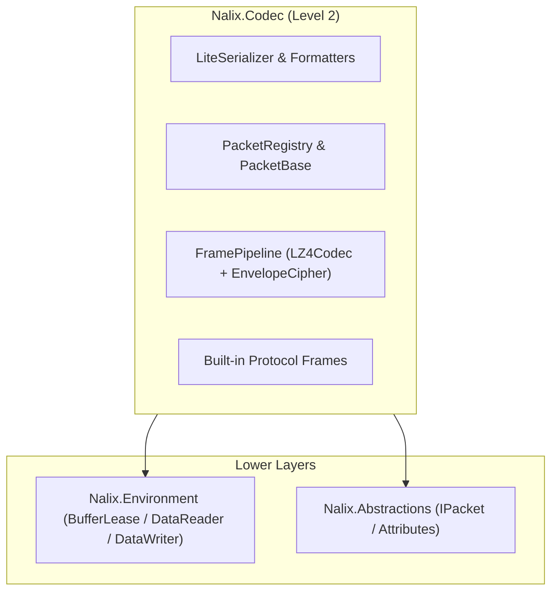
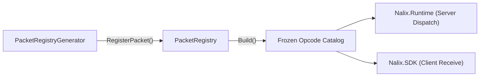

`Nalix.Codec` là gói biến đổi đường truyền **cấp 2**. Nó chuyển các đối tượng gói tin C# có kiểu thành payload nhị phân đã đóng khung và ngược lại, tích hợp tuần tự hóa lúc biên dịch (`LiteSerializer`), nén LZ4 có pool (`LZ4Codec`), mã hóa AEAD (`EnvelopeCipher`), pipeline frame hợp nhất (`FramePipeline`) và `PacketRegistry` toàn process.

## Trách nhiệm chính

- **Tuần tự hóa (`Nalix.Codec.Serialization`)**: Tuần tự hóa nhị phân không dùng reflection qua `LiteSerializer`, `FormatterProvider` và `IFormatter<T>`.
- **Catalog gói tin (`Nalix.Codec.DataFrames`)**: Các lớp gói tin cơ sở (`FrameBase`, `PacketBase<TSelf>`) và bảng tra cứu `PacketRegistry` đã đóng băng.
- **Pooling gói tin (`Nalix.Codec.Pooling`)**: `PacketFactory<TPacket>`, `PacketScope<TPacket>` và `PacketBatchScope<TPacket>` để thuê gói tin không cấp phát bộ nhớ.
- **Nén (`Nalix.Codec.LZ4`)**: Nén và giải nén khối LZ4 có pool, không cấp phát bộ nhớ qua `LZ4Codec`.
- **Mật mã (`Nalix.Codec.Security`)**: `EnvelopeCipher` (`ChaCha20Poly1305`, `Salsa20Poly1305`, `ChaCha20`, `Salsa20`), `HandshakeX25519`, `ProofOfWork`, `Keccak256`, `HmacKeccak256` và `Pbkdf2`.
- **Biến đổi frame (`Nalix.Codec.Transforms`)**: `FramePipeline`, `FrameCipher`, `FrameCompression` và `FrameTransformer` để xử lý frame đến và đi.

## Vị trí trong kiến trúc



## Luồng registry gói tin

Lúc biên dịch, `PacketRegistryGenerator` phát hiện mọi lớp được đánh dấu `[Packet]` và sinh ra một `[ModuleInitializer]` để đăng ký factory và deserializer của nó vào `PacketRegistry`. Gọi `PacketRegistry.Build()` (được `NetworkApplicationBuilder` gọi tự động) sẽ đóng băng catalog thành bảng tra cứu nhanh.



## Thành phần cốt lõi

### `FrameBase` và `PacketBase<TSelf>`

Các lớp cơ sở cho mọi gói tin trên đường truyền. `PacketBase<TSelf>` triển khai `IPacket`, `IPoolable`, gán header và các hàm trợ giúp giải tuần tự hóa/tuần tự hóa có pool.

### `LiteSerializer` và `FormatterProvider`

Bộ máy tuần tự hóa. Với các lớp gói tin có chú thích `[GenerateFormatter]` và `[SerializePackable]`, `SerializeFormatterGenerator` sinh một triển khai `IFormatter<T>` lúc biên dịch và đăng ký nó với `FormatterProvider`, tránh reflection hoặc sinh IL lúc chạy.

### `FramePipeline`, `FrameCipher` và `FrameCompression`

- `FramePipeline.ProcessOutbound(...)` áp dụng các biến đổi đi ra theo thứ tự truyền chuẩn (**nén trước, mã hóa sau**). Khi cả nén và mã hóa đều bật, nó dùng một **đường lease đơn hợp nhất** (`ProcessOutboundFused`) và tự động bỏ qua nén nếu payload không giảm ít nhất 12.5%.
- `FramePipeline.TryProcessInbound(...)` áp dụng các biến đổi đi vào theo thứ tự truyền chuẩn (**giải mã trước, giải nén sau**), đặt `EncryptedOnWire = true` và `ZeroOnDispose = true` trên các lease plaintext đã giải mã.

### Frame giao thức có sẵn (`Nalix.Codec.ProtocolFrames`)

- **Điều khiển & chỉ thị**: `Control` (`PING`, `PONG`, `DISCONNECT`, `PUBLIC_KEY_REQUEST`, v.v.), `Directive` (thông báo giới hạn tốc độ/lỗi), `TimeSync`.
- **Bắt tay X25519**: `SessionTofu`, `SessionInit`, `SessionChallenge`, `SessionProof`, `SessionEstablished`.
- **Tiếp tục phiên**: `SessionResume` (một frame thống nhất dùng `SessionResumeStage` cho `REQUEST` và `RESPONSE`).
- **Proof-of-Work**: `ProofOfWorkChallenge`, `ProofOfWorkProof`.

:::note[Nguyên thủy bộ nhớ và phân mảnh]
Trong khi `Nalix.Codec` thực hiện tuần tự hóa và biến đổi frame, các nguyên thủy bộ nhớ bên dưới (`BufferLease`, `DataReader`, `DataWriter`) và các kiểu phân mảnh (`FragmentHeader`, `FragmentAssembler`, `FragmentOptions`) nằm trong **[Nalix.Environment](./nalix-environment.md)**.
:::

## Ví dụ nhanh

```csharp
using Nalix.Abstractions.Networking.Packets;
using Nalix.Abstractions.Primitives;
using Nalix.Codec.DataFrames;
using Nalix.Codec.ProtocolFrames;

// Đóng băng danh mục gói tin (được gọi tự động khi dùng Nalix.Hosting)
PacketRegistry.Build();

// Thuê và khởi tạo một frame bắt tay SessionInit có sẵn
SessionInit init = SessionInit.Create();
init.Initialize(
    new Bytes32(publicKeyBytes),
    new Bytes32(nonceBytes),
    PacketFlags.SYSTEM);

byte[] wireBytes = init.Serialize();
```

## Trang API chính

- [Tuần tự hóa cơ bản](../api/codec/serialization/serialization-basics.md)
- [Tuần tự hóa gói tin](../api/codec/serialization/packet-serialization.md)
- [Nén LZ4](../api/codec/lz4.md)
- [Mô hình frame](../api/codec/packets/frame-model.md)
- [Registry gói tin](../api/codec/packets/packet-registry.md)
- [Frame có sẵn](../api/codec/packets/built-in-frames.md)
- [Phân mảnh](../api/codec/packets/fragmentation.md)
- [Mật mã](../api/security/cryptography.md)
