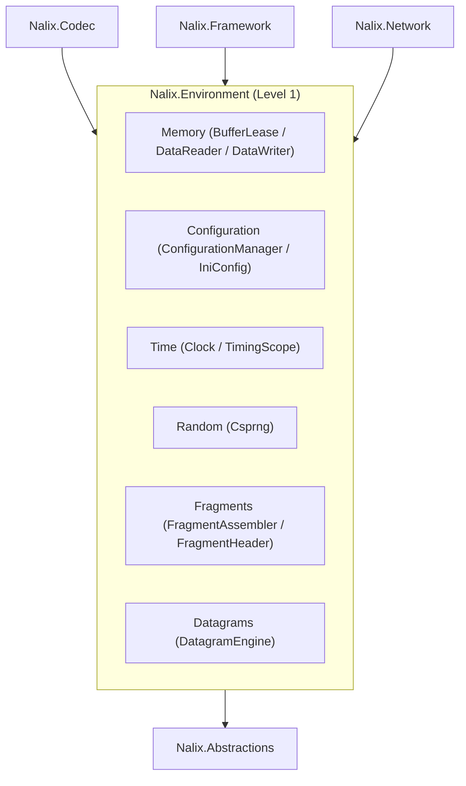

`Nalix.Environment` là gói nền tảng **cấp 1** (chỉ phụ thuộc vào `Nalix.Abstractions`). Nó cung cấp các nguyên thủy bộ nhớ mức thấp, bộ nạp cấu hình, đồng hồ đơn điệu, bộ sinh số ngẫu nhiên mật mã và bộ máy phân mảnh gói tin dùng chung trong toàn bộ stack.

## Trách nhiệm chính

- **Bộ nhớ không cấp phát (`Nalix.Environment.Memory`)**: `BufferLease`, `DataReader`, `DataWriter` và mã hóa số nguyên độ dài biến `Leb128`.
- **Cấu hình (`Nalix.Environment.Configuration`)**: Ràng buộc cấu hình `.ini` có kiểu qua `ConfigurationManager`, `ConfigurationLoader` và `IniConfig`.
- **Thời gian & độ trễ (`Nalix.Environment.Time`)**: `Clock` đơn điệu đã hiệu chỉnh độ lệch và `TimingScope` đo thời gian không cấp phát.
- **Ngẫu nhiên mật mã (`Nalix.Environment.Random`)**: `Csprng` an toàn đa luồng, dựa trên entropy gốc của hệ điều hành (`BCryptGenRandom` trên Windows, `getrandom` trên Linux/Android, `SecRandomCopyBytes` trên Apple, và `/dev/urandom` làm phương án dự phòng).
- **Phân mảnh gói tin (`Nalix.Environment.Fragments`)**: `FragmentHeader`, `FragmentAssembler`, `FragmentStreamId` và `FragmentAssemblyResult` để chia nhỏ và ghép lại payload quá lớn.
- **Đánh số thứ tự & băm (`Nalix.Environment.Sequencing`, `Nalix.Environment.Hashing`)**: `SequenceCounter` với cửa sổ chống phát lại, `XxHash32` và `Sha1`.
- **Bộ máy phiên datagram (`Nalix.Environment.Datagrams`)**: `DatagramEngine`, bộ máy giao thức không dùng socket ("sans-IO") cho một phiên Nalix Datagram Protocol (NDP v1), cùng `DatagramEngineState`, `DatagramCloseCode`, `DatagramPeerLimits`, `IDatagramEngineHandler` và `DatagramEngineOptions`.
- **Đường dẫn chuẩn hóa (`Nalix.Environment.IO`)**: Thư mục ứng dụng đa nền tảng qua `Directories`.

## Vị trí trong kiến trúc



## Thành phần cốt lõi

### `BufferLease`

Triển khai `IBufferLease` hiệu năng cao, dựa trên `ArrayPool<byte>.Shared`. Hỗ trợ dành trước khoảng trống transport (`BufferLease.TransportHeadroom`), tự động xóa dữ liệu mật mã khi giải phóng (`ZeroOnDispose = true`), và giữ tham chiếu đếm (`Retain()`).

### `DataReader` và `DataWriter`

Các nguyên thủy con trỏ tuần tự hóa nhị phân hiệu năng cao, thao tác trực tiếp trên `ReadOnlySpan<byte>`, `Span<byte>`, `byte[]` hoặc `IBufferLease` mà không cấp phát heap trung gian.

### `ConfigurationManager` và `ConfigurationLoader`

Registry trung tâm cho các lớp tùy chọn có kiểu, kế thừa từ `ConfigurationLoader`. Bộ sinh mã `ConfigurationGenerator` sinh ra mã ràng buộc và kiểm tra INI không dùng reflection lúc biên dịch.

```csharp
using Nalix.Environment.Configuration;
using Nalix.Environment.Options;

MemoryOptions memory = ConfigurationManager.Instance.Get<MemoryOptions>();
memory.Validate();
```

### `Clock` và `TimingScope`

- `Clock` cung cấp dấu thời gian đơn điệu độ phân giải cao và dấu thời gian Unix UTC (`Clock.MonoTicksNow()`, `Clock.MonoTicksToMilliseconds(long)`, `Clock.UnixMillisecondsNow()`, `Clock.UnixSecondsNow()`, `Clock.EpochMillisecondsNow()`, `Clock.NowUtc()`).
- `TimingScope` là một `readonly struct` nhẹ (`using TimingScope scope = TimingScope.Start();`) để đo thời gian tính bằng micro giây hoặc mili giây trên hot path mà không cấp phát `Stopwatch`.

### `Csprng`

Bộ sinh số ngẫu nhiên mật mã mạnh dạng tĩnh (`Csprng.Fill(Span<byte>)`, `Csprng.GetBytes(int)`, `Csprng.CreateNonce(int)`, `Csprng.GetInt32(int, int)`, `Csprng.NextUInt64()`). Dùng rejection sampling để có khoảng số nguyên không thiên lệch, và dừng với `CipherException` nếu entropy hệ điều hành không khả dụng.

### `FragmentAssembler` và `FragmentHeader`

Chia các payload vượt quá `FragmentOptions.MaxChunkSize` (mặc định `32_000` byte) thành các chunk có tiền tố là `FragmentHeader` trên đường truyền 8 byte (`FragmentHeader.WireSize = 8`: `Magic`, `StreamId`, `ChunkIndex`, `TotalChunks`, `Flags`), và ghép lại an toàn ở phía nhận với các slot luồng có giới hạn (`MaxOpenStreams = 64`) và loại bỏ khi quá thời gian chờ (`ReassemblyTimeoutMs = 30_000`).

### `DatagramEngine`

`DatagramEngine` (`public sealed partial class DatagramEngine : IDisposable`, namespace `Nalix.Environment.Datagrams`) là bộ máy giao thức của một phiên NDP v1. Nó không thực hiện I/O socket: bên sở hữu đưa payload UDP nhận được vào `Receive`, gửi những gì `Poll` tạo ra, và gọi `OnTimer` tại `NextTimer`. Mọi mốc thời gian tính bằng micro giây từ đồng hồ đơn điệu (`DatagramEngine.NowMicros()`). Nó triển khai số thứ tự gói, bảo vệ AEAD qua `IDatagramProtection`, dải ACK, phát hiện mất gói, kiểm soát tắc nghẽn NewReno có pacing, khám phá MTU của đường truyền, keepalive, thời gian chờ nhàn rỗi, đóng/draining, xác thực đường truyền, cập nhật khóa, và các chế độ `DeliveryMethod` trên các kênh độc lập với phân mảnh và ngân sách nhận được công bố. Nó không an toàn đa luồng (bên sở hữu tuần tự hóa mọi lời gọi) và sở hữu cũng như dispose phần bảo vệ.

```csharp
using Nalix.Environment.Datagrams;
using Nalix.Environment.Options;

public DatagramEngine(
    DatagramEngineOptions options, DatagramPeerLimits peerLimits, IDatagramProtection protection,
    ulong connectionId, bool isServer, IDatagramEngineHandler handler, long now);
```

| Thành viên | Mô tả |
| :--- | :--- |
| `State` | `DatagramEngineState` hiện tại. |
| `ConnectionId` | Định danh kết nối lấy từ ticket. |
| `static bool TryReadConnectionId(ReadOnlySpan<byte>, out ulong)` | Đọc id kết nối từ header dạng rõ mà không xác thực, để định tuyến datagram tới phiên của nó. |
| `static long NowMicros()` | Thời gian đơn điệu tính bằng micro giây cho các đối số `now`. |
| `bool TrySend(ReadOnlySpan<byte> message, DeliveryMethod method, byte channel, byte priority, long now)` | Đưa một thông điệp vào hàng đợi (được sao chép). Trả về `false` khi phiên đang đóng, thông điệp quá lớn so với method của nó, hoặc hàng đợi gửi của kênh đã đầy. Thông điệp lớn hơn `MaxUnfragmentedMessageSize` được phân mảnh và cần method tin cậy. |
| `Task<bool>? TrySendWithReceipt(...)` | Cùng đối số với `TrySend`; chỉ dùng method tin cậy (nếu không sẽ ném `ArgumentException`). Task hoàn tất với `true` khi mọi mảnh đã được xác nhận, hoặc `false` nếu phiên đã đóng hoặc một thông điệp `ReliableSequenced` mới hơn đã thay thế nó. Trả về `null` khi không được đưa vào hàng đợi. |
| `void RaiseReceiveLimits(DatagramPeerLimits limits)` | Nâng ngân sách nhận mà phía này công bố (không bao giờ giảm); một frame LIMITS báo cho peer biết. |
| `int Poll(Span<byte> destination, long now, out SocketAddress? path)` | Tạo datagram kế tiếp (`destination` phải dài ít nhất `MaxDatagramSize` byte); trả về độ dài hoặc `0` khi chưa có gì đến hạn. Gọi lặp lại sau mỗi `Receive`, `TrySend`, `Close` và `OnTimer`. `path` chỉ khác null với path challenge gửi tới một địa chỉ không phải đường truyền đang dùng. |
| `bool Receive(ReadOnlySpan<byte> datagram, SocketAddress? from, long now)` | Xử lý một datagram nhận được; `true` khi nó đã xác thực và được xử lý. `from` là bên gửi trên máy chủ và `null` trên client. |
| `void OnTimer(long now)` | Chạy các bộ hẹn giờ đến hạn (thời gian chờ nhàn rỗi, draining, phát hiện mất gói, thời gian chờ probe, keepalive, thử lại xác thực đường truyền, hủy khóa, hết hạn mảnh). |
| `long NextTimer` | Thời điểm của lần gọi `OnTimer` kế tiếp, hoặc `long.MaxValue` khi không cần. |
| `void Close(DatagramCloseCode code, string? reason, long now, ulong applicationCode = 0)` | Đưa frame CLOSE vào hàng đợi cho lần `Poll` kế tiếp, rồi chuyển sang draining. `IdleTimeout` không được phép (`ArgumentException`); tối đa 256 byte UTF-8 của `reason` được gửi. |
| `Mtu`, `SmoothedRtt`, `CongestionWindow`, `BytesInFlight` | MTU đường truyền hiện tại, RTT làm mượt (micro giây), cửa sổ tắc nghẽn và số byte đang bay. |
| `DatagramsSent`, `DatagramsReceived`, `DatagramsDropped`, `DatagramsLost` | Bộ đếm (received đếm các datagram đã xác thực; dropped gồm datagram sai định dạng, trùng lặp hoặc không xác thực được; lost chỉ đếm datagram ack-eliciting, không đếm datagram chỉ chứa ACK). |
| `ActivePath` | Địa chỉ peer đã xác thực trên máy chủ; `null` trước datagram đã xác thực đầu tiên và trên client. |
| `string GenerateReport()` | Bản tóm tắt thống kê một dòng để chẩn đoán. |
| `Dispose()` | Giải phóng bộ máy. |

Hằng số: `MinimumDatagramSize` (header 13 byte + 1 + tag 16 byte), `MaxDatagramSize = 1472`, và `MaxUnfragmentedMessageSize` (`DatagramEngineOptions.MinimumMtu` trừ header, cận của tag và header frame MESSAGE lớn nhất).

### `DatagramEngineState`, `DatagramCloseCode`, `DatagramPeerLimits`

- `DatagramEngineState : byte`: `Pending = 0` (chưa có datagram nào xác thực), `Established = 1`, `Draining = 2` (CLOSE đã vào hàng đợi, đã gửi hoặc đã nhận), `Closed = 3`.
- `DatagramCloseCode : byte`: `NoError = 0`, `InternalError = 1`, `ProtocolViolation = 2`, `FrameEncodingError = 3`, `FlowControlError = 4`, `IdleTimeout = 5` (chỉ cục bộ, không bao giờ được gửi), `AeadLimitReached = 6`, `ApplicationError = 7`.
- `DatagramPeerLimits(long ReceiveBufferBytes, long ChannelReceiveBufferBytes)` là một `readonly record struct` chứa ngân sách nhận mà peer đã công bố. `DatagramPeerLimits.Default` được dẫn xuất từ `DatagramEngineOptions` mặc định; `DatagramPeerLimits.From(DatagramEngineOptions)` dựng các giới hạn mà một phía với những tùy chọn đó công bố.

### `IDatagramEngineHandler`

Nhận đầu ra của bộ máy. Các lời gọi diễn ra đồng bộ từ chính lời gọi bộ máy đã tạo ra sự kiện, dưới khóa của bên sở hữu, nên phần triển khai cần chuyển việc đi nơi khác thay vì chặn.

```csharp
public interface IDatagramEngineHandler
{
    void OnMessage(BufferLease message, DeliveryMethod method, byte channel);
    void OnClosed(DatagramCloseCode code, ulong applicationCode, string reason, bool remote);
}
```

`OnMessage` chuyển quyền sở hữu `message` cho handler, và handler phải dispose nó. `OnClosed` được gọi một lần; `applicationCode` có ý nghĩa với `ApplicationError`, và `remote` là `true` khi peer đóng phiên.

### `DatagramEngineOptions`

`DatagramEngineOptions` (`Nalix.Environment.Options`, `sealed partial class : ConfigurationLoader, IValidatableConfiguration`) cấu hình một phía của phiên; máy chủ công bố số kênh, thời gian chờ nhàn rỗi, kích thước thông điệp và ngân sách nhận trong ticket, và client dùng cùng các giá trị đó. Hằng số: `MinimumMtu = 1200`, `MaxChannels = 64`.

| Thuộc tính | Mặc định | Phạm vi |
| :--- | :--- | :--- |
| `ChannelCount` | `8` | 1..64 |
| `IdleTimeoutMs` | `15_000` | 100..3,600,000 |
| `MaxAckDelayMs` | `25` | 1..1,000 |
| `UnreliableExpiryMs` | `100` | 1..60,000 |
| `MaxMessageSize` | `1024 * 1024` | 1..64 MiB |
| `ReceiveBufferBytes` | `4 MiB` | >= 1 |
| `ChannelReceiveBufferBytes` | `2 MiB` | >= 1 |
| `SendQueueBytesPerChannel` | `4 MiB` | >= 1 |
| `MaxOpenFragmentStreams` | `64` | 1..65,535 |
| `FragmentTimeoutMs` | `10_000` | 100..3,600,000 |
| `EnableMtuProbing` | `true` | n/a |
| `KeyUpdatePacketInterval` | `1L << 23` | 16..2^40 |
| `KeyUpdateIntervalMs` | `3,600,000` (1 giờ) | 1,000..7 ngày |

`Validate()` còn ném `ValidationException` trừ khi `ChannelReceiveBufferBytes >= MaxMessageSize + 65536`, `ReceiveBufferBytes >= ChannelReceiveBufferBytes` và `SendQueueBytesPerChannel >= MaxMessageSize`.

### `Directories`

Cung cấp các đường dẫn chuẩn hóa, khởi tạo lười (`BaseAssetsDirectory`, `ConfigurationDirectory`, `LogsDirectory`, `DataDirectory`, `TemporaryDirectory`, `StorageDirectory`, `DatabaseDirectory`, `CacheDirectory`, `UploadsDirectory`, `BackupsDirectory`), có tăng cường quyền truy cập Unix khi áp dụng được.

## Trang API chính

- [Quản lý bộ đệm](../api/environment/memory/buffer-management.md)
- [Cấu hình](../api/environment/configuration.md)
- [Thư mục](../api/environment/directories.md)
- [Clock & TimingScope](../api/environment/clock.md)
- [Ngẫu nhiên (Csprng)](../api/environment/random.md)
- [Đánh số thứ tự (SequenceCounter)](../api/environment/sequencing.md)
- [Phân mảnh](../api/codec/packets/fragmentation.md)

## Ánh xạ mã nguồn

- `src/Nalix.Environment/Datagrams/DatagramEngine.cs`
- `src/Nalix.Environment/Datagrams/DatagramEngine.Types.cs`
- `src/Nalix.Environment/Datagrams/DatagramEngine.Report.cs`
- `src/Nalix.Environment/Datagrams/DatagramEngine.Cleanup.cs`
- `src/Nalix.Environment/Datagrams/DatagramEngineState.cs`
- `src/Nalix.Environment/Datagrams/DatagramCloseCode.cs`
- `src/Nalix.Environment/Datagrams/DatagramPeerLimits.cs`
- `src/Nalix.Environment/Datagrams/IDatagramEngineHandler.cs`
- `src/Nalix.Environment/Options/DatagramEngineOptions.cs`
