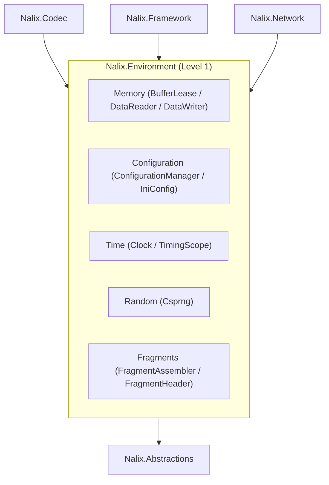

`Nalix.Environment` là gói nền tảng **cấp 1** (chỉ phụ thuộc vào `Nalix.Abstractions`). Nó cung cấp các nguyên thủy bộ nhớ mức thấp, bộ nạp cấu hình, đồng hồ đơn điệu, bộ sinh số ngẫu nhiên mật mã và bộ máy phân mảnh gói tin dùng chung trong toàn bộ stack.

## Trách nhiệm chính

- **Bộ nhớ không cấp phát (`Nalix.Environment.Memory`)**: `BufferLease`, `DataReader`, `DataWriter` và mã hóa số nguyên độ dài biến `Leb128`.
- **Cấu hình (`Nalix.Environment.Configuration`)**: Ràng buộc cấu hình `.ini` có kiểu qua `ConfigurationManager`, `ConfigurationLoader` và `IniConfig`.
- **Thời gian & độ trễ (`Nalix.Environment.Time`)**: `Clock` đơn điệu đã hiệu chỉnh độ lệch và `TimingScope` đo thời gian không cấp phát.
- **Ngẫu nhiên mật mã (`Nalix.Environment.Random`)**: `Csprng` an toàn đa luồng, dựa trên entropy gốc của hệ điều hành (`BCryptGenRandom` trên Windows, `getrandom` trên Linux/Android, `SecRandomCopyBytes` trên Apple, và `/dev/urandom` làm phương án dự phòng).
- **Phân mảnh gói tin (`Nalix.Environment.Fragments`)**: `FragmentHeader`, `FragmentAssembler`, `FragmentStreamId` và `FragmentAssemblyResult` để chia nhỏ và ghép lại payload quá lớn.
- **Đánh số thứ tự & băm (`Nalix.Environment.Sequencing`, `Nalix.Environment.Hashing`)**: `SequenceCounter` với cửa sổ chống phát lại, `XxHash32` và `Sha1`.
- **Đường dẫn chuẩn hóa (`Nalix.Environment.IO`)**: Thư mục ứng dụng đa nền tảng qua `Directories`.

## Vị trí trong kiến trúc



## Thành phần cốt lõi

### `BufferLease`

Triển khai `IBufferLease` hiệu năng cao, dựa trên `ArrayPool<byte>.Shared`. Hỗ trợ dành trước khoảng trống transport (`BufferLease.TransportHeadroom`), tự động xóa dữ liệu mật mã khi giải phóng (`ZeroOnDispose = true`), và giữ tham chiếu đếm (`Retain()`).

### `DataReader` và `DataWriter`

Các nguyên thủy con trỏ tuần tự hóa nhị phân hiệu năng cao, thao tác trực tiếp trên `ReadOnlySpan<byte>`, `Span<byte>`, `byte[]` hoặc `IBufferLease` mà không cấp phát heap trung gian.

### `ConfigurationManager` và `ConfigurationLoader`

Registry trung tâm cho các lớp tùy chọn có kiểu, kế thừa từ `ConfigurationLoader`. Bộ sinh mã `ConfigurationGenerator` sinh ra mã ràng buộc và kiểm tra INI không dùng reflection lúc biên dịch.

```csharp
using Nalix.Environment.Configuration;
using Nalix.Environment.Options;

MemoryOptions memory = ConfigurationManager.Instance.Get<MemoryOptions>();
memory.Validate();
```

### `Clock` và `TimingScope`

- `Clock` cung cấp dấu thời gian đơn điệu độ phân giải cao và dấu thời gian Unix UTC (`Clock.MonoTicksNow()`, `Clock.MonoTicksToMilliseconds(long)`, `Clock.UnixMillisecondsNow()`, `Clock.UnixSecondsNow()`, `Clock.EpochMillisecondsNow()`, `Clock.NowUtc()`).
- `TimingScope` là một `readonly struct` nhẹ (`using TimingScope scope = TimingScope.Start();`) để đo thời gian tính bằng micro giây hoặc mili giây trên hot path mà không cấp phát `Stopwatch`.

### `Csprng`

Bộ sinh số ngẫu nhiên mật mã mạnh dạng tĩnh (`Csprng.Fill(Span<byte>)`, `Csprng.GetBytes(int)`, `Csprng.CreateNonce(int)`, `Csprng.GetInt32(int, int)`, `Csprng.NextUInt64()`). Dùng rejection sampling để có khoảng số nguyên không thiên lệch, và dừng với `CipherException` nếu entropy hệ điều hành không khả dụng.

### `FragmentAssembler` và `FragmentHeader`

Chia các payload vượt quá `FragmentOptions.MaxChunkSize` (mặc định `32_000` byte) thành các chunk có tiền tố là `FragmentHeader` trên đường truyền 8 byte (`FragmentHeader.WireSize = 8`: `Magic`, `StreamId`, `ChunkIndex`, `TotalChunks`, `Flags`), và ghép lại an toàn ở phía nhận với các slot luồng có giới hạn (`MaxOpenStreams = 64`) và loại bỏ khi quá thời gian chờ (`ReassemblyTimeoutMs = 30_000`).

### `Directories`

Cung cấp các đường dẫn chuẩn hóa, khởi tạo lười (`BaseAssetsDirectory`, `ConfigurationDirectory`, `LogsDirectory`, `DataDirectory`, `TemporaryDirectory`, `StorageDirectory`, `DatabaseDirectory`, `CacheDirectory`, `UploadsDirectory`, `BackupsDirectory`), có tăng cường quyền truy cập Unix khi áp dụng được.

## Trang API chính

- [Quản lý bộ đệm](../api/environment/memory/buffer-management.md)
- [Cấu hình](../api/environment/configuration.md)
- [Thư mục](../api/environment/directories.md)
- [Clock & TimingScope](../api/environment/clock.md)
- [Ngẫu nhiên (Csprng)](../api/environment/random.md)
- [Đánh số thứ tự (SequenceCounter)](../api/environment/sequencing.md)
- [Phân mảnh](../api/codec/packets/fragmentation.md)
