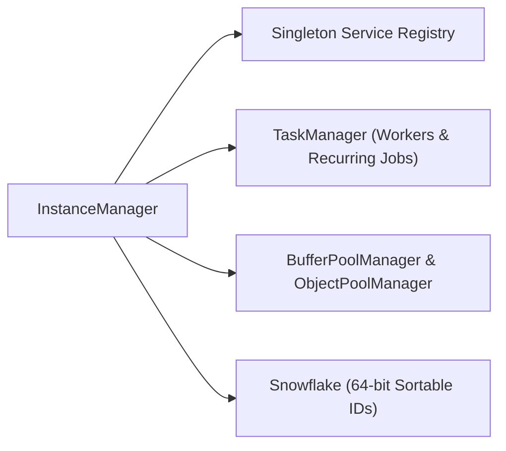

`Nalix.Framework` là gói dịch vụ runtime **cấp 2** (phụ thuộc vào `Nalix.Environment` và `Nalix.Abstractions`). Nó cung cấp đăng ký dịch vụ singleton (`InstanceManager`), worker nền và timer định kỳ được quản lý (`TaskManager`), định danh 64 bit có thể sắp xếp theo thời gian (`Snowflake`), và các trình quản lý pool tập trung (`BufferPoolManager` và `ObjectPoolManager`).

## Bản đồ dịch vụ runtime



## Thành phần cốt lõi

### `InstanceManager` (Dependency Injection)

`InstanceManager` (`Nalix.Framework.Injection.InstanceManager`) là registry singleton an toàn đa luồng, được dùng xuyên suốt stack để công bố và phân giải hạ tầng dùng chung (`ILogger`, `IConnectionHub`, `IConnectionGuard`, `IBufferPoolManager`, `IObjectPoolManager`, `ISessionService`).

Các lớp được chú thích `[Injectable]` và các lớp con của `SingletonBase<T>` có activator không dùng reflection và ánh xạ dịch vụ được `InstanceGenerator` sinh lúc biên dịch (còn các field và property `[Inject]` trên controller `[PacketHandler]` được `PacketHandlerGenerator` nối vào).

```csharp
using Microsoft.Extensions.Logging;
using Nalix.Framework.Injection;
using Nalix.Framework.Tasks;

// Đăng ký một instance singleton dùng chung
InstanceManager.Instance.Register<ILogger>(logger);

// Phân giải hoặc tạo dịch vụ được quản lý khi cần (lazy)
TaskManager taskManager = InstanceManager.Instance.GetOrCreateInstance<TaskManager>();
```

### `TaskManager` (Worker nền & job định kỳ)

`TaskManager` (`Nalix.Framework.Tasks.TaskManager`) lập lịch và giám sát các worker nền có tên (`ScheduleWorker`) và các job định kỳ (`ScheduleRecurring`), với giới hạn đồng thời theo nhóm, lan truyền hủy và báo cáo chẩn đoán (`GenerateReport()`).

```csharp
using Nalix.Framework.Injection;
using Nalix.Framework.Tasks;

TaskManager manager = InstanceManager.Instance.GetOrCreateInstance<TaskManager>();

manager.ScheduleRecurring(
    "session.cleanup",
    TimeSpan.FromSeconds(30),
    async ct => await CleanupExpiredSessionsAsync(ct));
```

### `Snowflake` (Định danh 64 bit có thể sắp xếp)

`Snowflake` (`Nalix.Framework.Identifier.Snowflake`) sinh ra các định danh 64 bit gọn, có thể sắp xếp theo thời gian (`ISnowflake`), kết hợp machine ID, thẻ kiểu (`SnowflakeType`) và bộ đếm thứ tự đơn điệu — phù hợp cho ID kết nối, token phiên và định danh thực thể.

### `BufferPoolManager` và `ObjectPoolManager`

Trong khi các nguyên thủy `BufferLease` cấp thấp nằm trong `Nalix.Environment`, `Nalix.Framework` sở hữu các trình quản lý pool thích ứng:

- `BufferPoolManager` (`Nalix.Framework.Memory.Buffers.BufferPoolManager`): Quản lý các pool mảng byte chia theo bucket (`BufferConfig`), số liệu cấp phát và cơ chế thu gọn nền thích ứng dựa trên `BufferOptions`.
- `ObjectPoolManager` (`Nalix.Framework.Memory.Objects.ObjectPoolManager`): Quản lý các instance `TypedObjectPool<T>` có kiểu cho các đối tượng `IPoolable` (cấu hình qua `ObjectPoolOptions`).
- `ObjectMap<TKey, TValue>` (`Nalix.Framework.Memory.Objects.ObjectMap<TKey, TValue>`): Map khóa-giá trị đồng thời được phân mảnh, dành cho tra cứu lúc chạy có tần suất đọc/ghi cao.

:::note[`TimingScope` nằm ở đâu?]
`TimingScope` nằm trong **`Nalix.Environment.Time`** để cả `Nalix.Environment` và `Nalix.Codec` đều có thể đo độ trễ trên hot path mà không phụ thuộc vào `Nalix.Framework`.
:::

## Trang API chính

- [Instance Manager (DI)](../api/framework/instance-manager.md)
- [Task Manager](../api/framework/task-manager.md)
- [Định danh Snowflake](../api/framework/snowflake.md)
- [Pooling đối tượng](../api/framework/memory/object-pooling.md)
- [Pool đối tượng có kiểu](../api/framework/memory/typed-object-pools.md)
- [Object Map](../api/framework/memory/object-map.md)
- [Quản lý bộ đệm](../api/environment/memory/buffer-management.md)
- [Clock & TimingScope](../api/environment/clock.md)
