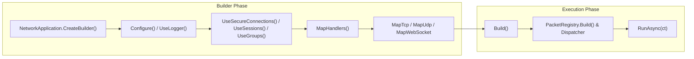

`Nalix.Hosting` là gói host ứng dụng **cấp 4** cho máy chủ Nalix. Nó cung cấp một builder kiểu fluent theo phong cách ASP.NET Core (`NetworkApplication.CreateBuilder()`) để kết nối `PacketRegistry`, `PacketDispatchChannel`, `InstanceManager`, các file cấu hình (`server.ini`), bắt tay bảo mật, phiên và các listener TCP/UDP/WebSocket vào một vòng đời thống nhất.

## Ánh xạ mã nguồn

- `src/Nalix.Hosting/NetworkApplication.cs`
- `src/Nalix.Hosting/NetworkApplicationBuilder.cs`
- `src/Nalix.Hosting/INetworkApplicationBuilder.cs`
- `src/Nalix.Hosting/NetworkApplicationBuilder.Extensions.cs`
- `src/Nalix.Hosting/IProtocolBindingBuilder.cs`
- `src/Nalix.Hosting/IWebSocketBindingBuilder.cs`
- `src/Nalix.Hosting/Bootstrap.cs`
- `src/Nalix.Hosting/Protocols/DefaultProtocol.cs`

## Luồng host



## API cốt lõi

### `NetworkApplication`

Host máy chủ có thể chạy, triển khai `IActivatableAsync`, `IReportable`, `IDisposable` và `IAsyncDisposable`.

- `NetworkApplication.CreateBuilder()` — Tạo một `INetworkApplicationBuilder` mới.
- `ActivateAsync(CancellationToken)` / `DeactivateAsync(CancellationToken)` — Khởi động hoặc dừng dispatcher và mọi listener đã gắn mà không chặn luồng.
- `RunAsync(CancellationToken)` — Kích hoạt host và chờ cho đến khi token hủy được kích hoạt, sau đó dừng lại một cách nhẹ nhàng.

### `INetworkApplicationBuilder` & mở rộng tính năng

| Phương thức | Mục đích |
| :--- | :--- |
| `Configure<TOptions>(Action<TOptions>)` | Thay đổi một instance tùy chọn `ConfigurationLoader` trước khi các dịch vụ được khởi tạo. |
| `ConfigureDispatchOptions(Action<PacketDispatchOptions<IPacket>>)` | Cấu hình middleware, xử lý lỗi và vòng lặp worker trên dispatcher mặc định. |
| `ConfigureDispatch(Func<...>)` | Cung cấp một triển khai `IPacketDispatch` tùy chỉnh. |
| `UseLogger(ILogger)` | Đăng ký một `ILogger` vào `InstanceManager` và nối các sự kiện `DiagnosticListener` lúc chạy. |
| `UseConnectionHub(IConnectionHub)` | Đăng ký một instance `IConnectionHub` tùy chỉnh. |
| `UseConnectionGuard(IConnectionGuard)` | Đăng ký một instance `IConnectionGuard` tùy chỉnh. |
| `UseBufferPoolManager(IBufferPoolManager)` | Đăng ký một instance `IBufferPoolManager` tùy chỉnh. |
| `UseObjectPoolManager(IObjectPoolManager)` | Đăng ký một instance `IObjectPoolManager` tùy chỉnh. |
| `RegisterScoped<TService>(Func<IPacketScope, TService>)` | Đăng ký factory dịch vụ theo phạm vi từng gói tin cho các tham số handler `[FromScope]`. |
| `MapHandlers<THandler>()` / `MapHandlers(Type)` | Đăng ký một lớp controller `[PacketHandler]` (instance, factory, hoặc lớp `static`). |
| `MapTcp<TProtocol>()` | Trả về `IProtocolBindingBuilder` (`OnPort(ushort)`, `WithFactory(...)`, `Bind()`) cho TCP. |
| `MapUdp<TProtocol>()` | Trả về `IProtocolBindingBuilder` (`OnPort(ushort)`, `WithMode(OperatingMode)`, `WithAuthentication(Func<IConnection, EndPoint, ReadOnlySpan<byte>, bool>)`, `Bind()`) cho UDP. |
| `MapWebSocket<TProtocol>()` | Trả về `IWebSocketBindingBuilder` (`OnPort(ushort)`, `WithPath(string)`, `MapGet(...)`, `MapPost(...)`, `Bind()`) cho WebSocket. |
| `UseSecureConnections(string? certificatePath = null)` | *(Mở rộng)* Bật bắt tay X25519 (`HandshakeHandlers`), Proof-of-Work (`ProofOfWorkHandlers`), `SystemControlHandlers` và `FileCertificateStore`. |
| `UseSessions()` | *(Mở rộng)* Bật tiếp tục phiên không trạng thái (`SessionHandlers`, `SessionService` và `SessionPersistenceObserver`). |
| `UseGroups()` | *(Mở rộng)* Đăng ký `IConnectionGroupRegistry` (`InMemoryGroupStore`) và dọn dẹp thành viên khi ngắt kết nối tự động (`GroupMembershipObserver`). |
| `UseSystemControl()` / `UseTimeSync()` | *(Mở rộng)* Bật `SystemControlHandlers` hoặc `SystemTimeSyncHandlers`. |

:::note[`MapTcp` / `MapUdp` / `MapWebSocket` thay thế `Listen*`]
`MapTcp<TProtocol>()`, `MapUdp<TProtocol>()` và `MapWebSocket<TProtocol>()` là các phương thức ràng buộc chính thức. Các phương thức cũ `ListenTcp<TProtocol>()`, `ListenUdp<TProtocol>()` và `ListenWebSocket<TProtocol>()` được đánh dấu `[Obsolete]` và chuyển tiếp sang `Map*`.
:::

### `Bootstrap` (Module Initializer)

Khi `Nalix.Hosting` được nạp, `Bootstrap.Initialize()` tự động đặt đường dẫn cấu hình thành `server.ini`, tạo file mẫu mặc định cho mọi lớp tùy chọn máy chủ, áp dụng `HostingOptions` (`MinWorkerThreads`, `MinCompletionPortThreads`, bộ hẹn giờ độ phân giải cao 1 ms trên Windows, và bộ xử lý ngoại lệ toàn cục), và in banner chẩn đoán khởi động trong console tương tác.

## Ví dụ tối thiểu

```csharp
using Microsoft.Extensions.Logging;
using Nalix.Hosting;
using Nalix.Hosting.Protocols;

await using NetworkApplication app = NetworkApplication.CreateBuilder()
    .UseLogger(logger)
    .UseSecureConnections()
    .UseSessions()
    .UseGroups()
    .MapHandlers<MyPacketHandlers>()
    .MapTcp<DefaultProtocol>().OnPort(57206).Bind()
    .Build();

await app.RunAsync(cts.Token);
```

## Gợi ý đọc tiếp

1. [API Network Application](../api/hosting/network-application.md)
2. [Tùy chọn Hosting](../api/options/hosting/hosting-options.md)
3. [Nalix.Network](./nalix-network.md)
4. [Nalix.Runtime](./nalix-runtime.md)
