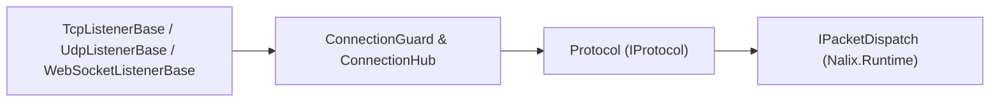

`Nalix.Network` là tầng transport máy chủ **cấp 3**. Nó cung cấp các listener TCP, UDP và WebSocket hiệu năng cao, vòng lặp nhận/gửi frame trên socket, kiểm soát chấp nhận kết nối (`ConnectionGuard`), theo dõi kết nối đang hoạt động (`ConnectionHub`), phân tích proxy-protocol/forwarded-header, và loại bỏ kết nối nhàn rỗi bằng timing wheel.

:::note[Với đa số dự án, hãy bắt đầu với `Nalix.Hosting`]
`Nalix.Hosting` bao bọc `Nalix.Network` bằng một builder kiểu fluent (`MapTcp<TProtocol>()`, `MapUdp<TProtocol>()`, `MapWebSocket<TProtocol>()`) để tự động quản lý vòng đời listener và protocol. Chỉ dùng `Nalix.Network` trực tiếp khi bạn xây dựng một host máy chủ tùy chỉnh.
:::

## Vị trí trong kiến trúc



## Thành phần cốt lõi

### 1. Listener transport (`Nalix.Network.Listeners`)

| Listener | Transport | Mô tả |
| :--- | :--- | :--- |
| `TcpListenerBase` | TCP | Listener socket thông lượng cao, dùng `SocketAsyncEventArgs` có pool, vòng lặp nhận theo khung có tiền tố độ dài, và hỗ trợ tùy chọn PROXY protocol / forwarded header. |
| `UdpListenerBase` | UDP | Listener datagram độ trễ thấp, có giới hạn tốc độ nguồn `DatagramGuard` và xác thực token phiên 8 byte. |
| `WebSocketListenerBase` | WebSocket | Listener WebSocket theo RFC 6455, hỗ trợ định tuyến theo đường dẫn, thương lượng subprotocol và stream frame nhị phân. |

Mọi listener đều triển khai `IListener`, `IActivatable` và `IReportable`:

- `Activate(CancellationToken)` / `Deactivate(CancellationToken)`
- `GenerateReport()` / `WriteReportData(Utf8JsonWriter)` để chẩn đoán trực tiếp

### 2. Cầu nối giao thức (`Protocol`)

Lớp trừu tượng `Protocol` (`Nalix.Network.Protocols.Protocol`) nối các kết nối transport thô với bộ điều phối gói tin:

- **Bộ xử lý frame & bộ trích xuất opcode** — Cung cấp `abstract IFrameProcessor FrameProcessor { get; }` và `abstract IOpCodeExtractor OpCodeExtractor { get; }` (được `ApplicationProtocol` / `DefaultProtocol` trong `Nalix.Hosting` triển khai tự động).
- **Chấp nhận kết nối** — `ValidateConnection(IConnection)` kiểm soát các kết nối mới trước khi đăng ký.
- **Vòng đời sau chấp nhận** — `OnAccept(IConnection, CancellationToken)` chạy sau khi đã qua kiểm soát và đăng ký vào hub.
- **Xử lý thông điệp** — `ProcessMessage(object? sender, IConnectionEventArgs args)` chuyển các payload `IBufferLease` đã đóng khung tới `IPacketDispatch.HandlePacket(...)`.
- **Bật/tắt chấp nhận động** — `IsAccepting` và `SetConnectionAcceptance(bool)` bật hoặc tạm dừng chấp nhận kết nối mới một cách nguyên tử, mà không đóng các socket đang hoạt động.

```csharp
using Nalix.Abstractions.Networking;
using Nalix.Hosting.Protocols;

public sealed class GameProtocol : ApplicationProtocol
{
    public override void ProcessMessage(object? sender, IConnectionEventArgs args)
        => this.Dispatch.HandlePacket(args.Lease, args.Connection);

    protected override bool ValidateConnection(IConnection connection)
        => true;
}
```

### 3. Kết nối, hub & bảo vệ chấp nhận

- **`SocketConnection` & `WebSocketConnection`** — Các triển khai `IConnection` cụ thể, quản lý việc truyền frame TCP/UDP/WebSocket (`IConnectionTransmission`), trạng thái số thứ tự và lease bộ đệm có pool.
- **`ConnectionHub`** — Registry kết nối đang hoạt động trong bộ nhớ, được phân mảnh (sharded), hỗ trợ tra cứu theo ID `ISnowflake`, các hàm phát tin và ảnh chụp chẩn đoán.
- **`ConnectionGuard`** — Bộ bảo vệ chấp nhận và chống lạm dụng nhiều tầng, thực thi trần kết nối toàn cục, hạn ngạch kết nối đồng thời theo IP, ngưỡng slowloris/lỗi, và cấm vĩnh viễn (`FileBanStore`, `FileBlacklistStore`).
- **`TimingWheel`** — Timer wheel phân cấp với độ phức tạp O(1), loại bỏ các kết nối nhàn rỗi mà không cấp phát timer riêng cho từng kết nối.

## Tùy chọn cấu hình (`Nalix.Network.Options`)

| Lớp tùy chọn | Điều khiển |
| :--- | :--- |
| `NetworkSocketOptions` | Cổng, chế độ IPv4/IPv6 kép, backlog, `NoDelay`, kích thước bộ đệm và tinh chỉnh socket |
| `NetworkWebSocketOptions` | Đường dẫn bind WebSocket, timeout bắt tay, kích thước frame tối đa và subprotocol |
| `ConnectionQuotaOptions` | Giới hạn kết nối đồng thời theo IP và giới hạn tốc độ chấp nhận kết nối |
| `ConnectionGuardOptions` | Trần kết nối toàn cục, ngưỡng điểm lỗi và thời lượng cấm tăng dần |
| `ConnectionBanStoreOptions` | Chính sách lưu file và giữ lại các lệnh cấm IP động |
| `ConnectionBlacklistStoreOptions` | Chính sách file blacklist IP và CIDR tĩnh/động |
| `ConnectionHubOptions` | Cài đặt phân mảnh và sức chứa cho `ConnectionHub` |
| `DatagramGuardOptions` | Giới hạn tốc độ gói UDP theo endpoint và loại bỏ bảng trạng thái |
| `TimingWheelOptions` | Độ phân giải tick, số slot của wheel và ngưỡng timeout kết nối nhàn rỗi |
| `NetworkCallbackOptions` | Ngưỡng đồng thời và chống flood cho các callback sự kiện kết nối |
| `TrustedProxyOptions` | Dải CIDR proxy đáng tin cậy để xác định IP client thật |
| `ForwardedHeadersOptions` | Chính sách phân tích `X-Forwarded-For` |
| `ProxyProtocolOptions` | Phân tích header PROXY protocol HAProxy v1/v2 |

## Trang API chính

- [Protocol](../api/network/protocol.md)
- [TCP Listener](../api/network/tcp-listener.md)
- [UDP Listener](../api/network/udp-listener.md)
- [WebSocket Listener](../api/network/websocket-listener.md)
- [Connection](../api/network/connection/connection.md)
- [Connection Guard](../api/network/connection/connection-guard.md)
- [Connection Hub](../api/network/connection/connection-hub.md)
- [WebSocket Connection](../api/network/websocket-connection.md)
- [Tùy chọn Network](../api/options/network/options.md)
