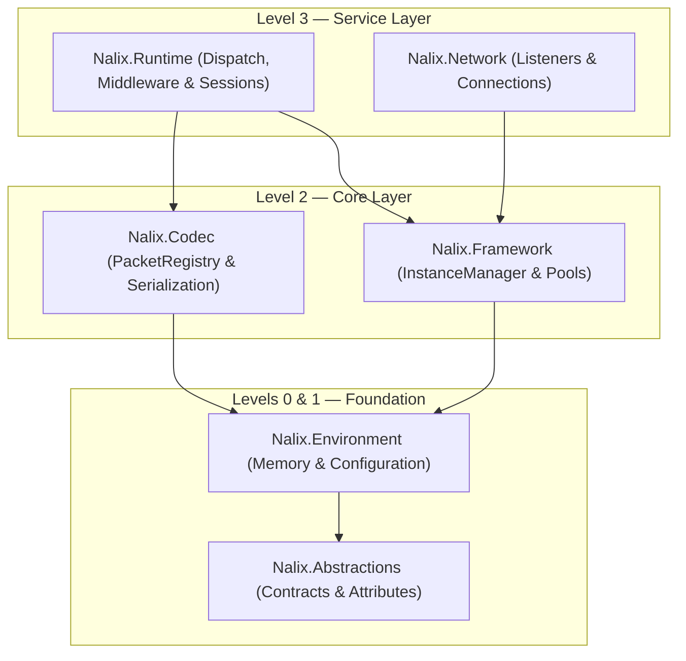

`Nalix.Runtime` là bộ máy điều phối gói tin phía máy chủ **cấp 3**. Nó vận hành việc điều phối gói tin theo shard đa luồng (`PacketDispatchChannel`), thực thi middleware đầu vào/đầu ra (`MiddlewarePipeline<TPacket>`), gọi handler không dùng reflection, các nguyên thủy giới hạn tốc độ, và tiếp tục phiên (`SessionService`).

## Ánh xạ mã nguồn

- `src/Nalix.Runtime/Dispatching/PacketDispatchChannel.cs`
- `src/Nalix.Runtime/Dispatching/PacketDispatcherBase.cs`
- `src/Nalix.Runtime/Dispatching/PacketContext.cs`
- `src/Nalix.Runtime/Dispatching/PacketSender.cs`
- `src/Nalix.Runtime/Middleware/MiddlewarePipeline.cs`
- `src/Nalix.Runtime/Middleware/Standard/PermissionMiddleware.cs`
- `src/Nalix.Runtime/Middleware/Standard/RateLimitMiddleware.cs`
- `src/Nalix.Runtime/Middleware/Standard/TimeoutMiddleware.cs`
- `src/Nalix.Runtime/Handlers/HandshakeHandlers.cs`
- `src/Nalix.Runtime/Handlers/ProofOfWorkHandlers.cs`
- `src/Nalix.Runtime/Handlers/SessionHandlers.cs`
- `src/Nalix.Runtime/Handlers/SystemControlHandlers.cs`
- `src/Nalix.Runtime/Handlers/SystemTimeSyncHandlers.cs`
- `src/Nalix.Runtime/Sessions/SessionService.cs`
- `src/Nalix.Runtime/Groups/InMemoryGroupStore.cs`

:::note[Thường được dùng qua `Nalix.Hosting`]
Đa số ứng dụng máy chủ cấu hình `Nalix.Runtime` thông qua `NetworkApplication.CreateBuilder()` trong `Nalix.Hosting` (dùng `MapHandlers`, `ConfigureDispatchOptions`, `UseSecureConnections`, `UseSessions` và `UseGroups`). Chỉ khởi tạo trực tiếp `PacketDispatchChannel` khi xây dựng một host tùy chỉnh.
:::

## Vị trí trong kiến trúc



## Thành phần cốt lõi

### 1. Điều phối gói tin theo shard (`PacketDispatchChannel`)

`PacketDispatchChannel` là bộ máy thông lượng cao xử lý các frame mạng đến:

- **Lập lịch công bằng theo kết nối & vòng lặp worker theo shard** — Các vòng lặp worker mở rộng theo số nhân CPU (hoặc `WithDispatchLoopCount(...)`) và lấy từ các hàng đợi nhận biết độ ưu tiên mà không bị chặn đầu hàng giữa các kết nối.
- **Hàng đợi ưu tiên** — Frame được lập lịch theo `PacketPriority` (`URGENT`, `HIGH`, `MEDIUM`, `LOW`, `NONE`) và chính sách bỏ của `DispatchOptions` (`DropNewest`, `DropOldest`, `Block`, `Coalesce`).
- **Bắt buộc mã hóa trước handler** — Kiểm tra `[PacketEncryption]` (`context.IsEncrypted`) trong `PacketHandler<TPacket>.CanExecute` trước khi gọi handler.
- **Gọi handler không dùng reflection** — Phân giải các delegate handler đã biên dịch được `PacketHandlerGenerator` sinh lúc build (hỗ trợ `IPacketContext<TPacket>`, các tham số tham chiếu `[FromScope]` đi kèm ở cuối được phân giải từ `context.Scope`, và các field/property `[Inject]` của controller).

```csharp
using Nalix.Abstractions.Networking.Packets;
using Nalix.Runtime.Dispatching;

PacketDispatchChannel dispatch = new(options =>
{
    options.WithErrorHandling((ex, opcode) =>
           {
               // Hook xử lý lỗi tùy chỉnh cho ngoại lệ handler chưa được xử lý
           })
           .WithMiddleware(new MyAuditMiddleware())
           .WithHandler(() => new AccountHandlers());
});

dispatch.Activate();
```

### 2. Middleware đầu vào tích hợp (`Nalix.Runtime.Middleware.Standard`)

`Nalix.Runtime` đi kèm ba thành phần middleware đầu vào điều khiển bằng attribute trong `Nalix.Runtime.Middleware.Standard`:

| Middleware | Thứ tự | Giai đoạn | Hành vi |
| :--- | ---: | :--- | :--- |
| `PermissionMiddleware` | `-50` | `Inbound` | Áp dụng `[PacketPermission]` (`PermissionEvaluation.MinimumLevel` hoặc `PermissionEvaluation.StrictMatch`) lên `context.Connection.Level`. |
| `RateLimitMiddleware` | `50` | `Inbound` | Áp dụng chính sách `[PacketRateLimit]` theo opcode (`PolicyRateLimiter`) hoặc quay về `TokenBucketLimiter` toàn cục. |
| `TimeoutMiddleware` | `75` | `Inbound` | Bọc việc thực thi handler trong một `CancellationTokenSource` liên kết, do `[PacketTimeout]` điều khiển. |

:::note[Hành vi mặc định cho phép của `[PacketPermission]`]
Nếu một method handler không khai báo `[PacketPermission]` (`context.Attributes.Permission is null`), `PermissionMiddleware` cho phép gói tin đi tiếp sang giai đoạn kế. Luôn trang trí các handler yêu cầu xác thực hoặc có đặc quyền bằng `[PacketPermission(PermissionLevel.USER)]` (hoặc đặt `[PacketPermission]` trên lớp controller).
:::

### 3. Nguyên thủy bảo vệ & giới hạn tốc độ

- **`TokenBucketLimiter`**: Bộ định hình lưu lượng token bucket theo endpoint (`TokenBucketOptions`).
- **`PolicyRateLimiter`**: Áp dụng hạn ngạch `[PacketRateLimit]` ở mức method.
- **`DirectiveGuard`**: Ngăn khuếch đại `Directive` đi ra trong điều kiện bị flood (`DirectiveGuardOptions`).

### 4. Handler giao thức tích hợp (`Nalix.Runtime.Handlers`)

- **`HandshakeHandlers` & `ProofOfWorkHandlers`**: Trao đổi khóa X25519 phía máy chủ, phục vụ khóa công khai TOFU, lưu trữ chứng chỉ (`FileCertificateStore`), và xác minh Proof-of-Work (`AdaptiveProofOfWorkPolicy`).
- **`SessionHandlers`**: Tiếp tục phiên không trạng thái (`SessionResume`) với chứng minh sở hữu `HmacKeccak256` và xoay vòng token nguyên tử qua `ISessionService`.
- **`SystemControlHandlers` & `SystemTimeSyncHandlers`**: Xử lý các frame `Control` (`PING`/`PONG`, `DISCONNECT`, `CIPHER_UPDATE`, `PUBLIC_KEY_REQUEST`) và `TimeSync`.

### 5. Kho lưu phiên & nhóm kết nối

- **`SessionService`, `SessionFactory`, `InMemorySessionStore`, `SessionPersistenceObserver`**: Ghi `SessionSnapshot` khi ngắt kết nối và khôi phục khóa mã hóa, mức quyền và thuộc tính khi có yêu cầu `SessionResume` hợp lệ.
- **`InMemoryGroupStore` & `GroupMembershipObserver`**: Triển khai `IConnectionGroupRegistry` cho phát tin theo phòng/kênh, và tự động gỡ các client đã ngắt kết nối khỏi mọi nhóm.

## Các dạng trả về của handler được hỗ trợ

| Kiểu trả về | Hành vi lúc chạy |
| :--- | :--- |
| `void` / `Task` / `ValueTask` | Thực thi tác dụng phụ; không gửi phản hồi tự động. |
| `TPacket` / `Task<TPacket>` / `ValueTask<TPacket>` | Tuần tự hóa và gửi gói tin trả về ngược lại trên kết nối của người gọi (`ReplyAsync` gán `SequenceId` của yêu cầu khi `response.Header.SequenceId == 0`). |
| `IAsyncEnumerable<TPacket>` | Stream từ máy chủ từng gói được yield qua `ReplyAsync` với look-ahead 1 phần tử, và đánh dấu `IPacketStreamable.IsEndOfStream = true` trên gói cuối. |
| `byte[]` / `Memory<byte>` / `ReadOnlyMemory<byte>` | Gửi trực tiếp bộ đệm thô tới kết nối của người gọi. |
| `ReturnValidation` | Đánh giá kết quả kiểm tra hợp lệ khai báo trước khi tiếp tục. |

## Gói liên quan

- [Nalix.Network](./nalix-network.md) — Các listener transport TCP, UDP và WebSocket
- [Nalix.Hosting](./nalix-hosting.md) — Bộ dựng máy chủ kiểu fluent
- [Nalix.Codec](./nalix-codec.md) — Registry gói tin, tuần tự hóa và biến đổi frame
- [Nalix.Framework](./nalix-framework.md) — DI, worker và pool đối tượng

## Trang API chính

- [Điều phối gói tin](../api/runtime/routing/packet-dispatch.md)
- [Tùy chọn điều phối gói tin](../api/options/runtime/packet-dispatch-options.md)
- [Pipeline middleware](../api/runtime/middleware/pipeline.md)
- [Permission Middleware](../api/runtime/middleware/permission-middleware.md)
- [Policy Rate Limiter](../api/runtime/middleware/policy-rate-limiter.md)
- [Token Bucket Limiter](../api/runtime/middleware/token-bucket-limiter.md)
- [Timeout Middleware](../api/runtime/middleware/timeout-middleware.md)
- [Kiểu trả về của handler](../api/runtime/routing/handler-results.md)
- [Tùy chọn Dispatch](../api/options/runtime/dispatch-options.md)
- [Kho lưu phiên & Service](../api/network/session-store.md)
