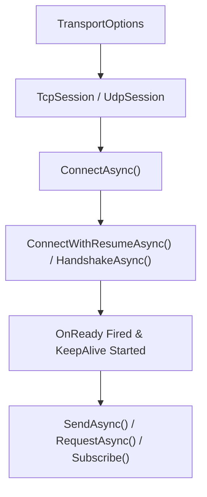

`Nalix.SDK` là gói transport phía client **cấp 3** để kết nối các ứng dụng .NET 10 (console, desktop, di động, hoặc client Unity/Godot) với máy chủ Nalix qua TCP hoặc UDP.

:::tip[Bắt đầu với `TcpSession`]
`TcpSession` là kiểu phiên client chính. Nó quản lý kết nối socket, các vòng lặp nhận frame chạy nền, các probe keepalive PING/PONG tự động, kết nối lại theo backoff lũy thừa (`ReconnectSupervisor`), bắt tay X25519, và ghép cặp request/response không có race condition.
:::

## Luồng kết nối client



## Thành phần cốt lõi

- **`TransportSession`** — Lớp cơ sở trừu tượng triển khai `ITransportSession`, `State` (`SessionState`), `WaitUntilReadyAsync`, `OnConnected`, `OnReady`, `OnDisconnected`, `OnMessageReceived`, `OnError`, probe keepalive và ghép cặp các request đang chờ.
- **`TcpSession`** — Phiên client TCP có khung, dùng pool `SocketAsyncEventArgs` và hỗ trợ kết nối lại tự động.
- **`UdpSession`** — Phiên datagram UDP đi kèm hoặc độc lập, tự động thêm token phiên 8 byte (`SessionToken`) đã thương lượng qua TCP.
- **`SessionState`** — Trạng thái runtime tạm thời (`Secret`, `SessionToken`, `EncryptionEnabled`, `LocalPort`), tách khỏi `TransportOptions` bền vững.
- **Mở rộng transport (`Nalix.SDK.Transport.Extensions`)**:
  - `HandshakeExtensions` (`HandshakeAsync`)
  - `ResumeExtensions` (`ResumeSessionAsync`, `ConnectWithResumeAsync`)
  - `RequestExtensions` (`RequestAsync<TResponse>`, `TryRequestAsync<TResponse>`, `CallAsync<TResponse>`)
  - `StreamExtensions` (`StreamAsync<TResponse>`)
  - `ControlExtensions` & `PingExtensions` (`NewControl`, `SendControlAsync`, `AwaitControlAsync`, `PingAsync`, `SyncTimeAsync`)
  - `CipherExtensions` & `RekeyExtensions` (`UpdateCipherAsync`, `RekeyAsync`)
  - `TransportSessionSubscriptions` (`On<TPacket>`, `OnExact<TPacket>`, `Subscribe(params IDisposable[])`)
- **Phân phối luồng (`Nalix.SDK.Dispatch`)** — `IThreadDispatcher` và `InlineDispatcher` để chuyển gói tin nhận được sang luồng chính của game engine hoặc UI.
- **Sinh client RPC có kiểu (`[RpcService]`)** — `RpcClientGenerator` tự động sinh các triển khai `<ServiceName>_RpcClient` được phân giải qua `session.CreateRpcClient<TService>()` cho các interface có chú thích `[RpcService]`.

## Ví dụ nhanh

```csharp
using Nalix.SDK.Options;
using Nalix.SDK.Transport;
using Nalix.SDK.Transport.Extensions;

TransportOptions options = new()
{
    Address = "127.0.0.1",
    Port = 57206,
    AutoReconnectEnabled = true
};

using TcpSession client = new(options);
client.OnConnected += (_, _) => Console.WriteLine("Socket connected");
client.OnReady += (_, _) => Console.WriteLine("Handshake/resume complete");
client.OnDisconnected += (_, ex) => Console.WriteLine($"Disconnected: {ex?.Message}");

await client.ConnectAsync();
await client.HandshakeAsync(); // Thương lượng bí mật phiên X25519 và bật mã hóa

MyResponsePacket reply = await client.RequestAsync<MyResponsePacket>(
    new MyRequestPacket(),
    RequestOptions.Default.WithTimeout(5_000).WithEncrypt());

await client.DisconnectAsync();
```

## Tham chiếu `TransportOptions` (`Nalix.SDK.Options`)

`TransportOptions` kế thừa từ `ConfigurationLoader` và có thể được khởi tạo trực tiếp trong mã hoặc nạp từ INI qua `ConfigurationManager.Instance.Get<TransportOptions>()`.

| Thuộc tính | Mặc định | Kiểm tra hợp lệ / Ghi chú nguồn |
| :--- | ---: | :--- |
| `Address` | `"127.0.0.1"` | `[Length(1)]` Địa chỉ IP hoặc tên máy chủ. |
| `Port` | `57206` | `[ValueRange(1, 65535)]` Cổng máy chủ đích. |
| `ConnectTimeoutMillis` | `30000` | `[ValueRange(0, int.MaxValue)]` `0` tắt timeout kết nối. |
| `NoDelay` | `true` | Điều khiển `TCP_NODELAY` (tắt thuật toán Nagle). |
| `BufferSize` | `65536` | `[ValueRange(2048, 1048576)]` Kích thước bộ đệm gửi/nhận của socket tính bằng byte. |
| `Algorithm` | `Chacha20Poly1305` | `CipherSuiteType` dùng khi bật mã hóa. |
| `CompressionEnabled` | `true` | Bật nén LZ4 cho các frame đi ra vượt quá `CompressionThreshold`. |
| `CompressionThreshold` | `512` | Kích thước payload tối thiểu (byte) để kích hoạt nén LZ4. |
| `AsyncQueueCapacity` | `1024` | `[ValueRange(1, 65536)]` Cài đặt dung lượng dành trước (dự phòng). |
| `MaxUdpDatagramSize` | `1400` | `[ValueRange(64, 65507)]` Kích thước datagram UDP tối đa tính cả token phiên 8 byte. |
| `ServerPublicKey` | `null` | Khóa công khai X25519 của máy chủ dạng HEX được ghim, tùy chọn, để chống tấn công MitM. |
| `AllowTofu` | `true` | Cho phép khám phá khóa công khai theo Trust-On-First-Use (TOFU) khi chưa đặt `ServerPublicKey`. |
| `PersistTofuKey` | `false` | Lưu `ServerPublicKey` được khám phá qua TOFU vào kho cấu hình sau khi xác minh. |
| `ResumeEnabled` | `true` | Thử `SessionResume` trước khi quay về bắt tay X25519 đầy đủ. |
| `ResumeTimeoutMillis` | `3000` | `[ValueRange(100, int.MaxValue)]` Timeout (ms) cho các yêu cầu tiếp tục phiên. |
| `ResumeFallbackToHandshake` | `true` | Tự động chuyển sang bắt tay mới nếu tiếp tục phiên thất bại. |
| `AutoReconnectEnabled` | `false` | Tự động kết nối lại qua `ReconnectSupervisor` khi ngắt kết nối bất thường. |
| `ReconnectBaseDelayMillis` | `500` | `[ValueRange(1, int.MaxValue)]` Độ trễ backoff ban đầu (ms) trước lần kết nối lại đầu tiên. |
| `ReconnectMaxDelayMillis` | `30000` | `[ValueRange(1, int.MaxValue)]` Trần backoff lũy thừa (ms) giữa các lần kết nối lại. |
| `ReconnectMaxAttempts` | `0` | `[ValueRange(0, int.MaxValue)]` Số lần kết nối lại liên tiếp tối đa (`0` = không giới hạn). |
| `KeepAliveIntervalMillis` | `0` | `[ValueRange(0, int.MaxValue)]` Chu kỳ PING định kỳ (ms) (`0` = tắt). |
| `KeepAliveTimeoutMillis` | `5000` | `[ValueRange(100, int.MaxValue)]` Timeout (ms) cho mỗi phản hồi PONG keepalive. |
| `KeepAliveMissThreshold` | `3` | `[ValueRange(1, int.MaxValue)]` Số PONG bị lỡ trước khi đánh dấu socket lỗi để kết nối lại. |
| `TimeSyncEnabled` | `true` | Cho phép `SyncTimeAsync` đồng bộ độ lệch đồng hồ đơn điệu/Unix cục bộ. |
| `TimeOffsetMs` | `0.0` | Độ lệch đồng hồ hiện tại (mili giây) do đồng bộ thời gian áp dụng. |

:::note[`SessionState` và `TransportOptions`]
Các giá trị phiên tạm thời — `Secret` (`Bytes32`), `SessionToken` (`ulong`), `EncryptionEnabled` (`bool`) và `LocalPort` (`int`) — nằm trên `session.State` (`SessionState`), giữ các khóa mật mã lúc chạy tách biệt khỏi `TransportOptions` bền vững.
:::

## Tham chiếu `RequestOptions` (`Nalix.SDK.Options`)

| Thuộc tính | Mặc định | Kiểm tra hợp lệ / Ghi chú nguồn |
| :--- | ---: | :--- |
| `TimeoutMs` | `5000` | Phải `>= 0`; `0` chờ vô thời hạn. Cấu hình qua `.WithTimeout(ms)`. |
| `RetryCount` | `0` | Phải `>= 0`; việc thử lại **chỉ** xảy ra khi có `TimeoutException`. Cấu hình qua `.WithRetry(count)`. |
| `Encrypt` | `false` | Mã hóa frame yêu cầu đi ra. Cấu hình qua `.WithEncrypt(bool)`. |

## Trang API chính

- [Transport Session](../api/sdk/transport-session.md)
- [TCP Session](../api/sdk/tcp-session.md)
- [Handshake Extensions](../api/sdk/handshake-extensions.md)
- [Resume Extensions](../api/sdk/resume-extensions.md)
- [Session Extensions](../api/sdk/tcp-session-extensions.md)
- [Cipher Extensions](../api/sdk/cipher-extensions.md)
- [Request Options](../api/options/sdk/request-options.md)
- [Chẩn đoán phiên](../api/sdk/diagnostics.md)
- [Phân phối luồng](../api/sdk/thread-dispatching.md)
